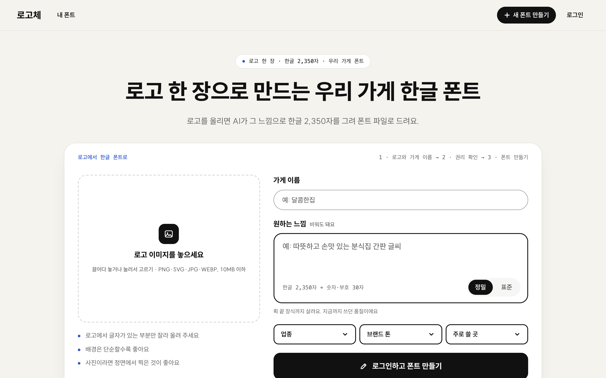
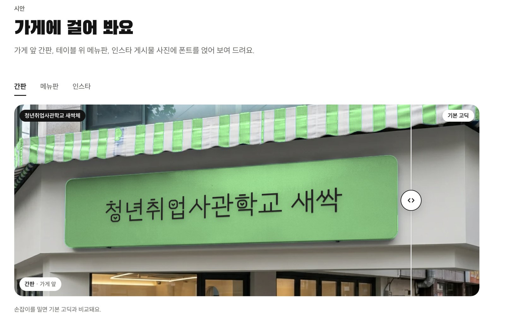
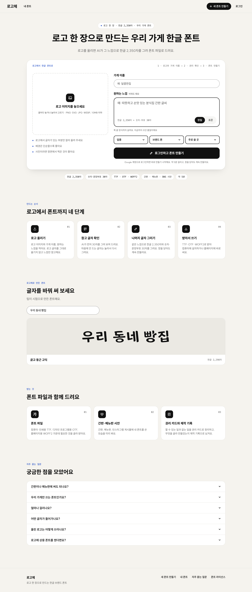

# 로고체

가게 로고 한 장으로 그 가게만의 한글 폰트를 만드는 서비스입니다.

**사이트: https://logoche.my**



## 한눈에 보기

| 항목 | 내용 |
|---|---|
| 넣는 것 | 가게 로고 한 장과 가게 이름. 원하는 느낌은 적어도 되고 비워도 됩니다 |
| 받는 것 | 한글 2,350자(KS X 1001 완성형)와 숫자·문장부호 30자가 든 폰트 파일(TTF·OTF·WOFF2), 간판·메뉴판 시안, 권리 카드와 제작 기록 |
| 걸리는 시간 | 폰트를 만드는 데 약 6~7분(표준으로 2,350자 전체를 돌려 잰 값, [실측 기록](docs/full-run-20261103.md)) |
| 만드는 방식 | AI(GPT Image)가 글자를 모두 새로 그리고, 다른 AI(Claude)가 한 장씩 검사하고, 엔진이 폰트 파일로 묶습니다 |

### 만든 결과 예시



'바다식당' 로고로 만든 폰트를 스튜디오의 간판 시안에 입힌 모습입니다. 간판 사진은 AI로 만든 것이고, 그 위의 글자는 만든 폰트로 그대로 쓴 것입니다. 이 폰트는 비용을 아끼려고 한글 90자만 그린 시험본입니다.

## 왜 만들었나

예비 청년 창업가가 브랜드를 기획해도, 개업할 때 간판과 메뉴판 글씨는 시공 업체가 정합니다. 업체에는 로고만 넘어가고, 나머지 글씨는 업체가 늘 쓰는 기본 폰트로 채워집니다. 그렇다고 전용 서체를 외주로 맡기면 평균 120만 원쯤 들고, 짧아도 15일이 걸립니다.

로고체는 로고를 전용 폰트 파일로 넓혀서, 기획한 브랜드가 매장 글씨까지 이어지게 합니다. 로고를 올려 폰트를 받기까지 15분 안에 끝내는 것이 목표입니다.

## 이렇게 씁니다

1. 메인 화면에 로고를 올리고 가게 이름을 적습니다. 업종·브랜드 톤·주로 쓸 곳은 고르지 않으면 AI가 로고를 보고 정합니다.
2. 로고의 권리가 누구에게 있는지, 로고 글자를 어떻게 만들었는지 두 가지를 답하고 구글 계정으로 로그인합니다.
3. AI가 먼저 **참고 글자** 30자를 그려 보여 줍니다. 마음에 안 드는 글자를 누르면 다시 그리고, 그대로 두면 20초 뒤 다음으로 넘어갑니다.
4. 같은 느낌으로 나머지 글자와 숫자·문장부호를 그린 뒤 폰트 파일을 만들고 검사합니다. 창을 닫아도 서버에서 계속 만듭니다.
5. 다 만들면 **스튜디오**에서 글자를 써 보고, 간판·메뉴판 시안을 보고, 파일을 받습니다.

| 화면 | 주소 | 하는 일 |
|---|---|---|
| 메인 | `/` | 첫 칸에서 바로 폰트를 만듭니다. 아래쪽에는 만드는 순서, 로고체로 만든 폰트로 글자를 써 보는 칸, 자주 묻는 질문이 있습니다 |
| 만드는 중 · 스튜디오 | `/fonts/[id]` | 만드는 동안에는 단계별 진행과 참고 글자 확인을 보여 주고, 다 만들면 같은 주소가 스튜디오가 됩니다. 스튜디오에는 써 보기, 간판·메뉴판·인스타 시안, 글자 표, 설치·홈페이지에 쓰는 법, 문자 세트와 검사 결과, 권리 카드, 제작 기록이 있습니다 |
| 내 폰트 | `/fonts` | 만든 폰트 목록입니다. 찾기, 상태별 보기, 정렬, 즐겨찾기, 받기가 됩니다. 폰트는 만든 사람만 볼 수 있습니다 |

- 간판·메뉴판 시안은 실제 가게처럼 보이는 사진(AI로 만든 사진)에 로고 색을 칠하고, 만든 폰트의 진짜 글자를 원근에 맞춰 얹은 것입니다. 시안 속 글자는 AI가 그린 그림이 아닙니다.
- 사람이 고르거나 다시 그리게 한 것은 모두 제작 기록에 남습니다.

<details>
<summary>메인 화면 전체 보기</summary>



</details>

## 어떻게 만드나

> **로고 글자는 폰트에 넣지 않습니다.** 로고 글자가 상용 폰트로 만들어졌을 수도 있기 때문입니다. 로고는 굵기·둥글기 같은 값을 재고 분위기를 읽는 데에만 쓰고, 폰트의 글자는 모두 새로 그립니다.

일은 셋으로 나뉩니다. 글자 그리기는 GPT Image가, 그림 보기(로고 해석·글자 검사·판독)는 Claude가 맡습니다. 엔진은 AI를 부르지 않고, 그린 그림을 폰트로 바꾸고 검사합니다.


1. **참고 글자 30자.** 기준 서체(Source Han Sans KR)로 30자를 6열×5행으로 놓은 그림(글자표)을 철자와 칸의 본으로 주고, 한 장에 그리게 합니다. 30자는 자주 쓰는 음절과 쌍자음·복합 모음·받침이 든 글자로 골랐습니다. 엔진이 글자 사이의 빈 띠를 찾아 칸을 자르면, Claude가 칸마다 그 글자로 읽히는지, 스타일이 맞는지 봅니다.
2. **나머지 글자.** 확정한 참고 글자 그림을 스타일 본으로 붙여 30자씩 그립니다. 가게 이름, 견본 문장, 자주 쓰는 글자 순서로 그리고, 한 번에 8장씩 동시에 그립니다. 검사에서 떨어진 글자는 떨어진 것끼리 모아 두 번 더 그립니다. 숫자와 문장부호 30자(0~9 . , ! ? 등)는 따로 한 장에 그립니다.
3. **폰트로 바꾸기.** 엔진(`drawn.py`·`build.py`)이 자른 그림을 폰트 틀에 놓습니다. 한 장에서 나온 글자는 같은 배율로 키워, 그린 글자끼리의 크기 차이를 그대로 살립니다. 획 두께는 참고 글자에 맞추고, vtracer로 외곽선을 따서 fontTools로 TTF를 만듭니다. 끝내 못 그린 글자는 빠진 채로 폰트를 만들고 "빠진 글자"로 알려 줍니다. 스튜디오에서 빠진 글자만 다시 그리게 할 수 있습니다.
4. **검사.** 엔진이 7가지를 봅니다. 글자 세트, 깨진 글자, 문서 포함 허용, 이름·라이선스, 기기별 표시, 작은 크기에서 뭉치거나 큰 크기에서 속공간이 무너지지 않는지, 다른 폰트와 닮았는지입니다. 닮은 정도는 무료 폰트 69개와 획 뼈대를 견줘 0.85 미만이어야 통과합니다. 그다음 Claude가 글자를 읽어 다른 글자로 읽히는 것을 찾습니다.

| 걸리는 것 | 실측 (11/3, 표준, 2,350자 전체) |
|---|---|
| 처음 만들기 | 약 6.4분. 로고 읽기 5초, 참고 글자 46초, 확인 대기 20초, 나머지 글자 약 4.8분(글자표 장당 중앙값 13.5초), 엔진 빌드 16초, 검사·판독 10초 |
| 호출과 비용 | 이미지 98회, 어림 약 4.6달러(표준). Claude 94회는 토큰으로만 쟀습니다(입력 29만·출력 14만). 단가는 어림이니 실제 청구액은 콘솔로 확인해야 합니다 |
| 끊긴 뒤 이어서 만들기 | 그린 글자는 그대로 쓰고, 못 그린 글자만 다시 그립니다. 이번 실측도 한 번 끊겨 이어서 만들었습니다 |
| 엔진 빌드 | 2,288자에 외곽선·저장 16초 |

같은 실행의 품질 실측: TTF와 그린 그림의 겹침 평균 0.979(최소 0.969), 닮은 폰트 검사 0.83(기준 0.85 미만이라 통과), 검사 7항목 중 글자 세트만 실패. 한글 83자(3.5%)와 숫자 0~8이 끝내 빠졌습니다. 스타일 검사로 다시 그린 글자는 0자였습니다. 자세한 내용은 [실측 기록](docs/full-run-20261103.md)에 있습니다.

그리기 수준을 '표준'으로 골랐고, '정밀'은 계좌 한도 때문에 전체를 돌려 보지 못했습니다. 표준의 장당 출력 토큰은 약 560개로 정밀(약 2,200개)의 약 4분의 1입니다. 정밀의 시간과 비용은 시험값(약 5분, 약 10달러)을 어림으로만 쓸 수 있습니다.

## 엔진을 바꿔 온 과정

가장 오래 고민한 것은 "AI가 그린 초안의 개성을 2,350자 끝까지 어떻게 지키느냐"였습니다.

| 시기 | 방식 | 결과 |
|---|---|---|
| 제출본 | 공개 폰트 50종으로 자소 기반 퓨샷 모델을 직접 학습 | 2주 안에 학습까지 끝내기 어려웠고, 공개 모델은 로고의 개성을 평범한 손글씨체로 뭉갬 |
| 10/27~10/29 | GPT Image가 자소(초성·중성·종성)를 그리고 엔진이 2,350자로 조합 | 낱자를 놓일 자리에 맞추느라 늘어지고, 배치가 기준 서체 그대로라 어느 가게든 비슷해짐 |
| 10/29 | 참고 글자 30자를 MX-Font++(공개 생성 모델)에 주어 2,350자 생성 | 굵기와 비례는 따라오지만 획 끝 말림 같은 장식이 누그러지고, 크게 보면 가장자리가 울퉁불퉁함 |
| 10/30 | MX-Font를 작업마다 참고 글자로 다시 학습(약 50초) | 참고 글자에서 뺀 글자와의 겹침이 0.46~0.60에서 0.74~0.83으로 좋아졌지만, 작은 장식은 여전히 뭉개짐 |
| **10/30 ~ 지금** | **GPT Image가 2,350자를 모두 그리고, 엔진은 외곽선만 땀** | 겹받침·쌍자음처럼 짜임이 어려운 30자 시험에서 두 스타일 모두 30자 전부 통과. TTF와 그린 그림의 겹침 0.97~0.99, 획 끝 물결도 그대로 남음 |

MX-Font 코드와 가중치는 저장소에서 뺐습니다.

## 화면 디자인

- Claude Design에서 정한 'Logoche Final' 시안에서 출발했습니다(원본은 `design-import/`). 11/2에 메인 화면을 만들면서 모든 화면을 크림색 바탕(#F5F3EE)에 흰 카드, 검정 강조로 맞췄습니다. 파랑과 고정폭 글씨는 꼬리표와 단계 표시에만 씁니다. 글꼴은 SUIT이고 배경 장식은 넣지 않았습니다.
- Apple Human Interface Guidelines를 기준으로 검토하고 반영했습니다.
  - 글자 크기는 rem 단위라서 브라우저의 글자 크기 설정을 따릅니다.
  - 화면 폭이 1,800px를 넘으면 화면 전체가 비율 그대로 커집니다. 큰 모니터에서 양옆 여백만 넓어지지 않게 하려는 것입니다.
  - 고른 선택지는 두꺼운 테두리와 체크로 보여 주고, 검정 채움은 누르는 버튼에만 씁니다.
- 밝은 화면만 씁니다. 어두운 모드를 넣어 봤더니 글자 그림과 시안만 흰 종이처럼 남아 어색해서 뺐습니다.

## 기술 스택

| 부분 | 쓰는 것 |
|---|---|
| 웹 | Next.js 16(App Router), React 19, TypeScript, Tailwind CSS 4, zod |
| 로그인 | Better Auth(구글 로그인), Node 내장 SQLite |
| AI | OpenAI GPT Image `gpt-image-2.5-flare`(그리기), Anthropic Claude `claude-opus-5-5`(로고 해석·글자 검사·판독). 키는 웹 서버에서만 읽습니다 |
| 엔진 | Python 3.12, FastAPI, fontTools, vtracer, OpenCV, skia-pathops, FreeType, uv |
| 배포 | AWS EC2 한 대(서울)에 웹과 엔진을 함께 올리고, Caddy가 HTTPS를 맡습니다 |
| 기준 서체 | Source Han Sans KR 1.001(Apache License 2.0). 글자표를 만들고 크기·자리를 맞추는 데에만 쓰고, 이 서체의 외곽선은 만든 폰트에 들어가지 않습니다 |

## 폴더 구조

| 폴더 | 내용 |
|---|---|
| [`web/`](web/README.md) | 화면과 API 라우트. 설정, API 목록, 모의 응답 모드는 이 폴더의 README에 있습니다 |
| `web/lib/server/` | AI 호출과 작업 진행. 폰트 작업 단계 `projects.ts`, 참고 글자 `glyphs.ts`, 나머지 글자 `rest.ts`, 빌드 `build.ts`, 로그인 `auth.ts` |
| [`engine/`](engine/README.md) | Python 서버. 엔진 API와 검사 기준값은 이 폴더의 README에 있습니다 |
| `engine/logoche_engine/` | 로고 측정 `measure.py`, 글자표 `sheets.py`, 자리 맞추기·외곽선 `drawn.py`, TTF `build.py`, 검사 `checks.py` |
| [`deploy/`](deploy/README.md) | 서버 설치·갱신 스크립트 |
| [`design.md`](design.md) | 화면 설계와 날짜별 결정 기록 |
| [`로고체-기획서.md`](로고체-기획서.md) | 기획서(10/29 기준) |
| `design-import/` | 화면 디자인 원본 |
| `docs/` | 이 문서에 쓴 화면 캡처 |

예전 여섯 단계 화면(`/style`·`/draft`·`/build`·`/kit`·`/download`)은 파일만 남아 있고 연결은 끊었습니다. 예전 새 폰트 만들기 주소 `/new`로 들어오면 메인으로 넘어갑니다.

## 직접 실행하기

Python 3.12와 [uv](https://docs.astral.sh/uv/), Node.js 24가 필요하고, 터미널 두 개를 씁니다.

```bash
git clone https://github.com/poongbit/logoche.git
cd logoche

# 1. 엔진 (터미널 하나)
cd engine
uv sync
uv run python scripts/fetch_compare_fonts.py   # 처음 한 번: 닮은 폰트 검사에 쓸 무료 폰트 받기
uv run uvicorn logoche_engine.main:app --port 8000 --reload

# 2. 웹 (다른 터미널에서 logoche 폴더로 가서)
cd web
cp .env.example .env.local   # AI 키 두 개와 구글 로그인 키를 채운다
npm install
npm run dev                  # http://localhost:3000
```

- 폰트를 만들려면 로그인해야 합니다. 그래서 구글 OAuth 클라이언트(리디렉션 URI `http://localhost:3000/api/auth/callback/google`)와 `BETTER_AUTH_SECRET`이 필요합니다. 자세한 내용은 `web/.env.example`에 있습니다.
- 키 없이 화면만 보려면 `web/.env.local`에 `LOGOCHE_MOCK=1`을 넣습니다. 모의 응답을 쓰기 때문에 엔진도 켜지 않아도 됩니다.
- 닮은 폰트 검사용 폰트는 저장소에 넣지 않았습니다. 위 명령은 Google Fonts의 한글 폰트 47개 파일만 받습니다. 저희가 쓴 나머지 20개 파일(Pretendard·SUIT 등)은 목록만 `engine/compare/free/local-fonts.json`에 있어서, 필요하면 직접 받아 `engine/compare/free/`에 넣습니다.
- 싸게 시험하려면 `GLYPH_REST_LIMIT=90`처럼 폰트에 넣을 글자 수를 줄입니다. 자주 쓰는 글자만 그리는 대신 글자 세트 검사는 떨어집니다.
- 나머지 설정도 `web/.env.example`에 있습니다.

## 배포

https://logoche.my 는 AWS EC2 한 대(서울)에서 돌아갑니다. Vercel 같은 서버리스에는 올리지 않습니다. 작업 파일을 서버 디스크에 쓰고, 폰트 한 벌을 서버에서 몇 분 동안 쉬지 않고 만들기 때문입니다.

코드를 바꾼 뒤에는 main에 푸시하고 서버에서 `deploy/update.sh`를 돌립니다. 처음 설치하는 방법은 [`deploy/README.md`](deploy/README.md)에 있습니다.

## 권리와 라이선스

- 만든 폰트는 SIL Open Font License 1.1로 냅니다. 가게에서 상업적으로 쓸 수 있고, 폰트 파일만 따로 팔지는 않습니다. AI로 만들었다는 표시는 폰트의 이름 정보와 권리 카드에 넣습니다.
- "○○체 느낌으로"처럼 특정 서체를 따라 해 달라는 요청은 받지 않습니다.
- 닮은 폰트 검사는 비슷한 폰트를 걸러 내는 선별 검사일 뿐, 권리를 보증하지는 않습니다.
- 자료별 출처와 라이선스는 [`engine/LICENSE-NOTES.md`](engine/LICENSE-NOTES.md)에 정리해 두었습니다.
- 이 저장소 코드의 라이선스는 아직 정하지 않았습니다.

## 남은 일

- '정밀'로 2,350자 전체를 돌려 시간과 비용 재기, 다른 로고로도 재기(11/3에 표준·로고 한 장은 쟀음)
- 숫자 0~8이 세 번 모두 "다른 글자 섞임"으로 떨어지는 원인 찾기, 속도 제한(429)으로 글자표 한 장이 통째로 실패하지 않게 하기
- 아주 굵은 스타일에서 작은 크기 뭉침 줄이기(12px로 쓰는 시험에서 23자 중 3자가 뭉침)
- 만든 폰트의 라이선스를 OFL로 계속 둘지 다시 정하기(OFL로 정한 이유였던 MX-Font를 뺐음)
- 상용 폰트도 닮은 폰트 검사 대상에 넣기(`engine/compare/commercial/`가 비어 있음)
- 결제(크레딧 충전 방식)
- 이용 조건·개인정보 처리방침 화면(구글 로그인 동의 화면을 게시하려면 필요)
- 인스타 시안을 실제 사진으로 바꾸기, 메인에 진열할 폰트 늘리기(지금 1개)

## 더 읽을 문서

이 문서는 2026-11-02 기준입니다. 화면 설계와 날짜별 결정은 [`design.md`](design.md)에, 문제 정의와 정책 연계는 [`로고체-기획서.md`](로고체-기획서.md)(10/29 기준)에 있습니다. 기획서에 적힌 엔진 방식(자소 조합)과 여섯 단계 화면은 그 뒤에 바뀌었으니, 지금 방식은 이 문서를 기준으로 봐 주세요.
