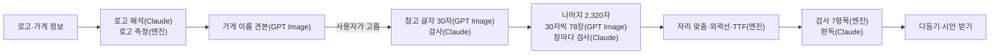

# 로고체

가게 로고 한 장으로 그 가게만의 한글 폰트(KS X 1001 완성형 2,350자)를 만드는 서비스입니다. 2026 청년취업사관학교 해커톤 본선(11/9) 데모이고, 팀 /eli30이 만들고 있습니다.

이 문서는 2026-10-30 기준입니다. 화면 설계와 날짜별 결정은 [`design.md`](design.md)에, 문제 정의와 정책 연계는 [`로고체-기획서.md`](로고체-기획서.md)(10/29 기준)에 있습니다. 기획서의 엔진 설명(자소 조합)은 그 뒤에 바뀌었고, 지금 방식은 이 문서가 최신입니다.

## 왜 만드나

예비 청년 창업가가 브랜드를 기획해도, 개업할 때 간판·메뉴판 글씨는 시공 업체가 정합니다. 업체에는 로고만 넘어가고 나머지 글씨는 업체의 기본 폰트로 채워집니다. 전용 서체를 외주로 맡기면 평균 약 120만 원, 짧아도 15일이 걸립니다.

로고체는 로고를 전용 폰트 파일로 넓혀, 기획한 브랜드를 매장 글씨까지 잇습니다. 목표 시간은 15분입니다.

## 지금 되는 것

로그인 없이 여섯 화면을 차례로 지나갑니다. 로고 업로드부터 폰트 파일 받기까지 모두 작동합니다.

| # | 화면 | 하는 일 |
|---|---|---|
| 1 | 로고 업로드 `/` | 로고와 가게 이름, 업종·브랜드 톤·주 사용처, 원하는 느낌 한 줄, 로고 출처를 받습니다. 가게 정보 → 분위기 → 권리 확인 세 묶음을 차례로 펼칩니다 |
| 2 | AI가 읽은 방향 `/style` | Claude가 로고를 해석하고 엔진이 굵기·둥글기·너비·대비·기울기를 잽니다. GPT Image가 표현 방식마다 가게 이름 견본을 그리면, 사용자가 그림을 보고 하나를 고릅니다 |
| 3 | AI 초안 `/draft` | GPT Image가 고른 견본대로 참고 글자 30자를 한 장에 그리고, Claude가 한 글자씩 검사합니다. 떨어진 글자는 자동으로 다시 그립니다. 사용자도 글자마다 다시 그리기·직접 고치기·되돌리기를 할 수 있습니다 |
| 4 | 폰트 만들기·다듬기 `/build` | 나머지 2,320자를 그려 TTF를 만들고 검사합니다. 굵기·너비·기울기·자간 슬라이더로 다듬고, 마음에 안 드는 글자는 그림판 같은 편집 화면(붓·지우개·직선·도형·채우기·선택해 옮기기)에서 고쳐 폰트에 바로 바꿔 끼웁니다 |
| 5 | 브랜드 적용 키트 `/kit` | 간판·메뉴판·인스타 시안에 새 폰트를 입혀 기본 고딕과 견줘 봅니다 |
| 6 | 다운로드 `/download` | TTF·OTF·WOFF2·WOFF와 CSS 예시, 라이선스 원문, 제작 기록을 받습니다. 모두 받기는 zip 하나입니다 |

사람이 고르거나 고친 것(톤, 표현 방식, 다시 그린 글자, 다듬기 값, 고친 글자)은 모두 제작 기록에 남습니다.

## 어떻게 만드나

그리기는 GPT Image가, 그림을 보는 일(로고 해석·글자 검사·판독)은 Claude가 합니다. 엔진은 AI를 부르지 않고 그린 그림을 폰트로 바꾸고 검사합니다.



1. **로고는 참고로만 씁니다.** 로고 글자를 잘라 폰트에 넣지 않습니다. 로고 글자가 상용 폰트로 만들어졌을 수 있어서입니다. 로고는 측정과 분위기 해석, 그리기의 참고 이미지로만 쓰고 글자는 모두 새로 그립니다.
2. **참고 글자 30자**(화면 3): 기준 서체(Source Han Sans KR)로 만든 6열×5행 글자표를 철자·칸 참고로 주고 한 장에 그리게 합니다. 30자는 자주 쓰는 음절과 쌍자음·복합 모음·받침이 든 글자로 골랐습니다. 엔진이 글자 사이 빈 띠에서 칸을 자르고, Claude가 칸마다 그 글자로 읽히는지와 스타일이 맞는지 봅니다.
3. **나머지 글자**(화면 4): 확정한 참고 글자표를 스타일 참고로 붙여 30자씩 그립니다. 가게 이름, 견본 글, 자주 쓰는 글자(말뭉치 빈도순) 차례로 그리고, 한 번에 8장씩 그립니다. 떨어진 글자는 떨어진 글자끼리 모아 두 바퀴 더 그립니다.
4. **폰트로 바꾸기**(엔진 `drawn.py`·`build.py`): 칸별로 자른 그림을 폰트 틀에 놓습니다. 한 장에서 온 글자는 같은 배율로 키워서, 그린 글자 사이의 크기 차이를 그대로 둡니다. 획 두께는 참고 글자에 맞추고, vtracer로 외곽선을 따서 fontTools로 TTF를 만듭니다. 끝내 못 그린 글자는 폰트에서 빠지고 "빠진 글자"로 알려 줍니다. 편집 화면에서 그려 넣으면 바로 들어갑니다.
5. **검사**: 7항목(글자 세트, 깨진 글자, 문서 포함 허용, 이름·라이선스, 기기별 표시, 작은 크기 뭉침·큰 크기 속공간, 유사도)을 엔진이 보고, Claude가 글자를 읽어 다르게 읽히는 글자를 찾습니다. 유사도는 무료 폰트 69개와 획 뼈대를 견줘 0.85 미만이어야 통과합니다.

| 걸리는 것 | 어림 (10/30) |
|---|---|
| 처음 만들기(2,350자) | 약 5분, 약 $10 (글자표 78장 × 약 $0.12 + Claude 검사) |
| 다듬은 뒤 다시 만들기 | 약 20초 (그린 글자는 다시 쓰고, 못 그린 글자만 다시 그림) |
| 엔진 빌드(외곽선·TTF·검사) | 2,350자 약 20초 |
| 글자 하나 고쳐 바꿔 끼우기 | 약 1초 |

2,350자 전체를 실제 화면에서 처음부터 끝까지 돌려 잰 값은 아직 없습니다. 위 값은 글자 수를 줄인 시험에서 나눠 잰 것입니다.

## 엔진을 바꿔 온 과정

가장 오래 고민한 부분은 "AI가 그린 초안의 개성을 2,350자까지 그대로 가져가는 방법"이었습니다.

| 시기 | 방식 | 결과 |
|---|---|---|
| 제출본 | 공개 폰트 50종으로 자소 기반 퓨샷 모델을 직접 학습 | 2주 안에 학습까지 끝내기 어렵고, 공개 모델은 로고의 개성을 평범한 손글씨체로 뭉갬 |
| 10/27~10/29 | GPT Image가 자소(초성·중성·종성)를 그리고 엔진이 2,350자로 조합 | 낱자의 비율이 놓일 자리와 달라 늘어지고, 배치가 기준 서체 그대로라 가게마다 비슷해짐 |
| 10/29 | 참고 글자 30자를 MX-Font++(공개 생성 모델)에 주어 2,350자 생성 | 굵기·비례는 따라오지만 획 끝 말림 같은 장식이 누그러지고, 큰 크기에서 가장자리가 울퉁불퉁함 |
| 10/30 | MX-Font를 작업마다 참고 글자로 다시 익히기(약 50초) | 참고 글자에서 뺀 글자와의 겹침이 0.46~0.60에서 0.74~0.83으로 나아졌지만, 작은 장식은 여전히 뭉개짐 |
| **10/30 지금** | **GPT Image가 2,350자를 모두 그리고, 엔진은 외곽선만 땀** | 겹받침·쌍자음 같은 어려운 짜임 30자 시험에서 두 스타일 모두 30/30. TTF와 그린 그림의 겹침 0.97~0.99, 획 끝 물결이 그대로 남음 |

MX-Font 코드와 가중치는 저장소에서 뺐습니다.

## 화면 디자인

- Claude Design에서 정한 'Logoche Final' 시안을 따릅니다. 흰 바탕에 검정 강조 하나, 글꼴은 SUIT입니다. 원본은 `design-import/`에 있습니다.
- Apple Human Interface Guidelines 기준으로 검토한 내용을 반영했습니다.
  - 글자 크기를 rem 단위로 바꿔 브라우저 글자 크기 설정을 따릅니다.
  - 화면 폭이 1,800px를 넘으면 화면 전체가 비율 그대로 커집니다. 큰 모니터에서 양옆 여백만 넓어지지 않게 하기 위해서입니다.
  - 고른 선택지는 두꺼운 테두리와 체크로 보이고, 검정 채움은 누르는 버튼에만 씁니다.
- 밝은 화면만 씁니다. 어두운 모드를 넣어 봤지만 글자 그림과 시안이 흰 종이로 남아 부자연스러워서 뺐습니다.

## 기술

| 부분 | 쓰는 것 |
|---|---|
| 웹 | Next.js 16(App Router), React 19, TypeScript, Tailwind CSS 4, zod |
| AI | OpenAI GPT Image `gpt-image-2.5-flare`(그리기), Anthropic Claude `claude-opus-5-5`(로고 해석·글자 검사·판독). 키는 웹 서버에서만 읽습니다 |
| 엔진 | Python 3.12, FastAPI, fontTools, vtracer, OpenCV, skia-pathops, FreeType, uv |
| 기준 서체 | Source Han Sans KR 1.001(Apache License 2.0). 글자표와 크기·자리 맞추기에만 쓰고, 외곽선은 만든 폰트에 들어가지 않습니다 |

## 폴더

| 폴더 | 내용 |
|---|---|
| [`web/`](web/README.md) | 여섯 화면과 API 라우트. 설정·API 목록·모의 응답 모드는 이 폴더의 README에 있습니다 |
| `web/lib/server/` | AI 호출과 작업 진행. 참고 글자 `glyphs.ts`, 나머지 글자 `rest.ts`, 빌드 `build.ts` |
| [`engine/`](engine/README.md) | Python 서버. 엔진 API와 검사 기준값은 이 폴더의 README에 있습니다 |
| `engine/logoche_engine/` | 로고 측정 `measure.py`, 글자표 `sheets.py`, 자리 맞추기·외곽선 `drawn.py`, TTF `build.py`, 검사 `checks.py` |
| [`design.md`](design.md) | 화면 설계와 날짜별 결정 기록 |
| [`로고체-기획서.md`](로고체-기획서.md) | 기획서(10/29) |
| `design-import/` | 화면 디자인 원본 |

## 실행

Python 3.12와 [uv](https://docs.astral.sh/uv/), Node.js가 필요합니다. 터미널 두 개를 씁니다.

```bash
# 1. 엔진
cd engine
uv sync
uv run uvicorn logoche_engine.main:app --port 8000 --reload

# 2. 웹
cd web
cp .env.example .env.local   # OPENAI_API_KEY, ANTHROPIC_API_KEY를 채운다
npm install
npm run dev                  # http://localhost:3000
```

- 키 없이 화면만 보려면 `web/.env.local`에 `LOGOCHE_MOCK=1`을 넣습니다. 모의 응답을 쓰고, 엔진도 켜지 않아도 됩니다.
- 싸게 시험하려면 `GLYPH_REST_LIMIT=90`처럼 폰트에 넣을 글자 수를 줄입니다. 자주 쓰는 글자만 그리고, 글자 세트 검사는 떨어집니다.
- 나머지 설정은 `web/.env.example`에 있습니다.

## 권리와 라이선스

- 만든 폰트는 SIL Open Font License 1.1로 냅니다. 가게에서 상업적으로 쓸 수 있고, 폰트 파일만 따로 팔지는 않습니다. AI로 만들었다는 표시는 폰트의 이름 정보와 권리 카드에 넣습니다.
- "○○체 느낌으로"처럼 특정 서체를 따라 하는 요청은 받지 않습니다.
- 유사도 검사는 비슷한 폰트를 걸러 내는 선별 검사이고, 권리를 보증하지는 않습니다.
- 자료별 출처와 라이선스는 [`engine/LICENSE-NOTES.md`](engine/LICENSE-NOTES.md)에 있습니다.
- 이 저장소 코드의 라이선스는 아직 정하지 않았습니다.

## 남은 일

- 2,350자 전체를 실제 화면에서 돌려 시간과 비용 재기
- 아주 굵은 스타일에서 작은 크기 뭉침 줄이기(시험에서 12px로 쓸 때 23자 중 3자가 뭉침)
- 만든 폰트의 라이선스를 OFL로 둘지 다시 정하기(OFL로 정했던 이유인 MX-Font를 뺐음)
- 상용 폰트를 유사도 비교 대상에 넣기(`engine/compare/commercial/`가 비어 있음)
- 적용 시안 이미지 내보내기(화면 6에 "준비 중")
- 로그인·결제는 본선 범위 밖입니다
