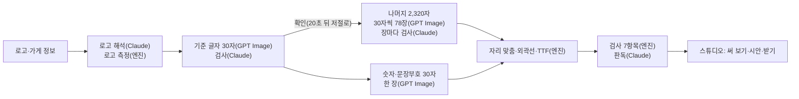

# 로고체

가게 로고 한 장으로 그 가게만의 한글 폰트를 만드는 서비스입니다.

**사이트: https://logoche.my**

> 🏆 **2026 청년취업사관학교 AI 인재 페스티벌 우수 프로젝트 발표회 우수상** (서울특별시 주최, 2026.11.9)
> 팀 **/eli30** · 김용휘(팀장·기획·개발) · 임낙원(디자인·프론트엔드)


[](https://youtu.be/T9JXQpk0VMo)

## 한눈에 보기

| | |
|---|---|
| 넣는 것 | 로고 한 장과 가게 이름 |
| 받는 것 | 한글 2,350자와 숫자·문장부호가 든 폰트(TTF·OTF·WOFF2), 간판·메뉴판 시안, 권리 카드, 제작 기록 |
| 걸리는 시간 | 느낌을 고른 뒤 약 13~18분 (11/5~6 실측) |
| 만드는 방식 | GPT Image가 글자를 모두 그리고, Claude가 검사하고, 엔진이 폰트 파일로 묶습니다 |


예시 가게 이름 '청년취업사관학교 새싹'으로 만든 폰트(새싹체, 한글 2,350자)를 간판 시안에 입힌 모습입니다. 간판 사진은 AI로 만들었고 글자는 만든 폰트입니다. 공식 로고나 서체가 아닌 시험용 예시입니다.

## 왜 만들었나

예비 청년 창업가가 브랜드를 기획해도 간판·메뉴판 글씨는 시공 업체의 기본 폰트로 채워지고, 전용 서체를 외주로 맡기면 평균 120만 원쯤에 짧아도 15일이 걸립니다. 로고체는 로고를 폰트 파일로 넓혀 매장 글씨까지 브랜드가 이어지게 합니다.

현장 인터뷰(10/30 창업 부스 다섯 팀, 11/3 교수진 세 분)에서 확인한 것:

- 사진을 찍은 네 팀 모두 로고는 영문인데 한글은 기성 고딕·명조였습니다.
- 다섯 팀 중 세 팀은 팀 안에 디자이너가 없었습니다.
- 표본이 작고 지불 의향은 듣지 못해서, 첫 파일럿에서 다시 재려고 합니다. ([검증 한계 자세히](docs/README-full.md#현장에서-확인한-것))

## 볼 만한 점

- **역할 분리**: 그리기는 GPT Image, 보고 판단하는 일(로고 해석·글자 검사·판독)은 Claude가 맡고, 폰트를 만드는 엔진은 AI를 부르지 않습니다.
- **그림을 폰트로 바꾸는 과정을 직접 구현**: 자리 맞춤 → 획 두께 맞춤 → vtracer 외곽선 → fontTools TTF. 만든 TTF와 원래 그림의 겹침은 평균 0.979입니다.
- **측정과 한계 공개**: 2,350자 전체를 돌려 시간·호출을 쟀고, 끝내 못 채운 한글 74자(3.1%)도 적었습니다.
- **권리 안전장치**: 로고 글자는 폰트에 넣지 않고, 무료 폰트 69개와 견줘 닮으면(0.85 이상) 다시 그립니다.
- **사람이 손봄**: 글자 다듬기 편집기(슬라이더, 끌어서 바꾸기, 초성·중성·종성 부분 나누기, 직접 그리기).

## 이렇게 씁니다

1. 로고와 가게 이름을 올립니다.
2. 질문 네 개(업종, 가게 이야기, 글씨 모양, 로고 권리)에 답하고 구글로 로그인합니다.
3. AI가 그린 **견본 세 가지** 중 하나를 고릅니다.
4. 기준 글자 30자를 확인하면 나머지 글자를 그리고, 폰트를 만들어 검사합니다. 창을 닫아도 서버에서 계속 만들고 메일로 알려 줍니다.
5. **스튜디오**에서 써 보고, 시안을 보고, 글자를 다듬고, 파일을 받습니다.

## 어떻게 만드나



> **로고 글자는 폰트에 넣지 않습니다.** 로고 글자가 상용 폰트일 수 있어서, 로고는 굵기·분위기를 읽는 데에만 쓰고 글자는 모두 새로 그립니다.

단계별 방법, 닮음 가드와 검사 기준(0.85의 근거), 실측 기록은 [자세한 설명](docs/README-full.md#어떻게-만드나)에 있습니다.

### 엔진을 바꿔 온 과정

공개 폰트로 직접 학습(제출본) → AI가 자소를 그려 조합 → 공개 생성 모델(MX-Font++)에 맡김 → **GPT Image가 2,350자를 모두 그리고 엔진은 외곽선만 땀(지금)**. 앞의 방식은 개성이 뭉개지거나 어느 가게든 비슷해지는 한계가 있었습니다. ([표로 보기](docs/README-full.md#엔진을-바꿔-온-과정))

## 기술 스택

| 부분 | 쓰는 것 |
|---|---|
| 웹 | Next.js 16(App Router), React 19, TypeScript, Tailwind CSS 4, Better Auth(구글 로그인) |
| AI | OpenAI GPT Image(그리기), Anthropic Claude(로고 해석·검사·판독) |
| 엔진 | Python 3.12, FastAPI, fontTools, vtracer, OpenCV, skia-pathops |
| 배포 | AWS EC2 한 대(서울), Caddy(HTTPS) |

## 직접 실행하기

Python 3.12, [uv](https://docs.astral.sh/uv/), Node.js 24가 필요합니다.

```bash
git clone https://github.com/poongbit/logoche.git && cd logoche

# 엔진 (터미널 1)
cd engine && uv sync
uv run python scripts/fetch_compare_fonts.py   # 처음 한 번: 닮은 폰트 검사용 무료 폰트
uv run uvicorn logoche_engine.main:app --port 8000 --reload

# 웹 (터미널 2)
cd web && cp .env.example .env.local   # AI 키 두 개와 구글 로그인 키를 채운다
npm install && npm run dev             # http://localhost:3000
```

키 없이 화면만 보려면 `web/.env.local`에 `LOGOCHE_MOCK=1`을 넣으면 됩니다(엔진도 필요 없음). 자세한 설정은 [`web/README.md`](web/README.md), [`engine/README.md`](engine/README.md), 배포는 [`deploy/README.md`](deploy/README.md)에 있습니다.

## 한계와 남은 일

- 한글 74자(3.1%)는 끝내 그리지 못했습니다(11/3 표준 품질 기준). 일상 글자는 사실상 다 들어 있습니다.
- 만든 폰트는 SIL OFL 1.1로 냅니다. 닮은 폰트 검사는 선별용이고 권리를 보증하지 않습니다. 이 저장소 코드의 라이선스는 아직 정하지 않았습니다.
- 남은 일: 결제, 이용 조건·개인정보 처리방침, 상용 폰트와의 비교, 현재 설정의 단계별 시간·비용 기록, 파일럿(약 10팀 목표).

## 더 읽을 문서

[자세한 설명](docs/README-full.md)(방법·실측·디자인·폴더 구조) · [사용 안내서](docs/service-guide.md) · [11/3 실측 기록](docs/full-run-20261103.md) · [화면 설계 기록](design.md) · [기획서](로고체-기획서.md)(10/29 기준, 엔진 방식은 그 뒤에 바뀜)

*2026-11-12 기준*
