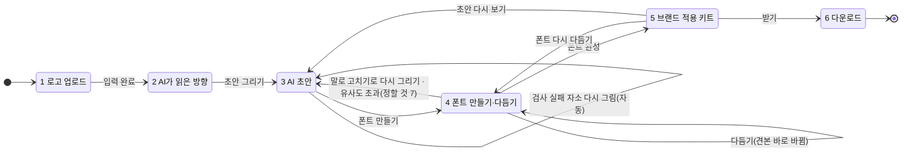

# 로고체 화면 설계

2026-10-27 기준 · 본선(11/9) 데모의 여섯 화면과 화면별 상태

근거는 세 가지다. [로고체 기획서](https://claude.ai/artifact/5C6KtENJtY6y1HF9pcso1J)(Claude Docs), [로고체 본선 범위](https://claude.ai/artifact/YBaxBR8hGErzywRaLAQsup)(10/27), 화면 목업 `프로토타입-화면.png`(10/20). 세 문서가 서로 다르면 본선 범위를 따른다. 단, 10/27에 새로 정한 것이 가장 우선하고, 본문에 `(10/27 결정)`으로 표시했다. 문서 사이의 차이는 [목업과 달라진 점](#목업1020과-달라진-점)과 [정할 것](#정할-것)에 적었다. 기획서·범위에 없는 상태는 `(제안)`으로 표시했다.

> 10/29: 화면의 시각 디자인은 Claude Design 'Logoche Final'(C안 확정, 프로젝트 "폰트 디자인 서비스 UI 분석")을 따른다. 받은 원본은 `design-import/Logoche Final.dc.html`(+ `C Stepbar`·`C States` 컴포넌트). 흰 바탕 + 검정 강조 하나(SUIT 글꼴), 위 단계 표시 72px · 아래 동작 막대 88px, 화면 1은 묶음 셋(가게 정보 → 분위기 → 권리 확인) 펼침형. 디자인은 자소 방식 때 만든 것이라 화면 3(자소 카드 → 참고 글자 30자 카드)·화면 4(자소 다듬기 → 말로 고친 기록)는 MX-Font 흐름에 맞춰 바꿨다. 디자인에 있지만 구현하지 않은 것: 화면 2 로고 위 번호 표시(자리를 알 수 없음), 화면 3·4 '멈추기'(작업 취소 없음), 화면 6 적용 시안 PNG(준비 중).
>
> 10/30 사용자 지적(넓은 화면): 큰 모니터(창 2,504px, 확대 80% → 화면 폭 3,130px)에서 최대 1,440px 내용이 가운데 46%만 차지했다. 너비·높이·여백·모서리의 px 165곳을 같은 값의 rem으로 바꾸고(테두리 두께·그림자는 px), 화면 폭 1800·2100·2500·2900px부터 기준 글자 크기를 112.5·125·137.5·150%로 키워 디자인 비율 그대로 커지게 했다(3,130px에서 69%). 기본 크기에서는 겉모습이 같다.
>
> 10/30 사용자 요청(화면 1): 묶음을 넘기는 '다음: 분위기'·'다음: 권리 확인'(마지막은 '분석하기')을 열린 묶음 안 맨 아래에 두고 남은 항목을 옆에 보인다. 접힌 줄은 어디를 눌러도 그 묶음이 열린다('바꾸기' 버튼 대신, 아직 안 연 묶음도). 아래 막대에는 '분석하기'만 남겼다. 가게 이름 칸에서 Enter로 다음 묶음. 이어서 사용자 지적: 다음 버튼은 구분선 아래 오른쪽 끝(남은 항목은 같은 줄 왼쪽, 버튼에 →), 고른 칩은 검정 채움 대신 2px 검정 테두리 + 체크(다음 버튼과 헷갈려서). 검정 채움은 누르는 버튼에만 쓴다. 이어서 사용자 결정: 화면 1에는 아래 막대를 두지 않는다(묶음 안 '분석하기'와 겹쳐서). 마지막 묶음과, 세 묶음을 다 채운 뒤 다시 연 묶음의 버튼은 '분석하기'다.
>
> 10/30 접근성 검토 반영(Apple HIG 기준, 사용자 요청): ① 글자 크기를 rem 토큰(`text-13`·`text-15` 등, globals.css `@theme`)으로 바꿔 브라우저 글자 크기 설정을 따른다(예전 px는 rem인 text-sm만 커져 위계가 뒤집혔다). 화면 3 글자 카드도 4.5rem. ② 어두운 모드: 한 번 넣었다가 뺐다(사용자 결정: 화면 틀만 어둡고 무대·로고·글자 그림은 흰 종이로 남아 부자연스러움). 밝은 화면만 쓴다. 넣는다면 글자 그림 반전·시안 색까지 함께 설계한다. ③ 화면 3 글자 카드 메뉴를 펼침 버튼으로(role="menu" 뺌, Esc로 닫으면 카드로 포커스), 그리는 중 카드에 상태 이름표. ④ 화면 4 나머지 글자를 그리는 동안 30자마다 견본을 다시 만들어 그린 글자부터 보이고, 그동안 굵기·너비를 다듬을 수 있다고 알린다. 화면 3 '폰트 만들기' 안내에 "처음 약 5분". ⑤ 문구: '다시 생성'→'다시 그리기', 화면 글은 '폰트'로 통일, 화면 5 폰트 불러오기 실패 안내를 쉬운 말 + '다시 불러오기'로. '고침' 표시는 초록 대신 검정(초록은 통과에만).

> 10/29 저녁 사용자 검토 반영: ① 화면 2 표현 방식마다 가게 이름 견본 그림(이미지 3장, 약 35초)을 보여 주고 그림을 보고 고른다. 고른 견본은 화면 3 초안의 참고 이미지가 된다. ② 화면 3 글자 카드를 누르면 다시 그리기(글자당 3번, 통과한 글자는 전 글자를 남김) · 직접 고치기 · 되돌리기. ③ 화면 4 말로 고치기와 그리기 방향 안내를 빼고, 그림판 같은 '글자 고치기'(붓·지우개·직선·네모·동그라미·채우기·선택해 옮기기)를 넣었다. 견본 글자를 누르거나 써 넣어 열고, 저장하면 폰트에 바로 바꿔 끼운다. ④ 화면 6 OTF·WOFF2(·WOFF)와 zip 묶음 받기(CSS 예시 포함). ⑤ 위 단계 표시 전환(알약이 옮겨 가며 이름이 펼쳐짐), 화면 1 묶음 모핑(View Transitions).
> MX-Font는 획 끝 말림 같은 장식을 2,350자에서 많이 누그러뜨린다(10/29 시험: 참고 글자 30자에는 말림이 있었지만 생성 결과는 둥근 고딕에 가까움). 장식이 중요한 글자는 화면 4에서 직접 고친다.
>
> 10/30 결정(사용자: "MX-Font가 퀄리티를 낮춘다 → 초안을 최대한 폰트로 바꾸는 엔진"): 공개 모델을 찾아봤지만(VQ-Font 한글판은 라이선스 불분명, 확산 모델은 한글 가중치·코드 없음, Eruku·InkSpire는 손글씨 줄 생성) 바로 바꿀 엔진은 없어서 1안 'MX-Font를 작업마다 참고 글자로 익히기'를 넣었다. 화면 4 진행 단계에 '참고 글자 익히기'(약 50초)가 생겼고 빌드는 처음 약 100초다. 참고 글자에서 뺀 6자로 재면 GPT 그림과 겹침이 고양이 0.60→0.83, 바다식당 0.46→0.74. 둥근·통통한 비례와 굵기는 따라오지만 획 끝 물결 같은 작은 장식은 아직 많이 누그러지고, 큰 크기에서 가장자리가 조금 울퉁불퉁하다. 다음 후보: 자주 쓰는 글자는 GPT가 직접 그리기(2안).
>
> 10/30 검토(사용자: "MX를 빼고 GPT가 2,350자를 다 그리면? 아니면 자소를 만들어 fonttools로 조합?"): 자소 조합은 10/27~10/29에 쓰다가 그만둔 방식(낱자 비율이 놓일 자리와 달라 늘임, 배치가 본고딕 그대로라 가게마다 비슷함)이라 권하지 않고, GPT가 모두 그리는 쪽을 권했다. 걸리던 것은 참고 30자에서 뺀 어려운 짜임 375자(겹받침 119·ㅙㅝㅞ 139·쌍자음+가로 모음 126, 글에서 2.7%이지만 없·않·많·원·월·왜·쓰·꼭 등). 시험(바다식당, 확정 30자 글자표를 네 번째 참고 이미지로, 자주 쓰는 어려운 글자, 다시 그리기 없음): 30칸 한 장 30/30(기준 글자 다·고·한 포함), 16칸 한 장 15/16(쓰를 ㅅ 하나처럼 그림). 칸을 줄여도 나아지지 않아 30칸이면 된다. 굵기는 확정 글자의 0.93배, 섞어 쓴 문장도 한 서체로 읽힌다. 장당 약 25~30초, 토큰 입력 약 7,000·출력 1,900~2,500(약 0.12달러). 결과 engine/data/어려운짜임-시험/. 이어서 고양이(아주 굵은 둥근 글씨)도 30칸 한 장 30/30(눈으로 봐도 모두 맞음). GPT 그림만으로 TTF 시험(engine/data/GPT-직접-폰트-시험/build.py, 운영 build_font에서 MX 생성만 바꿔 끼움, 글자 57자): 글자표마다 한 배율(잉크 넓이가 기준 서체와 같아지는 가운데 값)로 키워 기준 서체 잉크 상자 가운데에 놓고, 어려운 짜임 장은 확정 장 굵기에 맞춰 윤곽을 옮긴 뒤 vtracer(1em=500px). 깨진 글자 0·문서 포함·이름·플랫폼 검사 통과, TTF와 그림 겹침 0.97~0.99, 획 끝 물결이 그대로 남고 큰 크기 가장자리도 MX보다 매끈(800px에서 작은 턱 몇 군데). 고양이는 12px 뭉침 3/23자(로·괜·많)로 크기 검사 실패 — 아주 굵게 그린 스타일 탓. 글자당 점 가운데 330~385개, 57자 53~61KB(2,350자면 약 2.5MB). 사용자 결정: 이대로 구현.
>
> 10/30 구현(MX-Font를 뺐다, 코드 백업 backup/before-gpt-direct-20261030.tar.gz): 화면 3은 그대로 참고 글자 30자를 그리고, 그 글자들은 이제 그대로 폰트에 들어간다. 화면 4 진행 단계가 참고 글자 보내기 → **나머지 글자 그리기**(웹 lib/server/rest.ts: 참고 글자 글자표를 스타일 참고로 붙여 30자씩, 순서는 가게 이름 → 견본 글 → 자주 쓰는 글자 web/lib/hangulOrder.ts, 동시 8장, 장마다 엔진 /sheets/glyphs/place가 잘라 폰트 틀에 자리 맞춤·획 두께를 참고 글자에 맞춤, Claude가 장마다 검사, 떨어진 글자는 떨어진 글자끼리 글자표로 2바퀴 더) → 외곽선 → TTF → 검사 7항목 → AI 판독이 됐다. 엔진은 engine/logoche_engine/drawn.py로 그린 그림을 바로 외곽선으로 딴다(mxfont.py·mxfont_net.py·torch 의존성 삭제). 끝내 떨어진 글자는 서체에서 빠지고 글자 세트 검사가 "빠진 글자"로 알린다. 화면 4 글자 고치기로 그려 넣으면 폰트에 바로 추가되고 글자 세트 검사를 다시 한다. 다시 만들면 그린 글자는 그대로 쓰고 못 그린 글자만 또 그린다(처음 약 5분·약 $10, 다시 만들기 약 20초). 편집 화면 틀도 drawn.py 틀로 바뀌어 그 전에 고친 글자는 자리가 어긋날 수 있다. 시험(바다식당 사본, GLYPH_REST_LIMIT=90): 60자 3장(2장 + 떨어진 글자 1장) 모두 통과, 엔진 1초, 검사는 글자 세트(일부러 90자)만 떨어지고 나머지 통과, 다시 만들기는 그리기 건너뛰고 9초. 권리 문구(OFL)는 그대로 두었다(MX-Font 학습 데이터라는 이유는 사라짐, 바꿀지는 사용자 결정). 2,350자 전체를 실제 화면에서 돌려 보는 것은 사용자가 한다.

> 11/2 사용자 결정: B안(YoFont 화면 배치·만들기 흐름을 따름)으로 바꿨다. 시안은 Design 캔버스 '로고체 내 폰트 시안'(https://claude.ai/artifact/VNQry5vWEj9uGVB44qjUrQ)의 B안 줄. 여섯 단계 화면 대신 세 화면이다: `/new` 새 폰트 만들기(로고 · 가게 이름 · 원하는 느낌 · 업종과 분위기(접힘, 비우면 AI가 로고에서 읽은 톤) · 그리기 수준 · 권리 확인) → `/fonts/[id]` 만드는 중(로고 읽기 → 참고 글자 30자 → 확인 20초 뒤 저절로 계속, 글자를 누르면 기다렸다 다시 그리기 → 나머지 글자·숫자 → 폰트 파일·검사) → 같은 주소의 스튜디오(써 보기 · 시안 · 글자 표 · 설치·홈페이지 · 문자 세트와 검사 · 권리 카드 · 제작 기록 · 지우기). `/`는 내 폰트 목록(찾기 · 상태 필터 · 정렬 · 즐겨찾기 · 받기). 단계는 서버가 이어서 돌린다(web/lib/server/projects.ts, 작업마다 web/.data/projects/<id>.json) — 창을 닫아도 계속되고, 서버를 다시 켜 끊기면 '이어서 만들기'(그린 글자는 그대로). 화면 2 견본 고르기는 없어졌다(표현 방식은 AI가 낸 첫 안). 로딩 중 설문은 넣지 않았다(사용자 결정). 숫자·문장부호 30자(0~9 . , ! ? : ; ' " ( ) - ~ / % & + · * # ₩)를 따로 한 장에 그려 서체에 넣는다(글자 폭은 기준 서체 같은 글자). 그리기 수준: 정밀(지금까지 품질, 기본) / 표준(이미지 품질 medium, 시험에서 장당 출력 토큰 약 1/4). YoFont와 다르게 뺀 것: 공개 범위(늘 나만), 키 붙은 CDN 주소, 글자 편집기, 굵기·언어 추가. 로그인 전이라 폰트 주인은 모두 'local'이다. 예전 화면(/style·/draft·/build·/kit·/download)은 파일은 남기고 연결만 끊었다. 시험(바다식당, 표준, GLYPH_REST_LIMIT=90): 참고 글자 30/30, 숫자·문장부호 30/30 첫 장에 통과, 검사는 글자 세트만 떨어짐(일부러 90자).
>
> 11/2 화면 점검 반영(사용자 요청 '한꺼번에 고쳐줘'): ① 확인 화면: 남은 시간·버튼을 화면 아래에 붙이고(휴대폰에서 30칸이 길어 안 보였다) '기다리기' 단추를 넣었다. 키보드로 글자 칸에 들어와도 기다린다(WCAG 2.2.1). 휴대폰은 한 줄 4칸. ② 시안은 화면 폭이 아니라 시안 무대 폭을 따른다(`@container/mock`): 넓으면 세 장 한 줄, 스튜디오 칸이면 간판을 위에 넓게 + 메뉴판·인스타 나란히(메뉴판 가격·휴대폰이 잘렸다). ③ 간판 글자색은 로고 색 중 바탕과 대비 3:1이 넘는 색, 없으면 검정·흰색(바다식당은 어두운 파랑 2.5:1 → 밝은 색). 메뉴판·인스타 글은 4.5:1. ④ 탭·받기 메뉴는 역할(tab·menu)을 빼고 눌림 단추·펼침 단추로, 받기 메뉴는 열면 첫 항목, Esc면 '받기'로. 권리 확인은 radiogroup + 화살표 키. ⑤ 스튜디오에 h1(폰트 이름, 화면 읽기용), 탭 제목을 화면마다('새 폰트 만들기 · 로고체', '<폰트 이름> · 로고체'). ⑥ 지우기 확인은 '그만두기'에 포커스, 닫으면 '폰트 지우기'로. 이어서 만들기 실패·복사 실패를 알린다. ⑦ 검사 결과 설명을 자르지 않고 두 줄로, 오른쪽 열의 상자 안 상자(검사 목록·제작 기록)를 구분선으로, '빠진 글자 다시 그리기'는 글자 카드 위 하나만. ⑧ 폰트 미리보기는 WOFF2로 받는다(목록 카드마다 TTF 2.5MB). ⑨ 글자 크기 text-sm·lg·xl을 13·15·18·22 단계로, ✓ 글자를 그린 체크로, 움직임 줄이기에서도 도는 표시는 천천히 남긴다.
>
> 11/2 다시 점검 반영(13점 → 17점, 사용자 요청 '한꺼번에 고쳐줘'): ① 확인 화면의 남은 시간은 화면에만 보이고, 화면 읽기 프로그램에는 '잠시 뒤…'를 상태가 바뀔 때만 알린다(매초 다시 읽었다). ② 스튜디오 글자 표는 고른 칸 하나만 Tab에 멈추고 안에서 화살표·Home·End로 옮긴다(Tab 멈춤 127 → 38). ③ '‹ 내 폰트'는 링크(새 탭으로 열 수 있게). ④ 색 견본은 '로고 대표색'·'검정'처럼 이름으로 읽는다. ⑤ 폰트 이름 옆 연필 표시(휴대폰에는 마우스 올림이 없어 고칠 수 있는지 몰랐다). ⑥ 불러오는 중 표시는 role=status. ⑦ SUIT·Noto Sans KR은 CSS @import 대신 layout의 <link>(+ preconnect)로 불러온다. 그 밖에 만드는 단계 목록의 li를 display:contents에서 flex로, 남은 text-sm·흰색 하드코딩을 단계·변수로.
>
> 11/2 마무리 손질(/impeccable polish): 스튜디오 글자 표는 처음 120칸(휴대폰에서 설치 안내까지 너무 길었다), 휴대폰에서는 고른 글자 미리보기를 표 위에 작게(표 아래면 눌러도 안 보였다). 써 보기 칸은 글 길이만큼 높이(field-sizing, 가게 이름 한 줄에 큰 빈칸이 있었다). 권리 카드는 스튜디오에서 상자 안 상자 대신 구분선(`RightsCard bare`). 슬라이더 누르는 높이 28px, 파이어폭스 키보드 테두리. 확인 화면 상태 글은 글자를 따옴표로(''고'를 다시 그리고 있어요'). 만드는 단계의 잇는 선은 단계 뒤에 붙여 휴대폰 둘째 줄이 선으로 시작하지 않게. '‹ 내 폰트' 누르는 높이 44px.
>
> 11/2 메인 화면(사용자 요청 "YoFont 메인 스타일을 최대한 차용", 배경 장식은 빼고 나머지 화면도 크림으로): `/`는 메인, 내 폰트 목록은 `/fonts`로 옮겼다(폰트가 없으면 만들기로 보내던 것을 빈 목록 안내로). 메인은 위에서 아래로 꼬리표 알약 · 제목 · 첫 칸(YoFont '이미지에서' 탭 배치: 왼쪽 로고 올리는 칸·팁(샘플 로고 고르기는 뺌, 사용자 결정 — /new에는 남음), 오른쪽 가게 이름 · 원하는 느낌(그릴 글자 수 · 정밀/표준) · 업종/브랜드 톤/주로 쓸 곳 펼침 + 넓은 검정 버튼) · 받는 폰트 칩 · 만드는 순서 번호 카드 4개 · 로고체로 만든 폰트(팀 시험 폰트에 써 보기, lib/constants.ts SHOWCASE_FONTS) · 받는 것 번호 카드 3개 · 자주 묻는 질문(권리 답은 RIGHTS에서) · 아래 줄. 첫 칸의 버튼은 채운 값을 /new의 입력 저장 칸(lib/newDraft.ts, /new와 함께 씀)에 넣고 넘어간다 — 권리 확인과 만들기는 /new에서. 로고는 메인 어디에 놓아도 받는다. 색: 화면 바탕 크림 --paper #F5F3EE(머리줄·아래 막대도), 카드·입력칸은 흰색 그대로, 무대는 크림 위에서 보이게 #EBE9E3, 꼬리표·단계에 파랑 --accent #2C56C9와 시스템 고정폭 글씨(font-mono). YoFont의 문구·모델 이름·검정 모눈 'Aa' 올리는 칸·색 값은 가져오지 않았다. 아직 없는 것: 이용 조건·개인정보 처리방침 화면(구글 로그인 동의 화면에 필요), 진열할 다른 표현의 폰트(지금 1개).
>
> 11/2 간판 시안을 실제 사진으로(사용자 요청, 사진은 사용자가 AI로 만든 가게 앞 사진): `components/Mockups.tsx` SignScene이 사진(public/mockups/sign-street.webp)을 캔버스에 그리고, 칠할 곳 지도(public/mockups/sign-street-map.png, 회색 = 밝기 비율·투명도 = 파란 간판 면과 차양 줄무늬)대로 로고 대표색 × 밝기 비율로 칠한 뒤, 간판 면 네 꼭짓점에 맞춰 실제 폰트 글자를 원근대로 얹는다(CSS matrix3d, 글자는 AI가 그리지 않음). 로고 색을 모르면 사진의 파랑 그대로 + 흰 글자. 무대가 넓으면 옆으로 길게(1110×510), 좁으면 간판 둘레를 높게(920×520) 자른다. 원본은 engine/data/mockup-sign-street-original.png, 지도·꼭짓점은 engine/scripts/mockups/sign_map.py로 다시 만든다. 주황·초록·노랑·보라로 칠해 봤다. 이어서 메뉴판도 사진으로(가죽판 위 크림색 종이 한 장, public/mockups/menu-board.webp): 종이 색은 그대로, 가게 이름·구분선·메뉴 3줄·가격을 로고의 어두운 색으로 종이 결과 곱해(multiply) 원근대로 얹는다. 종이 네 꼭짓점은 engine/scripts/mockups/menu_quad.py가 찾는다(집게가 덮은 곳은 빼고 직선 맞춤). 두 장면은 PhotoStage 하나를 쓴다: focus(꼭 보일 곳)는 다 보이게, 무대는 safe(보여도 되는 곳) 안의 사진으로 채운다. 메뉴판 사진 오른쪽 아래 테이블 위에 Gemini 표시가 있어 safe 밖에 두었다 — 데모 전 표시 없는 원본으로 바꾸기를 권함(사용자에게 알림). 다음: 업종별 사진, 인스타(휴대폰) 사진.

> 11/2 구글 로그인(사용자 요청 "구글 로그인 먼저"): Better Auth 1.7.10(web/lib/server/auth.ts, 주소 /api/auth/*) + Node 내장 SQLite(web/.data/auth.sqlite, 표는 처음 쓸 때 만든다). 카카오는 하지 않는다(11/2 결정). 폰트 작업의 주인은 로그인한 사람의 id(lib/server/projects.ts의 밖으로 나가는 함수는 모두 주인을 받아 확인, 남의 것은 404). 막은 곳: /api/projects(목록·만들기·하나·로고·확인·다시 만들기), /api/font/[id]·/bundle(만든 사람만, 메인 진열 폰트 SHOWCASE_FONTS는 누구나). 로그인 시점: 메인·/new 입력은 로그인 없이, /new의 버튼이 로그인 전이면 '로그인하고 폰트 만들기' → 구글 → /new?continue=1로 돌아와 저장해 둔 입력으로 바로 만든다. 머리줄 오른쪽 끝에 '로그인' 또는 첫 글자 동그라미(이름·메일·로그아웃). 내 폰트·폰트 화면은 로그인 전이면 로그인 안내. 카카오톡 등 앱 안 브라우저는 구글이 막아(disallowed_useragent) 구글로 보내지 않고 '다른 브라우저로 열기'(카카오톡은 kakaotalk://web/openExternal)를 안내. 키: web/.env.local의 BETTER_AUTH_SECRET·BETTER_AUTH_URL·GOOGLE_CLIENT_ID·GOOGLE_CLIENT_SECRET(구글 콘솔 리디렉션 URI http://localhost:3000/api/auth/callback/google). 이어서 11/2 배포(https://logoche.my) 때 나머지도 막았다: 글자 그림과 글자 작업(/api/glyphs/jobs/[id]/…)은 그 작업을 쓴 폰트의 주인만(lib/server/auth.ts requireGlyphJob, 남의 것은 404), 예전 화면 API(/api/style/*·/api/glyphs/jobs 만들기·/api/glyphs/structure·/api/build/*·/api/preview)는 로그인해야 부른다(지금 화면은 안 쓰지만 AI·엔진을 부르는 길이라). 로그인 전에 만든 작업(owner 'local', 바다식당체)은 아무에게도 안 보인다.
>
> 11/2 저녁 사용자 결정("logoche.my에서 이 로고로 폰트 만들기를 누르면 /new로 넘어가 같은 입력을 또 한다. 메인에서 바로 만들거나, 메인은 시작하기만 두거나 둘 중 하나") → 메인에서 바로 만든다. /new에 있던 권리 확인(로고 권리 · 로고 글자)·구글 로그인·만들기를 메인 첫 칸(components/home/Hero.tsx)으로 옮겼다. 권리 확인은 로고를 올리면 로고 아래(팁 자리)에 펼친다. 휴대폰은 로고 → 권리 확인 → 가게 이름 순서(보이는 순서와 Tab·화면 읽기 순서를 같게, order로 바꾸지 않음). 주 버튼은 빠진 것이 있어도 꺼 두지 않고, 누르면 빠진 것(로고 · 가게 이름 · 로고 권리 · 로고 글자)을 보이고 첫 칸으로 옮긴다. 로그인 전이면 '로그인하고 폰트 만들기' → 구글 → /?continue=1로 돌아와 저장해 둔 입력(lib/newDraft.ts)으로 바로 만든다. /new는 메인으로 넘긴다(next.config.ts redirects, 307). 머리줄 '새 폰트 만들기'·내 폰트 빈 목록·아래 줄 링크는 /#make(첫 칸). /new에만 있던 샘플 로고 고르기와 원하는 느낌 예시 칩은 없어졌다.
>
> 11/2 밤 품질 개선(사용자가 고른 안, 시험은 거의 다 그린 '굵고 둥근 고딕' 2,298자 그림으로 AI 호출 없이): ① 엔진 빌드 전 다듬기(drawn.refine) — 기준 서체 같은 글자와 견준 획 두께가 폰트 가운데 값에서 ±10% 넘게 벗어난 글자만 그 끝까지 맞추고(얇·훑·핥처럼 획 많은 글자가 옅었다), 굵은 스타일(기준 서체 Regular의 1.6배 넘게 굵음)은 속공간 둘레만 획 두께의 12% 깎는다(12px 뭉침 2→1자). 크기는 이미 99%가 ±6% 안이라 맞추지 않는다. 외곽선은 해상도를 올려 따면 오히려 물결이 생겨 그대로 두고 vtracer length_threshold 4→6(점 458→416, 2.78→2.56MB, 그림과 겹침 0.983→0.978은 일부러 고친 만큼). ② 스타일 검사 — 엔진이 장마다 획 두께·크기 점수를 내고(drawn.style_scores, 참고 글자 기준 ±20%·크기 ±12% 밖이면 styleProblem), 웹이 그 글자를 한 번 더 그려 기준에 더 가까운 쪽을 쓴다(rest.ts). 한 벌에 26자(1.1%) 꼴. 이 비용은 사용자에게 받지 않는다(사용자 결정). 제작 기록에 '획 두께·크기가 다른 글자와 달라 다시 그린 글자 N자'. ③ 짜임별로 묶어 그리기 — 가게 이름·견본 글 다음 나머지 글자를 모음 방향(세로·가로·섞임) × 받침(없음·홑·겹) 묶음 순서로(같은 묶음 안은 자주 쓰는 순서), 다시 그리는 바퀴도 묶는다. ④ 참고 글자 30자에서 하·로·수·들을 빼고 원·없·꽃·흙(ㅝ·겹받침·ㄲ+가로 모음)을 넣었다(혼자 가늘게 튄 글자가 이 짜임에 몰렸다). 초성 15→16, 받침 8→11, 짜임 6→8/9. 떨어지면 쉬운 글자로(없→앉·값, 흙→읽·닭). ⑤ 글자표 해상도 4:3 1792×1344 → 2048×1536, 1:1 1536 → 1776(장당 비용 약 1.3배 어림, 크기를 받는 것은 품질 low 한 장으로 확인). ⑥ 스튜디오 글자 표에 '다시 볼 글자' 탭 — 기준에서 5% 넘게 벗어난 나머지 글자 최대 30자, 눌러 여러 개 고르고 '고른 N자 다시 그리기'(POST /api/projects/[id]/redraw). 다시 그린 그림이 검사·스타일 검사를 통과할 때만 바꾼다. 사용자가 고른 다시 그리기의 비용을 받을지는 아직 안 정했다. ③~⑤는 실제로 그려 봐야 효과를 안다(아직 시험 안 함).

> 11/3 2,350자 전체 실측(사용자 요청, 로고: 생선 문 고양이·가게 이름 '냥이네', 계좌 한도 15달러라 표준으로, 기록 `docs/full-run-20261103.md`): 약 6.4분, 이미지 98회(어림 약 4.6달러, 단가는 10/30 시험값에서 역산한 어림), Claude 94회(토큰 입력 29.4만·출력 13.9만). 시험값과 달라진 것: 시간 약 5분→6.4분(표준), 장당 시간 25~30초→중앙값 13.5초(표준), 스타일 이상치 재그리기 1.1%→0자, 겹침 0.97~0.99는 평균 0.979·최소 0.969로 맞음(너비 101%·기울기 −1°·자간을 그림에도 건 뒤 비교, 변환 없이 재면 0.76으로 잘못 나옴). 새로 드러난 문제: ① 숫자 0~8이 세 바퀴 모두 '다른 글자 섞임'으로 떨어져 폰트에 없음(9만 통과) ② 한글 83자(3.5%) 빠짐 — 속도 제한(429)으로 글자표 한 장이 통째로 실패한 것과 어려운 짜임(뛔·쫴·곌·곕·꼍·삥·뱐)이 반복해서 떨어진 것이 섞여 있고 둘을 나눠 세지 못함 ③ 닮은 폰트 검사 0.83(가장 가까운 Pretendard Bold)으로 기준 0.85에 가까움. 실행은 점검 중 모의 모드가 폰트 작업에 적용되지 않아 실제 호출이 나가 한 번 끊겼고 이어서 만들기로 이었다(그래서 1바퀴 실패율 26%(366/1,391)는 뒤 구간만 정확). 호출 기록 계측은 web/lib/server/usage.ts(LOGOCHE_LEDGER·LOGOCHE_COST_CAP).

> 11/3 밤 후속(같은 기록 6~9장): ① 숫자 0~8 실패 원인은 검사가 아니라 이미지 지시문의 `1.0 2.1 …` 표기(소수·분수로 읽어 0 칸에 1, 5 칸에 2/3를 그림)였고, `N번 칸 '기호'`로 고쳐 다시 그리자 7자가 첫 시도에 통과했다. 검사 모음 그림의 칸 번호가 원인이라는 첫 가설은 정상 숫자 장을 넣어 보고 버렸다. ② 429(속도 제한)는 2·4·8초 지수 대기로 다시 시도하게 했다(가짜 서버로 간격 검증). 빠진 한글 83자는 429가 아니라 검사 탈락이었다(429는 1바퀴에만 8건). ③ 빠진 글자만 다시 그리기(이미지 12회, 약 0.6달러)로 9자만 더 채워 74자가 남았고, 한 글자씩 따로 그리기 파일럿도 통과 1/8(약 12%)이라 접지 않았다. 74자는 짜임으로 설명되지 않고(겹받침 0, 쌍자음+가로 모음 0, 평범한 짜임 31) 말뭉치 160만 자에서 출현 2회라, **한계로 남기기로 했다**(사용자 결정). ④ 글자표 요청 동시 실행 중 엔진 500 2건(fontTools 표 읽기 경합 의심)은 재현하지 못해 고치지 않았다. 검사에 떨어진 그림은 이제 `rest/rejected/`에 남고 장별 실패 원인은 호출 기록의 `sheet` 줄에 적힌다.

## 한눈에

| # | 화면 | 하는 일 | 다음 화면으로 가는 조건 | 영상 |
|---|---|---|---|---|
| 1 | 로고 업로드 | 로고, 가게 이름, 사업 정보 선택지(업종·브랜드 톤·주 사용처), 원하는 느낌, 로고 출처, 로고 글자 폰트를 받는다 | 필수 입력 완료 | 0:35 |
| 2 | AI가 읽은 방향 | 고른 톤과 로고 측정값으로 AI가 초안의 방향(조절값 7축, 자유 안 표현 방식)을 정한다. 사용자는 바꾸지 않고 바로 그려도 된다(10/27 결정: AI 초안 먼저, 다듬기는 그 뒤) | 초안 그리기 | 0:45 |
| 3 | AI 초안 | AI가 참고 글자 30자를 새로 그린다(10/29 결정: 자소 대신 참고 글자, 안은 하나). 화면 2에서 고른 견본과 견줘 본다 | 폰트 만들기 (통과한 글자 20자 이상) | 0:55 |
| 4 | 폰트 만들기·다듬기 | MX-Font가 참고 글자의 스타일로 2,350자를 만들어 TTF로 묶고 7항목·OCR·유사도 검사를 돌린다(10/29 결정). 만든 폰트(TTF)를 보며 전체(굵기·너비·기울기·자간)로 다듬고, 마음에 안 드는 글자는 그림판처럼 직접 고친다(10/29). 자소별 다듬기와 말로 고치기는 10/29에 없앴다. 다듬은 내용은 '적용해 보기'를 누를 때 다시 만들어 검사한다(10/28 결정) | 폰트 파일 완성 (10/30 사용자 결정, 시연용: 검사·유사도에 떨어져도 만든 폰트로 넘어가 받을 수 있다) | 1:08 |
| 5 | 브랜드 적용 키트 ★ | 메뉴판·간판·인스타 시안에 새 글씨를 입혀 기본 고딕과 비교한다 | 사용자가 '받기'를 누름 | 1:18 |
| 6 | 다운로드 | TTF·OTF·웹폰트(WOFF2·WOFF), 라이선스 원문(SIL OFL 1.1, 10/29), 제작 기록을 받는다. 모두 받기는 zip 하나 | — | 1:30 |

★ 핵심 순간. 여섯 화면 밖의 화면은 본선 전에 만들지 않는다(범위). 전체 목표 시간은 15분이고 아직 실측 전이다.

## 흐름

2·3으로 돌아가 값을 바꾸면 4 조합·빌드와 검사를 다시 거친다.

작업은 서로 따로 돈다(10/30). 화면 1에서 새 로고·톤으로 시작하거나 화면 6에서 처음부터를 누르면 상태와 제작 기록을 모두 비우고 작업 회차(run)를 늘린다. 늦게 도착한 지난 회차의 분석·견본·초안·빌드 결과는 버린다. 초안은 그린 입력(표현 방식·고른 견본·톤 충돌 선택)을 기억해, 화면 2에서 이 값을 바꾸고 화면 3에 오면 새로 그린다(되돌리면 그대로 쓴다).

## 자소 생성에 들어가는 입력

로고 글자는 잘라 쓰지 않는다(10/27 결정). 로고 글자는 상용 폰트로 만든 경우가 많아서, 그 자소를 그대로 쓰면 권리 분쟁의 여지가 생긴다. 로고는 측정, 분위기 해석, 이미지 API의 참고 이미지로만 쓰고, 자소는 모두 AI가 새로 그린다. 상용 폰트를 닮은 결과는 화면 4 유사도 검사에서 거른다(10/27 결정). 분위기의 기준은 사용자가 고른 선택지이고, Claude의 해석은 이를 보충하고 확인한다.

| 입력 | 처리 | 생성에 쓰이는 곳 |
|---|---|---|
| 업종 | 사용자 선택 | 어울리는 톤 추천, 분위기 사전의 기본 범위 |
| 브랜드 톤 2~3개 | 사용자 선택 | 7축 조절값의 범위. 분위기의 기준 |
| 주 사용처 | 사용자 선택 | 가독성 기준. 간판·메뉴판은 멀리서 읽히도록 굵기 하한을 두고 자간을 넓게, SNS·썸네일은 굵게 |
| 원하는 느낌 한 줄 | 사용자 입력 | 프롬프트 문장, 창작 의도 기록 |
| 로고 이미지 | OpenCV 측정 | 굵기·둥글기·너비·대비·기울기 숫자. 톤 범위 안에서 최종값과 슬라이더 초기값이 된다 |
| 로고 이미지 | Claude 해석(10/27 결정: Gemini 대신) | 획 끝 묘사, 심볼에서 따온 시그니처 요소 위치, 사용자 톤과 맞는지 확인 |
| 로고 이미지 | 이미지 API(GPT Image)에 참고 이미지로 첨부(10/27 결정) | 획 끝과 질감 참고. 로고 글자 모양은 그대로 옮기지 말라고 지시한다 |
| 기준 자소표 | Source Han Sans KR(Apache-2.0)로 만듦 | 자소 구조를 보여 주는 참고 이미지 |

이미지 API에 들어가는 프롬프트 예시는 다음과 같다.

> 디저트 카페 간판용. 따뜻하고 손맛 있는 느낌. 굵기 750/900, 모서리 둥글기 0.9, 너비 108%. 첫 번째 이미지(로고)의 획 끝과 질감을 참고하되 로고 글자 모양은 그대로 옮기지 마라. 두 번째 이미지(기준 자소표)의 구조를 지켜 ㅇ·ㄱ·ㄴ…을 한 장에 그려라.

참고 이미지를 붙이면 이미지 모델이 로고 글자 모양을 따라 그릴 수 있다. 로고를 올릴 때 폰트를 판별하지 않고, 생성된 서체를 화면 4에서 상용 폰트와 비교해 거른다(10/27 결정). 상용 폰트를 비교 대상에 넣는 방법은 정할 것 5에 있다.

## 공통 규칙

- 로그인·결제가 없다. 개인정보를 받지 않고, 시연은 가상 데이터로 한다(범위).
- 미리보기 문구는 가게 이름과 메뉴 예문 20~30자다. 값이 바뀌면 이 문구만 바로 다시 그리고, 2,350자 전체는 화면 4에서 만든다(기획서 2-4 ⑤).
- 로고에서 뽑은 색은 미리보기와 시안에만 쓴다. 서체에는 들어가지 않는다(기획서 2-4 ①).
- 슬라이더에는 상한이 있다. 획이 많은 글자(뷁·뚫)의 속공간이 막히지 않게 한다(기획서 2-4 ⑤).
- 사람이 고르거나 고친 것은 모두 제작 기록에 남고, 화면에 "기록됨"으로 보인다(목업 3번 화면). 남는 항목은 [제작 기록에 남는 것](#제작-기록에-남는-것)에 모았다.
- AI 생성 표시는 서체 이름 정보와 권리 카드에 넣는다(기획서 2-5, AI 기본법).
- 특정 서체를 따라 하는 요청("○○체 느낌으로")은 받지 않는다(기획서 2-5). 글을 입력하는 곳(화면 1 원하는 느낌, 화면 2 말로 고치기)에 모두 적용한다.

모든 화면에 공통인 상태

| 상태 | 언제 | 보이는 것 |
|---|---|---|
| 처리 중 | AI·엔진이 일하는 동안 | 지금 하는 일 한 줄. 예: "로고를 재는 중" |
| API 오류 (제안) | Claude·이미지 API(GPT Image) 호출 실패 | 실패한 단계와 다시 시도 버튼 |
| 오프라인 시연 | 현장 인터넷이나 API 장애 | 백업 로고 5개의 미리 만든 결과를 불러온다(기획서 2-7) |

## 화면별 상태

### 1. 로고 업로드

받는 것

- 로고 파일: PNG·SVG·JPG·사진(목업)
- 샘플 로고로 체험: 달콤한집·바다식당·숲속공방(목업). 고르면 선택지도 미리 채운다 (제안).
- 가게 이름
- 업종 1개(10/27 결정, 같은 날 14개로 늘림): 카페·디저트 / 베이커리 / 분식·한식 / 양식·브런치 / 일식·아시안 / 술집·바 / 공방 / 뷰티·네일 / 꽃·식물 / 옷·소품샵 / 반려동물 / 운동·요가 / 학원·교육 / 크리에이터
- 브랜드 톤 2~3개(10/27 결정, 같은 날 14개로 늘림): 귀여운 / 따뜻한 / 장난스러운 / 고급스러운 / 믿음직한 / 전통적인 / 모던한 / 자연스러운 / 레트로한 / 힙한 / 강렬한 / 차분한 / 산뜻한 / 우아한. 업종을 고르면 어울리는 톤 2개에 '추천'을 붙인다.
- 주 사용처 1개 이상(10/27 결정): 간판·메뉴판 / SNS·썸네일 / 포장·스티커
- 원하는 느낌 한 줄(선택 입력, 10/27 결정). 예: "따뜻하고 손맛 있는". 고른 톤과 함께 창작 의도로 기록된다.
- 로고 출처 3택: 직접 만들었어요 / 외주로 만들고 저작권을 넘겨받았어요 / 잘 모르겠어요(기획서·목업)
- 로고 글자 폰트 5택(10/28 결정, 필수): 직접 그렸어요(손글씨·레터링) / 무료 폰트 / 유료(상용) 폰트 / 로고에 글자가 없어요 / 잘 모르겠어요. 무료·상용이면 폰트 이름을 적을 수 있다(선택). 상용이면 "라이선스는 직접 확인, 로고체는 상용 폰트와 비교하지 않음"을 알린다. 답은 제작 기록에 남는다. 권리 확인을 나누기로 한 결정: 로고(입력)에 쓴 폰트는 사용자가, 만든 서체(결과)가 다른 폰트와 닮았는지는 도구가 선별 검사로 본다.

업종·톤 목록은 분위기 사전(임낙원)과 맞춘다. 10/27 사용자 결정으로 업종·톤을 14개씩으로 늘렸다(이전 계획: 업종 3~4개, 톤 5~6개). 톤별 조절값 범위는 '귀여운'만 기획서 값이고 나머지는 분위기 사전이 확정될 때까지 임시 값이다.

| 상태 | 언제 | 보이는 것 | 다음 |
|---|---|---|---|
| 빈 화면 | 처음 들어옴 | 업로드 칸, 샘플 로고 3개, 선택지, 출처 3택. '분석하기' 비활성 | 파일 올림 또는 샘플 선택 |
| 입력 중 | 필수 항목(로고·가게 이름·업종·톤·사용처·출처) 중 빈 것이 있음 | 빈 항목 표시 | 다 채우면 입력 완료 |
| 입력 완료 | 필수 항목을 모두 채움 | '분석하기' 활성 | 누르면 화면 2 |
| 외주 로고 | 출처 = 외주 | 저작권 양도를 확인하라는 안내(기획서 2-5) | 진행 |
| 출처 모름 | 출처 = 모름 | 정할 것 6 | — |
| 흉내 요청 거절 | 원하는 느낌에 "○○체 느낌으로", "○○체랑 비슷하게", "프리텐다드처럼" 같은 특정 서체 이름(10/27 판정 강화) | 특정 서체는 따라 하지 않는다는 안내, '분석하기' 막힘. 고딕·명조 같은 서체 갈래는 막지 않는다 | 다시 입력 |
| 파일 오류 (제안) | 형식·크기가 맞지 않음 | 받는 형식 안내 | 다시 올림 |

### 2. AI가 읽은 방향

10/27 결정: 조절값은 AI가 초안을 그린 뒤 화면 3에서 다듬는다. 이 화면에는 조절값(7축 값·슬라이더·로고와 톤이 부딪힐 때 묻던 3안)을 보이지 않는다. AI가 정한 값 그대로 초안을 그리고, 로고 측정값을 따르는 안은 화면 3의 '로고 충실' 안이 맡는다.

보이는 것

- 로고에서 읽은 것: 획 끝, 시그니처 요소, 색(화면 5 적용 시안에만)
- Claude가 읽은 로고 분위기가 사용자 톤과 다르면 알린다. 예: "로고는 '고급스러운' 느낌으로도 읽힙니다"
- 자유 안의 표현 방식(10/27 결정): AI가 로고와 고른 톤을 보고 3개를 제안하고(예: 풍선처럼 부풀린 획, 녹아 흐르는 획), 사용자가 고르거나 직접 쓴다. 화면 3의 자소 초안(10/28부터 자유 안 하나)에 쓰이고, 창작 의도로 기록된다. 특정 서체 이름은 받지 않는다.
- 버튼 '초안 그리기'

조절값 7축(굵기·둥글기·너비·대비·기울기·흔들림·자간)과 근거는 화면 3 '전체 다듬기'에 보인다. 둥글기·대비·흔들림은 그리기 방향(프롬프트에 들어가 바꾸면 다시 그려야 함)이라 값만 보이고, 굵기·너비·기울기·자간은 슬라이더로 바꾼다. 축마다 AI 제안값의 근거를 함께 보인다(10/27 결정, 분위기 근거 표시).

| 근거 | 예 |
|---|---|
| 선택(사용자) | 둥글기 범위 0.7~1.0: '따뜻한' 톤 · 굵기 하한: 주 사용처가 간판 |
| 측정(로고) | 둥글기 0.9: 로고 모서리 반지름이 선 굵기의 90% |
| 해석(Claude) | 획 끝 "둥글게 맺음" · 시그니처 요소: 곰 얼굴 → ㅇ 자리 |
| 범위 가운데 | 흔들림 0.25, 자간 +4%: 로고에서 잴 수 없음 |

| 상태 | 언제 | 보이는 것 | 다음 |
|---|---|---|---|
| 분석 중 | 화면 진입 | 로고를 재고 분위기를 읽는 중 | 카드 표시 |
| 카드 표시 | 분석 끝 | 로고에서 읽은 것, 표현 방식 제안 | 표현 방식 고르기 또는 바로 초안 그리기 |
| 해석 다름 (제안) | Claude 해석이 고른 톤과 다름 | 알림 | 카드 표시 |
| 흉내 요청 거절 | 표현 방식에 "○○체 느낌으로" | 특정 서체는 따라 하지 않는다는 안내, '초안 그리기' 막힘 | 다시 입력 |

### 3. AI 초안

> 10/29 결정: 자소 조합 대신 MX-Font. 이 화면은 AI가 참고 글자 30자(`REFERENCE_CHARS`)를 글자표 한 장에 그리고, 칸마다 검사해 떨어진 글자만 다시 그린다. 보이는 것은 참고 글자 카드 30장(그리는 중·다시 그리는 중·실패), 화면 2에서 고른 견본(10/30 결정: 있던 'MX-Font로 만든 가게 이름 미리보기'는 초안을 따르지 않고 작업마다 거의 같은 글씨여서 뺐다), 실패한 글자만 다시 그리기, '폰트 만들기'다. 통과한 글자가 20자 이상이면 떨어진 글자는 빼고 만든다. 10/30: 다시 그릴 때 겹자음·겹모음·겹받침의 짜임 설명을 지시문에 넣고, 같은 글자로 다시 그려 한 번 떨어지면 같은 어려운 자모가 든 쉬운 글자로 바꿔 그린다(꽃→꼬·까, 원→워·뭐, 빵→빠, 있→씨 등. 받침 빼기·초성 ㅇ으로 바꾸기가 기본). 참고 글자는 스타일 견본이라 원래 글자도 폰트에 들어간다. 고양이 작업 시험: 짜임 설명만으로는 꽃·원 모두 다시 떨어졌고, 바꿔 그리기로 5번 중 4번 통과(꼬 1번 떨어지고 까 통과). 아래의 자소·3안·자소 다듬기 설명은 10/28까지의 기록이다.
>
> 10/30 (2): 그린 글자표 6장을 다시 보니 글자표에서 떨어진 11자는 모두 '칸 경계에 닿음'이었다. 그림 모델은 글자를 제대로 그렸지만 격자를 조금 어긋나게 그려서, 고르게 나눈 경계로 자르면 글자 끝이 잘렸다(고양이 작업 9자 → 다시 그리기 15번). 글자 모양으로 떨어진 것은 모두 한 자씩 다시 그릴 때였다. 그래서 (1) 엔진이 글자 사이 빈 띠(줄·열의 잉크 합이 가장 적은 곳)에서 자른다(6장 모두 잘림 0자). (2) 참고 글자 30자를 기준으로 다시 골랐다(`REFERENCE_CHARS` 주석: 한 장 30자, 기본 자음 14개 초성·대표 받침 7개·기본 모음 6개, 짜임 6가지, 자주 쓰는 글자, 뭉개지는 짜임 빼기). 전 30자에는 초성 ㅁ·받침 ㄱ·ㅂ·모음 ㅐ·ㅕ가 없었고 꽃·원이 있었다. 새 30자: 가다타파하서이에내 고로무수 의쥐퀴 한헌람것있밥면빵쳇 는를들국 왕. 모든 가게가 같은 30자를 쓴다(참고 글자는 스타일 견본일 뿐이고 MX-Font가 2,350자를 모두 다시 만든다). (3) 지시문을 정리했다(글자표 1,534자 → 1,066자). 로고 이미지는 그대로 붙인다. GPT 시험(새 지시문·새 30자, 로고 대신 견본): 고양이 30/30, 바다식당 28/30(획 끝 물결이 짧은 획처럼 보여 가→갸·서→샤) → "획 끝 장식이 짧은 획처럼 보이지 않게" 한 줄을 더하니 바다식당 30/30(물결 표현은 그대로). 결과 engine/data/글자표-새30자-시험/. 사용자 결정: 30자는 이대로 고정하고, 필요하면 30자보다 늘려도 된다(격자는 글자 수에 맞춰 정해진다).

> 10/28 결정: 3안이 이미지 생성을 세 배로 써서 기본은 자유 안 하나만 그린다. 자소 카드에는 초안 한 장이 보이고 고르기 없이 '폰트 만들기'로 간다. 사람의 기여는 화면 2의 표현 방식 결정과 화면 4의 다듬기로 남는다. 아래 3안 설명은 `JASO_VARIANTS=three`일 때다.
>
> 10/28 결정: 순서를 초안 → 폰트 만들기 → 다듬기로 바꿨다. 아래의 전체 다듬기·자소 다듬기는 화면 4로 옮겼다. 화면 3에는 초안 카드, '초안으로 조합한 글씨', 실패한 자소 다시 그리기만 있다.
>
> 10/28 결정: 팬그램 모드에서는 '초안으로 조합한 글씨'와 화면 4 견본에 팬그램 문장만 보인다. 가게 이름은 대부분 서체에 없는 글자라 기본 글꼴과 섞여 폰트가 적용되지 않은 것처럼 보였다. 자소를 모두 그리면(`JASO_SET=full`) 가게 이름과 예문을 보인다.

> 10/27 결정: 비용 때문에 당분간 "다람쥐 헌 쳇바퀴에 타고파"의 자소 19개만 그린다(팬그램 모드). 이 자소로 만들 수 있는 글자는 216자라 화면 4의 TTF도 216자이고, 가게 이름·메뉴 가운데 없는 글자는 기본 글꼴로 보인다. 67개 전부는 `JASO_SET=full`(web/README.md). 10/28 결정: 초성 19개·중성 21개·홑받침 16개, 모두 56개를 자리별 표 3장에 그리고, 겹받침 11개는 따로 그린 홑받침 두 개를 기준 서체 겹받침의 두 자리에 넣어 지어 2,350자를 모두 만든다(web/README.md 기본 작업). 초성과 받침은 따로 디자인한다. 같은 날 거친 안: 시안 메뉴 자소 더하기(한 장 30칸) → 팬그램 + 많이 쓰는 자소 21개(40개, 1,630자) → 받침 8개 + 나머지 홑받침은 초성 그림 빌리기(48개) → 실제로 보니 빌린 받침이 어색해 지금 안(사용자 결정).

보이는 것(목업 3번 화면)

- 자소마다 카드 한 장: 자소와 자리(예: ㅇ 초성), 1안·2안·3안 썸네일과 짧은 이름. 3안은 중간·로고 충실·자유다(10/27 결정, 기획서의 톤 강조 안을 자유 안으로 바꿈). 자유 안은 화면 2의 표현 방식으로 과감하게 그리고, 간판·제목용 디스플레이 서체에 가깝다. 로고에 있는 자소도 새로 그린다(10/27 결정).
- 고른 안에 "기록됨" 표시. 안내 문구: "고른 모양은 제작 이력서에 '사용자 결정'으로 기록됩니다"
- 전체 다듬기(10/27): 굵기·너비·기울기·자간 슬라이더와 말로 고치기. 가게 글씨 미리보기에 실제 조합 글자로 바로 보인다.
- 자소 다듬기: 고른 자소의 굵기·곡률 슬라이더(범위). 이것이 기획서의 "자소 직접 수정"이다.
- 반영 범위 안내: ㅂ 하나를 고치면 ㅂ이 들어간 모든 글자가 바뀐다(기획서 2-1).
- 미리보기: 가게 이름 + 예문 20~30자

| 상태 | 언제 | 보이는 것 | 다음 |
|---|---|---|---|
| 그리는 중 | 화면 진입 | "고른 느낌으로 자소를 그리는 중", 그린 수 / 전체 (제안) | 검사 |
| 다시 그리는 중 | Claude 검사·OCR이 틀린 획이나 스타일 불일치를 찾음 | 해당 자소 칸만 "다시 그리는 중" | 고르기 전 |
| 고르기 전 | 3안 도착 | 3안 썸네일. 기본 선택 여부는 정할 것 2 | 고름 |
| 고름 | 1안 선택 | 테두리 강조, "기록됨" | 슬라이더 조정 또는 다음 자소 |
| 직접 수정 중 | 굵기·곡률 슬라이더 조정 | 그 자소가 들어간 미리보기 글자 강조 | 고름 |
| 다 고름 | 자소가 모두 정해짐 | '조합하기' 활성 | 화면 4 |
| 그리기 반복 실패 | 다시 그려도 검사를 못 넘음 | 미정. 기획서의 대안(디자이너가 직접 그리는 모드)은 운영 방식이라 사용자 화면이 없다 | — |

### 4. 폰트 만들기·다듬기

> 10/30 결정: MX-Font를 빼고 이미지 모델이 나머지 글자를 그린다(진행 단계: 참고 글자 보내기 → 나머지 글자 그리기 → 외곽선 따기 → TTF → 검사 7항목 → OCR). 자세한 것은 위 '한눈에'의 10/30 구현.
>
> 10/29 결정: MX-Font가 2,350자를 만든다(진행 단계: 참고 글자 보내기 → 2,350자 생성 → 외곽선 따기 → TTF → 검사 7항목 → OCR). 다듬기는 전체 다듬기(굵기·너비·기울기·자간·말로 고치기)만 남았다. 검수 글자는 누르면 크게 보이고 AI가 읽은 글자를 보여 주지만, 자소 다듬기로 가지 않는다. 만든 서체는 SIL OFL 1.1이라 권리 카드가 "상업 사용 가능 + 제작 기록"과 OFL 조건(받은 사람도 같은 조건으로 쓰고 나눌 수 있음, 서체 파일만 따로 팔지 않음)을 보인다.

> 10/28 결정: 들어오면 바로 폰트를 만든다. 만든 폰트 견본은 TTF 파일을 불러와 그린다. 전체 다듬기(굵기·너비·기울기·자간·말로 고치기)와 자소 다듬기(굵기·곡률)를 여기서 하고, 값을 바꾸면 견본이 미리보기(빌드와 같은 조합)로 바로 바뀐다. 폰트 파일은 '적용해 보기'를 누를 때 한 번 다시 만들고 검사도 다시 해, 통과하면 바로 적용 키트로 넘어간다(슬라이더마다 빌드·OCR을 돌리지 않으려고. 처음엔 '폰트에 반영' 버튼을 따로 뒀다가, 견본이 이미 바로 바뀌어 군더더기라 10/28에 뺐다). 검수 글자를 누르면 그 자소를 이 화면의 자소 다듬기에서 연다.

보이는 것(목업 6번 화면 + 범위)

- 조합 진행: 초성 8벌·중성 4벌·종성 4벌(344개)을 6가지 글자 틀에 놓아 2,350자를 만든다. 본선은 단순한 벌 체계로 시작한다(범위).
- 진행 상황(10/27): 6단계(자소 보내기 → 자리별 자소 모양 만들기 → 음절 조합 → TTF 파일 만들기 → 상업용 검사 7항목 → OCR 판독)와 지금 단계, 지난 시간·남은 시간 어림. 끝난 단계는 걸린 시간, 진행 중인 단계는 개수(OCR은 한 번에 읽어서 글자 수만)를 보인다. 엔진 단계의 어림은 M 시리즈 맥에서 잰 단위당 시간(전체 2,350자 약 20초, 팬그램 216자 약 2초)을 실제 속도로 맞춘 값이고, OCR 어림은 임시 값(4초 + 글자당 0.15초)을 판독이 끝날 때마다 실제 시간으로 맞춘다.
- 자주 쓰는 글자 우선 검수: 신뢰도가 낮은 글자를 표시한다(목업).
- 상업용 검사 7항목과 결과

  | 항목 | 본선 기준 |
  |---|---|
  | 글자 세트 | 한글 2,350자 (영문·숫자·기호는 본선 이후) |
  | 깨진 글자 | 0개 (윤곽 자기교차·열린 패스) |
  | 문서 포함 허용 | fsType 0 |
  | 이름·라이선스 정보 | 메타데이터 기록 |
  | 기기별 표시 | Windows·macOS·iOS·Chrome |
  | 크기 기준 | 12px~96px 가독 |
  | 유사도 | 무료 폰트(10/28 기준 69개)와 비교하고(발급 대장과는 비교하지 않음, 10/30 결정: 서체마다 따로 만든다), 무엇과 비교했는지를 결과에 적는다("상용 폰트는 비교 안 함"). 선별 검사이지 권리 보증이 아니라고 화면 4·6에 밝힌다. 상용 폰트 비교 방법은 정할 것 5, 기준값은 정할 것 7 |

- OCR 판독 결과
- 유사도: 점수, 가장 가까운 폰트, 기준값, 통과 여부. 점수와 통과 여부는 반드시 화면에 보인다(범위 완료 기준).

| 상태 | 언제 | 보이는 것 | 다음 |
|---|---|---|---|
| 보내는 중 | 화면 진입 | 6단계 중 1단계 · 자소 보내기 | 조합 중 |
| 앞 작업 기다림 | 앞서 시작한 조합이 아직 도는 중(엔진은 한 번에 하나씩) | "앞서 시작한 조합이 끝나면 바로 시작해요" | 조합 중 |
| 조합 중 | 엔진이 작업을 받음 | 단계별 진행(n / 2,350자), 지난 시간·남은 시간 | 검사 중 |
| 검사 중 | 조합·TTF 빌드 끝 | 7항목이 하나씩 결과로 바뀜, 이어서 OCR 판독 | 결과에 따라 |
| 조합 실패 | 엔진 오류 | 멈춘 단계에 실패 표시와 이유, '다시 만들기' | 다시 만들기 |
| 다르게 읽은 글자 | OCR이 다른 글자로 읽음 | 만든 폰트로 그린 글자와 'AI가 읽은 글자'(헌 → 현)를 나란히 보이고 글자 칸 강조. 누르면 읽은 글자와 다른 자리의 자소(ㅓ)를 먼저 다듬게 표시(10/28) | 다듬기 후 다시 검사 |
| 항목 실패 | 유사도 외 항목 실패 | 실패 항목과 이유. 다음 버튼 막힘 | 미정 |
| 유사도 초과 | 기준값 넘음 | 가장 닮은 폰트와 점수. 상용 폰트와 닮았으면 라이선스 안내도 띄운다. 다시 만든다(기획서 2-5) | 정할 것 7 |
| 모두 통과 | 7항목·OCR 통과 | 유사도 점수와 "통과", '적용해 보기' 활성 | 화면 5 |

### 5. 브랜드 적용 키트 ★

보이는 것

- 시안 3종: 메뉴판·간판·인스타. 로고에서 뽑은 색을 쓴다.
- 비교: 업체 기본값 고딕과 로고체를 나란히 둔다(범위). 범위 페이지 예시는 달콤한집 메뉴판(딸기 생크림 케이크 6,500 · 바닐라 마들렌 3,000 · 얼그레이 스콘 3,800)이다.
- 가격 숫자는 기본 글꼴로 둔다. 본선 서체에는 숫자가 없다.

| 상태 | 언제 | 보이는 것 | 다음 |
|---|---|---|---|
| 시안 만드는 중 | 화면 진입 | "메뉴판·간판·인스타에 입히는 중" | 시안 표시 |
| 시안 표시 | 기본 | 로고체를 입힌 시안 3종 | 비교 또는 받기 |
| 비교 | 비교 선택 | 기본 고딕과 로고체를 나란히 | 시안 표시 |
| 다시 다듬기 (제안) | 마음에 들지 않음 | 화면 2 또는 3으로 돌아감. 돌아오면 화면 4를 다시 거친다 | 화면 2·3 |

### 6. 다운로드

받는 것(범위)

- TTF: 한글 2,350자
- 제작 기록
- 적용 시안 3종

보이는 것(목업 4번 화면)

- 완성 문구. 예: "달콤한집체가 완성됐어요"
- 권리 카드(10/27 결정): 권리는 "저작권 소유" 대신 "모든 이용권 + 제작 기록"으로 표현한다.
  - 할 수 있어요: 상업 사용(간판·메뉴판·현수막, 영상·SNS, 쇼핑몰·앱 임베딩), BI/CI 사용과 수정, 간판·인쇄 업체에 맡겨 제작하기(범위), 가게를 넘길 때 함께 넘기기(기획서 2-5)
  - 할 수 없어요: 폰트 파일 자체를 판매·배포하기
  - 문구는 법률 자문 때 확인한다.
- 제작 기록: 시각이 붙은 기록 줄과 복사 버튼

| 상태 | 언제 | 보이는 것 | 다음 |
|---|---|---|---|
| 받을 준비 됨 | 화면 진입 | 파일 목록, 권리 카드, 제작 기록 미리보기 | 받기 |
| 받는 중 | 받기 누름 | 진행 표시 | 받음 |
| 받음 | 내려받기 끝 | "간판 업체에 TTF와 제작 기록을 보내세요" (범위: 사용자가 업체에 보낸다) | 끝 |
| 복사됨 | 제작 기록 복사 | "복사했어요" | 받을 준비 됨 |

## 데이터 필드

코드(`web/lib/types.ts`)에서 쓰는 필드 이름이다. 화면 사이와 API가 이 이름으로 값을 주고받는다.

| 화면 | 필드 | 뜻 | 값 |
|---|---|---|---|
| 1 | `logoImage`, `logoFileName`, `logoHash` | 로고 이미지(data URL), 파일 이름, 원본 SHA-256 | |
| 1 | `inputPath`, `sampleId` | 업로드인지 샘플인지 | `upload` · `sample` |
| 1 | `storeName` | 가게 이름 | |
| 1 | `industry` | 업종 1개 | `cafe_dessert` · `bakery` · `snack_korean` · `western_brunch` · `asian` · `bar_pub` · `craft` · `beauty` · `flower_plant` · `fashion_goods` · `pet` · `fitness` · `education` · `creator` |
| 1 | `brandTones` | 브랜드 톤 2~3개 | `cute` · `warm` · `playful` · `premium` · `trustworthy` · `traditional` · `modern` · `natural` · `retro` · `hip` · `bold` · `calm` · `fresh` · `elegant` |
| 1 | `usageContexts` | 주 사용처 1개 이상 | `signage_menu` · `sns_thumbnail` · `packaging_sticker` |
| 1 | `desiredFeel` | 원하는 느낌 한 줄 (창작 의도) | 비워도 됨 |
| 1 | `logoSource` | 로고 출처 | `self_made` · `outsourced_transferred` · `unknown` |
| 1 | `logoFont`, `logoFontName` | 로고 글자를 만든 방법(10/28), 쓴 폰트 이름(비워도 됨) | `lettering` · `free_font` · `commercial_font` · `no_text` · `unknown` |
| 2 | `axes[].key` | 조절값 7축 | `weight` 굵기 · `roundness` 둥글기 · `width` 너비 · `contrast` 대비 · `slant` 기울기 · `wobble` 흔들림 · `tracking` 자간 |
| 2 | `axes[].value`, `suggested`, `range` | 지금 값, AI 제안값, 고른 톤의 범위 | |
| 2 | `axes[].basis`, `reason` | 값의 근거 | `selection` 선택 · `measurement` 측정 · `interpretation` 해석 · `range_mid` 범위 가운데 |
| 2 | `conflict.options[].kind` | 톤과 측정값이 부딪힐 때 3안 | `logo` 로고 충실 · `tone` 톤 강조 · `middle` 중간 |
| 2 | `strokeEnd`, `signature`, `toneMismatch`, `colors` | 획 끝, 시그니처 요소, 톤과 다른 해석 알림, 미리보기 색 | |
| 2 | `expression`, `expressionOptions` | 자유 안의 표현 방식(사용자가 고르거나 씀), AI 제안 3개 | |
| 3 | `jasoItems[]` (`jaso`, `position`, `status`, `candidates`, `recommendedId`) | 자소 67개와 3안 | `position`: `initial` · `medial` · `final`, `status`: `drawing` · `redrawing` · `ready` · `failed` |
| 3 | `jasoChoices[id]` (`candidateId`, `byUser`, `weight`, `curvature`) | 고른 안, 사용자가 골랐는지, 자소별 굵기·곡률 보정 | |
| 4 | `phase`, `builtGlyphs`, `totalGlyphs` | 조합 진행 | `composing` · `checking` · `done` · `failed` |
| 4 | `stages[]` (`key`, `status`, `done`, `total`, `seconds`), `queued`, `elapsedSeconds`, `remainingSeconds` | 단계별 진행, 앞 작업 기다림, 지난 시간, 남은 시간 어림 | `key`: `prepare` · `compose` · `save` · `check` · `ocr` (`send`는 화면만), `status`: `pending` · `active` · `done` · `failed` |
| 4 | `checks[].key` | 상업용 검사 7항목 | `glyph_set` · `broken_glyphs` · `embedding` · `naming_license` · `platform_render` · `size_legibility` · `similarity` |
| 4 | `similarity` (`score`, `threshold`, `nearestFont`, `nearestKind`, `passed`) | 유사도 결과 | `nearestKind`: `free` · `commercial` |
| 4 | `ocrPassed`, `misreads`, `fontId` | OCR 결과, 다르게 읽은 글자와 AI가 읽은 글자(10/28), TTF 주소용 id(통과했을 때만) | |
| 전체 | `record[].category` | 제작 기록 항목 | `creative_intent` 창작 의도 · `ai_model` AI 모델명 · `chat_log` 채팅 지시 기록 · `selection` 선택·수정 과정 · `ai_scope` AI 활용 범위 · `check` 검사 결과 |

## 제작 기록에 남는 것

범위 페이지의 완료 기준 항목(지식재산처 가이드 권장 항목 + 이용권)을 화면별로 나눴다.

| 화면 | 남는 내용 | 제작 기록 항목 |
|---|---|---|
| 1 | 로고 원본 해시, 업로드/샘플, 출처 답변 | 선택·수정 과정(로고 원작) |
| 1 | 업종·브랜드 톤·주 사용처, 원하는 느낌 한 줄 | 창작 의도 |
| 2 | 자유 안의 표현 방식(AI 제안에서 고름 / 직접 씀) | 창작 의도 |
| 2 | 조절값 7축(AI 제안값 → 최종값)과 근거, 채팅 원문, 3안 중 고른 안 | 채팅 지시 기록, 선택·수정 과정 |
| 3 | 자소마다 고른 안("제시 3안 중 사용자 결정"), 굵기·곡률 값 | 선택·수정 과정 |
| 2~4 | 쓴 모델과 API 버전(GPT Image 이미지 생성, Claude 해석·검사·OCR·말로 고치기), 로고를 어디에 썼는지(측정·해석·참고 이미지, 로고 글자는 자소로 쓰지 않음) | AI 모델명, AI 활용 범위 |
| 4 | 7항목 결과, 유사도 점수, 고친 글자 | 기획서의 제작 이력서 항목 |
| 6 | 이용권(간판·인쇄 업체 대행 제작 포함) | 이용권 |

## 목업(10/20)과 달라진 점

| 항목 | 목업 10/20 | 지금 기준 |
|---|---|---|
| 화면 순서 | 1 업로드, 3 자소 3안, 6 검수가 있고 3번 다음이 '스타일 조절' | 업로드 → 스타일 카드 → 자소 3안 → 조합·빌드 → 적용 키트 → 다운로드 |
| 화면 1 입력 | 로고, 출처 3택. 버튼 '글자 추출하기' | 사업 정보 선택지(업종·브랜드 톤·주 사용처)와 원하는 느낌 한 줄 추가. 버튼 '분석하기' |
| 로고 글자 | 로고 글자를 추출해 자소로 씀(이력서: "추출 글자: 달콤한집", "자소 커버: 초성 4/19…") | 잘라 쓰지 않고 모든 자소를 새로 그린다(10/27 결정) |
| 스타일 조절 위치 | 자소를 고른 뒤 | 자소를 그리기 전(화면 2) |
| 적용 시안 | 없음 | 화면 5, 핵심 순간 |
| 상용 폰트 검사 | 없음 | 로고를 올릴 때가 아니라 화면 4 유사도 검사에서 거른다(10/27 결정) |
| 받는 파일 | TTF·OTF·WOFF2, 권리카드.pdf, 제작이력서.pdf | TTF + 제작 기록 + 적용 시안 3종 |
| 글자 세트 | 2,350자 + 영문·숫자·기호 | 한글 2,350자만. 영문·숫자·기호는 본선 이후 |
| 슬라이더 | 굵기·너비(이력서 예: 굵기 700 · 너비 100%) | 전체 굵기·둥글기·너비(기획서), 자소별 굵기·곡률(범위) |
| 권리 카드 | "할 수 없어요: 폰트 파일 자체 판매·배포" | 그대로 둔다(10/27 결정). 표현은 "모든 이용권 + 제작 기록"이고, 업체 대행 제작과 가게 양도는 허용 |
| 제작 기록 | 해시·입력 경로·권리 답변·자소 선택·슬라이더 | 여기에 창작 의도(선택지·한 줄), AI 모델명, 채팅 지시, AI 활용 범위, 이용권 추가 |

## 정할 것

1. **"3안"의 단위.** 기획서 2-1·2-3은 서체 전체 3안(로고 충실·분위기 강조·중간)이고, 범위와 목업은 자소별 3안이다. 이 문서는 전체 3안을 화면 2의 '3안 고르기' 상태로, 자소 3안을 화면 3으로 나눠 두었다. 자소 3안이 스타일이 다른 세 장으로 그려진다면, 자소마다 다른 장에서 고를 때 글자 안에서 스타일이 어긋날 수 있다.
2. **화면 3에서 직접 고를 자소 수.** (10/27: 당분간 팬그램 자소 19개만 그린다. 위 화면 3 참고.) 로고 글자를 쓰지 않으므로 기본 자소 67개(초성 19·중성 21·종성 27)를 모두 그린다. 3안씩이면 썸네일이 201개다. 15분 안에 끝내려면 AI 추천안을 기본으로 골라 두고 몇 개만 직접 고르게 하는 식의 줄이기가 필요하다.
3. **화면 2 미리보기.** (10/27 결정: 없앴다. 그리기 전에는 실제 글자가 없어 근사 글씨가 오해를 부른다. 실제 글자 미리보기는 화면 4부터 보인다. 10/30에 화면 3의 미리보기도 뺐다.)
4. **슬라이더 위치와 이름.** 기획서는 전체 슬라이더(굵기·둥글기·너비), 범위는 자소별 슬라이더(굵기·곡률)이고, 범위의 화면 2에는 말로 고치기만 있다. 둘 다 둘지, '둥글기'와 '곡률' 중 어느 이름으로 통일할지.
5. **유사도 검사에 상용 폰트를 넣는 방법.** 상용 폰트는 생성된 서체의 유사도 검사에서 거르기로 했다(10/27 결정). 그런데 지금 비교 대상은 무료 폰트뿐이고(발급 대장은 10/30부터 비교하지 않음), 상용 폰트 파일은 우리에게 없다. 후보는 KIPRIS 디자인 검색에 올라 있는 등록 글자체 디자인이다. 글자 모양 자체는 저작권 보호를 받지 않으므로(기획서 2-5), 모양이 닮아 생기는 권리 문제는 주로 등록 글자체의 디자인권이다. 대량 비교에 쓸 API가 있는지는 확인하지 못했다. 10/28 진행: 무료 폰트를 2개에서 69개(52가족)로 늘렸다(engine/README.md). 상용 폰트는 아직 없어서 권리 확인을 나눴다. 로고에 쓴 폰트는 화면 1에서 사용자가 답하고 라이선스를 확인하며, 도구는 선별 검사 범위를 결과와 권리 카드에 밝힌다.
6. **출처 "잘 모르겠어요".** 진행을 허용할지, 경고만 할지, 막을지.
7. **유사도 기준값과 초과 시 동작.** 목업의 0.80은 예시다. 10/28: 비교 폰트 69개로 다시 재서 0.85를 그대로 뒀다(다른 가족끼리 95%가 0.84 이하, 따로 만든 본문용 고딕·명조끼리는 0.92~0.93까지, 질감 사본은 0.76~0.98, 우리 빌드는 당시 0.77 이하, 11/3 고양이 로고 전체 실측은 0.83으로 Pretendard Bold와 가장 가까움. engine/README.md). 넘으면 자동으로 다시 만들지, 화면 3으로 돌려보내 자소를 다시 고르게 할지.
8. **화면 4 '낮은 신뢰도 글자 눌러서 수정'.** 목업에는 있고 범위 페이지 화면 4에는 없다. 10/28: 넣었다. OCR이 다르게 읽은 글자를 '헌 → 현'처럼 보이고, 누르면 다르게 읽힌 자소부터 다듬게 한다.
9. **본선 현장 생성 여부(범위 '정할 것').** 미리 만든 결과만 쓰면 화면 3·4의 처리 중 상태는 짧은 연출로 충분하다.
10. **기획서 '대상별 화면'의 메뉴판 PDF 출력과 크리에이터 썸네일·자막 미리보기.** 범위 페이지 화면 5에는 없다. 넣을지 본선 이후로 둘지.

> 11/3 사용자 결정: 폰트 만들 때 고르던 "그리기 수준(정밀/표준)"을 화면에서 뺐다. 정밀이 기본이자 유일한 수준이다(메인 첫 칸의 선택·안내 문구, 내 폰트 목록·스튜디오의 수준 표시 삭제). 서버는 새 작업을 항상 정밀로 만들고, 이미 만든 표준 작업의 저장값과 `quality` 필드는 호환을 위해 남겼다. 11/3 전체 실측은 표준으로 쟀으므로 정밀 시간·비용은 아직 실측값이 없다.

> 11/3 완성 알림 메일(사용자 요청): 폰트가 다 만들어지면(`done`) 구글 로그인 메일로 "○○체 폰트가 완성됐어요"와 폰트 주소를 보낸다. 중간에 멈추면(`failed`, 서버가 다시 켜져 끊긴 경우는 제외) "이어서 만들기" 안내를 보낸다. Resend HTTP API(`web/lib/server/mail.ts`), 보내는 주소 noreply@logoche.my(가비아 DNS에 DKIM·SPF 성격 CNAME·DMARC 추가, Resend에서 Verified 확인). 작업 파일의 `notified`로 같은 종류는 한 번만 보내고(이어서 만들기·글자 다시 그리기로 다시 끝나도 중복 없음), 보내기에 실패해도 작업에는 영향이 없다. 파일은 첨부하지 않고 로그인해야 열리는 주소만 보낸다. 끄는 선택(체크)은 넣지 않았고(`upload.notifyByEmail === false`면 보내지 않는 자리만 있음) 메인 하단에 "다 되면 메일로 알려 드려요"를 적었다. 시험: 가짜 서버로 보내기·본문 이스케이프·500 오류 처리를 확인했고, 실제 메일 발송은 서버에 키를 넣은 뒤 확인한다.

> 11/3 사용자 결정: 폰트를 만든 뒤 사용자가 직접 손보는 "다듬기" 편집기를 넣는다(슬라이더·이미지처럼 끌어 바꾸는 변형·펜과 지우개로 그리기). 10/30 멘토링의 "글자 고치기 빼기"를 뒤집는 결정이고, 목적은 AI 초안에 사람의 창작 기여를 기록으로 남기는 것이다(권리 문구는 "조정 이력이 기록된다"까지만 쓴다). 화면 설계안은 YoFont 글리프 편집기(격자+편집기 2단, 글자별 버전 100개)를 참고했다. 2단계까지 구현: (1) 엔진 `contour.Tweak`(굵기 증감·기울기 증감·가로·세로·크기·이동)를 글자별로 건다. 굵기만 그림 윤곽을 옮기고 나머지는 외곽선에 한 번에 거는 변환이며, 축은 글자 몸통 가운데(advance/2, 380)다. 한글은 모두 같은 폭이어야 해서 가로를 바꿔도 글자 폭은 그대로다. 표의 `"*"`는 전체 글자, 글자별 조정은 그것을 덮어쓴다(더하지 않는다). `engine/tests/test_tweak.py`로 순서·축·폭을 확인했다. (2) 서버는 조정 표와 글자별 기록(최대 100개)을 `.data/glyphs/<작업>/tweaks.json`에 두고(`web/lib/server/tweaks.ts`), 모든 빌드·미리보기·글자 바꿔 끼우기 요청에 실어 보낸다(안 그러면 이어서 만들기·다시 만들기에서 조정이 말없이 사라진다). `PUT /api/projects/[id]/tweaks`는 글자 하나를 지금 폰트에 바로 바꿔 끼우고 제작 기록에 `human_edit` 한 줄을 남긴다. 굵기 조정은 굵기 축 값 기준이라 1단위가 틀에서 0.08px에 그친다(눈에 보이려면 ±100 안팎). 굵기 한도는 WEIGHT_CAP(850) 안으로 맞춘다. 남은 일: 전체 조정 후 다시 만들기(지금 다시 만들기는 OCR을 다시 돌려 "AI 호출 없음"이 아님), 화면(격자+편집기), 그리기 탭(옛 GlyphEditor 되살리기), 실제 폰트로 저장 시험.

> 11/4 로그아웃·탈퇴(사용자 요청): 로그아웃은 11/2에 머리글 계정 메뉴에 이미 있다(`authClient.signOut()` 뒤 메인으로). 탈퇴를 같은 메뉴에 "탈퇴"(작은 밑줄 글자)로 넣었다. 누르면 창이 열려 지워지는 것(만든 폰트 N개의 파일·그린 글자·직접 고친 글자와 조정·제작 기록, 로고 이미지, 구글 계정 연결)을 보여 주고, 확인 문구 "탈퇴"를 적어야 버튼이 켜진다. 서버 `DELETE /api/account`(body `{confirm:"탈퇴"}`, `lib/server/account.ts`)는 ①폰트 작업을 모두 지우고(엔진 `DELETE /builds/{id}`로 폰트 폴더, `.data/glyphs/<작업>`, 작업·로고 파일. 작업 파일은 마지막에 지워 중간에 실패해도 다시 누르면 이어서 지워진다) ②세션 쿠키를 지우는 응답을 받아 두고 ③Better Auth `internalAdapter.deleteUser`로 사용자·구글 토큰이 든 계정 행·세션을 지운다. 만드는 중인 폰트가 있으면 아무것도 지우지 않고 409, 메인에 진열하는 폰트(SHOWCASE_FONTS)는 주인이 탈퇴해도 지우지 않는다. 엔진의 발급 기록(`issued`: 폰트 번호·가게 이름·로고 해시)은 같은 로고의 폰트를 가려내는 데 쓰려고 남기고, 탈퇴 창에 그렇게 적었다(개인정보 처리방침 문구와 맞춰야 한다). 시험: 임시 사용자·폰트로 안내(GET)·확인 문구 없이 400·로그인 없이 401·정상 삭제(작업·글자 폴더·엔진 폰트 폴더·사용자·계정·세션 행 모두 삭제, 쿠키 3종 만료)·삭제한 쿠키로 다시 401을 확인했다. 창 화면은 브라우저 자동화가 불안정해 눈으로는 아직 확인하지 못했다.

> 11/4 분석 강화·느낌 고르기(사용자 요청: font-gen-test의 입력·Claude 분석 방식 차용, 참고 글자 30자 대신 시안 고르기). 근거 실험(냥치, 같은 12자 한 장씩, 이미지 약 $0.13): 현재 방식은 굵은 고딕+붓 느낌, 서체 계열(명조)만 더하면 확실히 명조로 바뀌고, Claude가 쓴 설계 지시문(계열·획 대비·획 끝·곡선·속공간)을 더하면 가장 정제됐다. 우리 축에 '서체 계열'이 없던 것이 개성이 약한 근본 원인이었다. **A단계**: ①`StyleCard`에 계열(`family`: 고딕·명조·둥근 고딕·붓·디스플레이)·설계 지시문(`designBrief`)·방향 3개(`directions`)·슬로건·가치 매핑을 더했다(모두 선택 항목, 없으면 지시문이 예전과 똑같아 이전 작업을 이어 만들어도 서체가 안 바뀐다). ②Claude 한 번 호출(effort medium)이 방향 3개(안마다 계열·표현 방식·설계 지시문, 적어도 2개는 계열이 다름), 슬로건 3개, 가치→조형→근거 3~4개를 낸다. 설계 지시문은 서체 전체를 말해야 하고 색·배경·기울기·크기/위치/높이 변화·로고·가게 이름을 쓰면 안 되며, 어긴 문장은 `sanitizeBrief`가 걷어 낸다(실험에서 지시문이 '짙은 갈색'을 시켜 글자가 갈색으로 나왔다). ③지시문 순서는 계열 → 표현 방식 → 설계 지시 → 굵기 → 고정 규칙(검은 글씨·똑바로·ㅏ/ㅑ 주의)이고, 설계 지시문은 한 번 정해 모든 글자표에 같은 글을 쓴다(장마다 달라지면 서체가 흔들린다). 고딕·둥근 고딕을 고른 안에는 "고딕처럼 보이면 실패" 문장을 빼 계열 지시와 부딪히지 않게 했다. ④입력 칸 "원하는 느낌"을 "사업 내용과 추구하는 가치"(400자, 여러 문장)로 바꿨다(키 `desiredFeel`은 그대로). ⑤슬로건을 스튜디오 "문장" 탭 견본에 쓴다. ⑥제작 기록(창작 의도)에 방향 3개·가치 매핑·고른 방향·설계 지시를 남긴다. **B단계**: 새 단계 `choosing`. 분석 뒤 방향마다 가게 이름 견본을 이미지 1장씩 병렬로 그려(`createSample`, 약 15초) 3장을 보여 주고, 사용자가 고르면 그 안의 계열·표현 방식·설계 지시문으로 참고 글자를 그리며 고른 견본은 참고 이미지로 붙는다. 고르지 않으면 견본이 다 된 뒤 40초 뒤 추천 안(첫 안)으로 저절로 계속하고(창을 닫아도 계속 만든다는 약속), '기다리기'로 멈출 수 있다. 견본 상태는 작업 파일에 둬서 서버를 다시 켜도 이어 가며 끊긴 견본은 다시 그린다. 견본을 하나도 못 그리면 기다리지 않고 추천 안으로 간다. 새 작업은 참고 글자 확인(20초) 단계를 거치지 않는다(이전에 그 단계에서 멈춘 작업만 `reviewing`을 이어 받는다). 탈퇴는 견본 그림도 지운다. 실측(로컬, 냥치): 로고 읽기 16초, 견본 3장 15초, 고른 뒤 참고 글자 30자가 이미지 1장·27초에 30/30 통과(이전 실측 90초). 세 견본이 명조·둥근 고딕·붓으로 뚜렷이 달랐다. 아직 안 한 것: 2,350자 전체를 이 지시문으로 돌려 장 사이 일관성·검사 통과율·재그림(restyle) 횟수를 재는 것(약 $5~10), 서체 계열을 사용자가 직접 바꾸는 화면.

> 11/4 다듬기 편집기 화면(사용자 요청, 설계안 `7FApHK…`): 스튜디오 '글자' 카드에서 글자를 고르면 오른쪽에 `GlyphPolish`가 열린다(`web/components/fonts/GlyphPolish.tsx`). ①슬라이더 7개(굵기 ±150·기울기 −10~30°·가로·세로 60~140%·크기 50~150%·가로/세로 이동 ±200)와 프리셋 6개, ②끌어서 바꾸기(글자 둘레 네모 점으로 크기·가로·세로, 안쪽으로 이동), ③직접 그리기(10/29 그림판 `GlyphEditor`를 모달로 되살림, 빠진 글자도 그려 채움), ④조정 기록(현재 버전·이전 버전 되돌리기, 최대 100). 미리보기는 서버를 부르지 않고 브라우저 CSS로 그린다: 엔진이 글자 몸통 가운데(advance/2, 380)를 축으로 크기·가로·세로 → 기울기 → 이동 순으로 거는 것과 같은 아핀 변환을 쓰고, 폰트 파일에 이미 든 저장값에서 지금 값으로 가는 차이만 `lib/tweak.ts deltaTransform`으로 건다(폰트 hhea 880/−120·1em=1,000이라 줄 높이 1의 글자 칸 가운데가 축). 굵기만 윤곽을 옮기는 일이라 CSS 선 굵기로 어림하고(늘리는 쪽만) 저장하면 정확히 반영된다. 저장하면 `PUT /api/projects/[id]/tweaks`(글자 하나는 지금 폰트에 바로 바꿔 끼움, 제작 기록 human_edit)와 `PUT /api/projects/[id]/glyph-edit`(직접 그리기, 같은 기록)로 간다. 폰트는 `view.revision`(프로젝트 갱신 시각)으로 다시 불러온다. 서버 상수·변환은 서버와 브라우저가 함께 쓰도록 `lib/tweak.ts`로 옮겼다. 아직 없는 것: 전체 글자에 한 번에 적용(폰트를 다시 만들어야 하고 OCR 없는 재빌드가 필요), AI로 다시 그리기(프롬프트 탭), 숫자·부호 조정(직접 그리기만 됨). 시험: 목 응답으로 슬라이더·끌어서 바꾸기·저장·기록 흐름 확인, 실제 서버 폰트로는 배포 뒤 확인.

> 11/4 30자 결과를 보고 이어서 그릴지 정하기(사용자 결정: "30자를 그리고 나서 더 그릴지 선택지를 주고, 결과물을 보고 더 만들지 안 만들지 결정할 수 있어야 한다"). 나머지 글자 그리기(약 2,300자, 약 6분)가 이 서비스에서 가장 큰 비용이라, 참고 글자 30자를 그린 뒤 `reviewing` 단계에서 **저절로 계속하지 않고 사용자가 정할 때까지 기다린다**(이전의 20초 자동 계속과, 오늘 아침 넣었던 "30자 뒤 바로 나머지 그리기"를 없앴다). 고를 수 있는 것: ①'이어서 나머지 그리기'(`continue`), ②'다른 느낌으로 다시'(`restyle`: 그린 30자는 지우고 느낌 고르기로 돌아가며 이번에는 저절로 고르지 않는다. 견본 3장은 남아 있어 30자만 다시 그리면 되므로 비용이 거의 안 든다), ③마음에 안 드는 글자만 다시 그리기, ④나중에 정하기(창을 닫으면 서버가 일을 멈추고 기다린다). 기다리는 단계는 서버가 도는 루프를 돌지 않는다(`drive`가 `false`를 받으면 멈추고, 결정하면 `reviewProject`가 다시 돌린다). 30자 초안이 나오면 메일로 알린다(`draftMail`, 작업당 한 번, `restyle` 뒤 다시). 결정을 기다리는 `choosing`·`reviewing`은 탈퇴를 막지 않는다(`ACTIVE` = analyzing·drawing·building만 막음). 단계 표시는 5단계(로고 읽기 · 느낌 고르기 · 30자 확인 · 나머지 글자 · 폰트 파일·검사)로 늘렸다. 메인 문구도 "먼저 30자를 그려 보여 드리고, 이어서 만들지는 그때 정해요"로 바꿨다. 시험(로컬, 냥치): 견본 3장 → 고름 → 30자 완성에서 `reviewing`으로 멈춰 45초 뒤에도 그대로(나머지 안 그림, 이미지 호출 4번뿐) → '다른 느낌으로 다시'로 이전 30자 폴더 삭제·`choosing` 복귀·50초 뒤에도 저절로 고르지 않음 → 둘째 안 선택 → 30자 완성 → '이어서 나머지 그리기'로 `building` 시작. 아직 안 한 것: 30자만 폰트 파일로 받기(10/30 멘토링 "30자 무료 TTF 1회"), 결제·크레딧 연결(이 결정 지점이 비용을 나눌 자리다).

> 11/4 느낌 고르기도 저절로 고르지 않음(사용자 요청: "몇 초 뒤에 AI 추천 느낌으로 만들어요 이거 빼자"). 앞서 넣은 40초 자동 진행·카운트다운·'기다리기'·'AI 추천 느낌으로 만들기' 버튼을 없앴다. 이제 견본 3장이 다 그려지면 서버가 일을 멈추고(`waitChoice`가 false) 사용자가 고를 때까지 기다린다(30자 확인 단계와 같은 방식). 그래서 "창을 닫아도 계속 만든다"는 약속을 지키려고 견본이 다 그려졌을 때 메일로 알린다(`chooseMail`, 작업당 한 번, '다른 느낌으로 다시' 뒤 다시). 화면 하단에는 "마음에 드는 느낌을 골라 주세요. 고를 때까지 기다려요."와 "나중에 고르기" 링크만 둔다. 견본을 하나도 못 그려도 기다리고(글씨 없이 계열·표현 방식만 보고 고를 수 있다), `ChooseAction`은 `pick`만 남았다. 시험(로컬, 냥치): 견본 3장 완성 뒤 60초가 지나도 `choosing` 유지, 고르면 30자 그리기 시작(30초), `hold` 같은 옛 동작은 400. 결과적으로 사용자가 정해야 하는 지점은 두 곳(느낌, 30자 뒤 이어서 그릴지)이고, 둘 다 정할 때까지 서버가 기다린다.

> 11/4 중단·그만두기·빠진 글자 그리기 점검(사용자 요청). ①**"AI 추천 느낌으로 만들기" 버튼 삭제**: 앞서 자동 진행을 없앨 때 이미 없앴다(고르기 화면에는 각 카드의 "이 느낌으로 만들기"만 남음). ②**중단하기**: 만드는 중 화면(로고 읽기·참고 글자·나머지 글자·파일 만들기) 오른쪽 카드에 "중단하기"(누르면 "지금 멈출까요?" 확인 → 멈추기/계속 만들기). 서버 `POST /api/projects/[id]/cancel`(`cancelProject`)은 그린 글자를 남기고 멈춘다. 나머지 글자 그리기는 `RestRun.aborted`로 아직 시작하지 않은 장을 그리지 않고(`Aborted`, 떨어진 글자로 적지 않음) 엔진 빌드를 시작하지 않는다(`cancelBuild`). 이미 이미지를 부르는 중인 장은 끝까지 가서 그 비용은 나간다. 이미 완성한 폰트가 있는 상태(빠진 글자 그리기 도중)에서 중단하면 그 폰트로 돌아가고(`done`, `buildJobId = fontId`), 없으면 '멈춤'이 된다(멈춤 메일은 안 보냄). 늦게 끝난 단계가 중단된 작업을 덮어쓰지 않게 analyze·waitRefs·waitBuild에 단계 확인을 넣었다. ③**멈춤 화면**: "이어서 만들기" / "그만두기"(확인 뒤 폰트·글자·견본을 모두 지움) / 내 폰트로 가기. 참고 글자를 그리다 멈춘 작업은 이어서 만들면 나머지부터가 아니라 30자 확인 단계로 간다. 목록의 '지우기'(`deleteProject`)는 그동안 작업 파일과 로고만 지우고 폰트·그린 글자·견본은 남겼는데, 탈퇴와 같은 `purgeProject`로 모두 지우게 고쳤다(만드는 중이면 먼저 중단하라고 409). ④**빠진 글자 그리기 점검**: `rest.ts plan()`이 참고 글자·이미 그린 글자·직접 그려 넣은 글자를 모두 빼고 안 그린 글자(빠진 한글 + 빠진 숫자·부호)만 그린다. 로컬 시험(그릴 글자 150자 설정): 30자를 그린 뒤 중단하고 이어서 만들기를 누르니 그릴 글자가 120자(=150−30)로 줄었다. 직접 그려 넣은 글자는 이제 '빠진 글자'에서도 빠진다(`waitBuild` present에 포함). 시작 전 확인 창("빠진 글자 N자만 그려요, 약 M분, 도중에 중단하면 지금 폰트 그대로")을 넣었고, 빠진 글자를 그리는 중에는 "빠진 글자를 그리고 있어요" 화면에 같은 중단하기가 있어 "도중에 멈출 수 없다"는 팝업은 필요 없다. 시험(로컬 냥치, 이미지 약 $0.6): 나머지 그리기 시작 8초 뒤 중단 → 이미 그리던 장 1개(30자)만 끝나고 나머지 4장은 호출하지 않음, 떨어진 글자 기록 0, 엔진 빌드 안 만들어짐. 완성 폰트가 있는 상태의 중단은 꾸민 작업 파일로 확인(`done` 복귀). 아직 안 한 것: 빠진 글자를 그려 새 폰트가 만들어지면 이전 폰트 파일 폴더가 서버에 남는다(정리 필요).

> 11/4 UI 점검(`/impeccable audit`) 반영: 점수 14/20(접근성 3·성능 2·테마 3·반응형 3·구현 일관성 3)에서 나온 항목을 한꺼번에 고쳤다. **접근성**: 모달 공통 부품 `ModalPortal`(대화상자를 body 뒤에 그려 나머지 화면을 inert로 막고, Tab을 안에서 돌게 하고, 닫으면 연 버튼으로 포커스를 돌려준다. 열었던 항목이 사라지는 탈퇴 창은 계정 단추로)을 탈퇴 창·그림판에 적용, 인라인 확인 상자 3곳의 `role="alertdialog"`를 `InlineConfirm`(`role="group"`, 열리면 안전한 단추로 포커스)으로 바꿨다. 로컬 실측: 탈퇴 창에서 Tab 10번이 모두 창 안, 뒤 화면 4곳 inert, 닫으면 포커스가 계정 단추로 돌아옴, 그만두기 확인 상자는 '계속하기'에 포커스. **성능**: 사용자의 결정을 기다리는 단계(느낌 고르기·30자 결정)는 더는 1.5초마다 서버를 부르지 않는다(견본·다시 그리는 글자가 남은 동안만; 실측 4.5초에 작업 중 4회·대기 중 최초 1회 이내), 시안은 화면에 가까워질 때까지 만들지 않고(`LazyMount`), 그림판은 누를 때 받으며(동적 import), 글자 표 120칸·시안·다듬기 패널은 memo라 예문 입력에 다시 그려지지 않는다, 아래쪽 이미지는 lazy. **정리(distill)**: 11/2부터 연결을 끊었던 옛 단계 화면(`/draft` `/build` `/style` `/download` `/kit`, 1,689줄)과 그 부품(BuildProgress·GlyphPreview·Glyphs·Refine·RequireStep·StepNav·Slider), 옛 클라이언트 API 함수, 서버의 옛 라우트(`/api/style/analyze`, `/api/style/samples` POST, `/api/glyphs/jobs` 생성·진행·다시 그리기·고치기, `/api/build/jobs`, `/api/preview`)와 `server/preview.ts`·`mock.ts`·`jobs.ts`를 지웠다. 옛 라우트는 로그인한 누구나 프로젝트 흐름(느낌 고르기·확인·비용 확인)을 거치지 않고 AI 이미지 호출을 시작할 수 있는 길이라 비용 면에서도 막은 것이다. 남긴 것: 글자 그림 `GET /api/glyphs/jobs/[id]/images·rest`와 견본 그림 `GET /api/style/samples/[id]`. `next build` 통과. **글자·누름 영역**: 글자 크기 단계에 `text-12`를 더하고 11px·9px 글자를 모두 12px 이상으로 올렸다(다듬기 가이드선은 SVG 대신 HTML이라 라벨이 안 늘어난다), 머리글·즐겨찾기·탭·다듬기 칩·'나중에 정하기' 링크를 40~44px로, 변형 점은 눈에 보이는 크기는 그대로 두고 누르는 영역만 키웠다. 390·768px 실측: 느낌 고르기·30자 결정은 44px 미만 누름 영역 0개, 12px 미만 글자 0개, 가로 넘침 0. **정직한 표시**: 저장했을 때 "저장했어요. 폰트에 넣었어요."(`role="status"`)를 보인다. **화면**: 유니코드 글자를 아이콘으로 쓰던 곳(✎ ● ✕ ↶ ↷)을 SVG·CSS로 바꿨고, 홈의 '만드는 순서'·'받는 것' 카드에서 아이콘 상자를 걷었다(순서가 정보인 번호만 남김), 로고 올리기 칸의 아이콘 상자도 걷었다, 768px에서 느낌 고르기 카드가 2열+1개로 남지 않게 3열로 고쳤다, 하단 막대는 `StickyBar` 하나로 합쳤다. 남긴 것: 홈 입력 카드 안의 칸(검사기의 '카드 안의 카드')은 11/2에 사용자가 정한 YoFont식 구성이라 그대로 두었고, 크림 바탕 경고는 의도된 결정이다. 스튜디오의 36~40px 탭·칩(AA 24px 기준은 충족)과 폰트 라이선스 문장 속 링크는 손대지 않았다.

> 11/4 서체 방향마다 굵기를 따로 정하기(입력 시험 뒤 구현). 입력 정보를 늘려 가며 견본을 비교한 시험(냥치, L1 필수만·L2 +톤·L3 +한 줄·L4 +긴 설명, 이미지 15장 약 $0.56)에서 알게 된 것: ①톤 칩이 가장 큰 한 방(톤을 고르지 않으면 명조가 후보에 아예 안 오른다), ②설명은 슬로건과 표현 문구를 가게 이야기로 바꾸고 긴 설명은 가장 어울리는 방향의 표현력을 올린다, ③설명이 없으면 로고에 끌려간다, ④**굵기 숫자가 톤·로고 측정으로만 정해져 세 방향이 같은 굵기(580)를 써서, "우아한" 톤에서도 둥근 고딕·붓이 계속 무거웠다**, ⑤같은 입력 반복의 편차는 작다. 이에 `StyleDirection.weight`(방향의 기본 굵기, 150~WEIGHT_CAP)를 더했다: Claude가 방향마다 굵기를 정하고(서로 100 이상 차이, 고른 톤이 권하는 굵기 범위를 기준으로 계열에 맞게 ±150, 주 사용처의 하한 존중), 견본은 그 방향의 굵기로 그리고, 방향을 고르면 `applyDirection`이 폰트 전체 굵기 축을 그 값으로 바꾼다(기본 방향은 첫 안). 카드에 "굵기 가는/보통/굵은"을 보이고 제작 기록에 방향별 굵기를 남긴다. 굵기 없는 이전 작업은 조절값 그대로. 재시험(같은 로고·입력, L1·L2·L4, 이미지 9장): 견본의 먹 면적(글자 높이² 대비, 굵기 어림) 최대−최소 폭이 L1 0.10→0.26, L2 0.24→0.47, L4 0.36→0.42로 넓어졌다(L1·L2는 붓·명조가 가늘어지고 둥근 고딕이 굵어짐). 한계: L4에서는 명조가 0.46→0.55로 오히려 조금 굵어졌다("보통 굵기로"라는 말이 설계 지시문의 가는 가로획과 부딪힘). 굵기 말 경계(350·550·750)를 계열에 맞게 다시 맞추거나 굵기를 설계 지시문 안에 넣어야 한다. 또 L4의 첫(추천) 안이 굵은 둥근 고딕이라, 추천 순서를 톤 적합도로 정하는 것도 남았다. n=1, 가게·로고 하나, 두 글자 견본 기준이다.

- 11/4 2차 시험: 굵기 말 경계 300/420/540/680(새 작업), 첫 안을 톤 적합도 순으로 정렬(rankDirections). 먹 면적 폭 L1 0.26→0.22, L2 0.47→0.47, L4 0.42→0.44(유지). 명조 먹 면적은 1차와 같음(L4 0.55). 첫 안: L1 고딕 700, L2·L4 붓.

## 11/4 입력 흐름 개편(1차)
- 메인은 로고 올리기 + 가게 이름 + 폰트 만들기만 받는다(components/home/Hero.tsx). 나머지는 /make/industry → business → style → rights 질문 페이지가 한 가지씩 묻는다(components/make/MakeWizard.tsx, lib/makeSteps.ts).
- 건너뛰기 없음(사용자 결정): 업종, 사업 내용(10자 이상), 속성 네 쌍, 로고 권리가 필수. 로고 글자·브랜드 톤·주 사용처는 묻지 않는다(이전 작업 데이터에만 남음).
- 업종은 묶음별 목록을 스크롤해 고르거나 직접 입력(직접 입력은 '기타'+직접 적은 업종). 속성은 획 끝·굵기·가로세로 굵기·손맛 네 쌍(lib/constants.ts ATTRIBUTE_*), 견본 '가'는 OFL 글꼴에서 따 둔 외곽선(lib/attributeGlyphs.ts).
- 서버: UploadInput.attributes. 프롬프트에 '반드시 따름' 블록, 방향 굵기를 선택 범위(가늘게 150~419, 굵게 540~850)로 맞춤, 둥글기·대비·흔들림 축을 선택값으로 고정(chosen=true라 그리기 지시문에 늘 들어감), 톤 충돌 3안은 이 축에서 묻지 않음. 입력 검증은 rules.missingUploadFields.
- 단계 표시는 가게 → 느낌 → 권리 → 견본 → 만들기 다섯 칸으로 통일(Making.tsx STEPS).
- 실측: 새 입력 21회 호출 시험(로고 글자 판별 12/12, 굵기 선택 반영 9/9)과 실서버 1건(각지게·가늘게·명조 차이·손맛)에서 세 방향 굵기 380/270/160, 축 3개 고정 확인. 단 세 견본이 모두 가는 명조 계열로 닮아 보임(제약이 강하면 방향 다양성이 줄어듦).
- 2차(미구현): 로고 읽기를 질문 중에 미리 시작.
