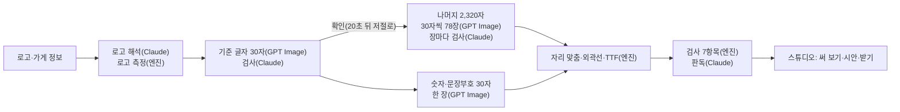

# 로고체 자세한 설명

[README](../README.md)에서 줄인 내용 중 꼭 필요한 부분만 모았습니다.

## 왜 만들었나

예비 청년 창업가가 브랜드를 기획해도 간판·메뉴판 글씨는 시공 업체의 기본 폰트로 채워집니다. 전용 서체를 외주로 맡기면 평균 120만 원쯤에 짧아도 15일이 걸립니다. 로고체는 로고를 폰트 파일로 넓혀 매장 글씨까지 브랜드가 이어지게 합니다.

### 현장에서 확인한 것

10/30 서울시 청년 창업 사업(로컬인서울) 팝업 부스의 다섯 팀(참여팀 창업자 4명, 팀 디자이너 1명)과 11/3 창업 교육 교수진 세 분을 만났습니다.

- 사진을 찍은 네 팀 모두 로고는 영문인데 한글은 기성 고딕·명조였습니다. 디자이너가 있는 팀도 같았습니다.
- 다섯 팀 중 세 팀은 팀 안에 디자이너가 없었습니다.
- 지원 흐름(로고·브랜딩 수업, 사업화 자금)에는 간판·메뉴판 글씨를 다루는 단계가 없었습니다.
- 사장님이 고를 수 있는 길은 기성 폰트(바로 쓰지만 옆 가게와 같을 수 있음)와 외주(77만–120만 원, 작업일 15일)였습니다. 로고체는 그 사이를 약 15분으로 메웁니다. 품질이 같다고 말하지는 않습니다.

### 아직 검증하지 못한 것

- 표본이 작고, 로컬인서울 팀은 브랜딩 수업을 받은 팀이라 일반 청년 창업보다 디자인 도움을 더 받는 쪽입니다.
- 지인에게 로고를 맡긴 팀을 빼면 디자이너 없는 팀은 5팀 중 2팀(40%)입니다.
- "네 팀 모두 기성 폰트"는 불편을 들은 것이 아니라 쓰는 모습을 본 관찰입니다. 한 창업자는 초기에는 무료 폰트로 충분하다고 했습니다.
- 답이 모인 질문은 로고를 누가 만들었는지, 교육에서 글씨를 다뤘는지, 쓸 의향이 있는지 세 가지뿐입니다. 돈을 낼 의향은 듣지 못했습니다.
- 첫 파일럿(참여팀 약 10팀 목표)에서 매장 글씨가 로고와 이어졌는지, 누가 돈을 냈는지, 얼마나 걸렸는지를 잽니다.

## 어떻게 만드나

**로고 글자는 폰트에 넣지 않습니다.** 로고 글자가 상용 폰트일 수 있어서, 로고는 굵기·분위기를 읽는 데에만 쓰고 글자는 모두 새로 그립니다.

1. **기준 글자 30자**
   - 기준 서체(Source Han Sans KR)로 30자를 6열×5행에 놓은 글자표를 견본으로 주고 한 장에 그리게 합니다.
   - 엔진이 칸을 자르면 Claude가 칸마다 그 글자로 읽히는지, 스타일이 맞는지 봅니다.
   - **닮음 가드**: 무료 폰트와 0.78 이상 닮으면 폰트를 만들기 전에 최대 두 번 다시 그립니다. 그래도 넘으면 가장 덜 닮은 안을 쓰고 점수를 기록에 남깁니다. 기준 글자 그림의 점수가 완성 폰트보다 낮게 나오는 경향이 있어서(시험에서 0.75대가 완성 뒤 0.86) 완성 폰트 기준(0.85)보다 낮게 잡았습니다.
2. **나머지 글자**
   - 확정한 기준 글자 그림을 스타일 견본으로 붙여 30자씩, 한 번에 8장씩 동시에 그립니다. 검사에서 떨어진 글자는 두 번 더 그립니다.
   - 숫자와 문장부호 30자는 따로 한 장에 그립니다.
3. **폰트로 바꾸기**
   - 한 장에서 나온 글자는 같은 배율로 키워 자리를 맞추고, 획 두께를 기준 글자에 맞춥니다.
   - vtracer로 외곽선을 따서 fontTools로 TTF를 만듭니다.
   - 끝내 못 그린 글자는 빠진 채로 만들고 "빠진 글자"로 알려 줍니다. 스튜디오에서 그 글자만 다시 그릴 수 있습니다.
4. **검사**
   - 엔진이 일곱 가지를 봅니다. 글자 세트, 깨진 글자, 문서 포함 허용, 이름·라이선스, 기기별 표시, 작은 크기·큰 크기 표시, 다른 폰트와의 닮음입니다. 그다음 Claude가 다른 글자로 읽히는 글자를 찾습니다.
   - 닮음은 무료 폰트 69개와 획 뼈대를 견줘 **0.85 미만**이어야 통과합니다. 0.85는 서로 다른 가족 2,329쌍의 점수(중앙값 0.40, 95%가 0.84 이하)를 재서 정했습니다.
   - 뼈대만 보는 선별 점수라서 따로 만든 본문용 고딕·명조끼리도 0.92–0.93이 나오고, 한 값으로 완벽하게 가르지는 못합니다.

## 실측

**지금 기본 설정**(이미지 모델 `gpt-image-2.5-sunburst`, 붐비면 flare, 품질 정밀)으로 2,350자 전체를 만드는 데 느낌을 고른 뒤 **약 13–18분**이 걸렸습니다(11/5–6 실측). 화면의 안내 문구는 여유를 두어 12–17분입니다.

정밀은 장당 출력 토큰이 약 2,200개로 표준(약 560개)의 약 4배라서, 처음 표준 품질로 쟀던 6.4분보다 오래 걸립니다. 단계별 시간과 비용은 아직 기록으로 남기지 못했습니다.

| 11/3 표준 품질 기록 | 결과 |
|---|---|
| 시간 | 약 6.4분 (나머지 글자 약 4.8분, 엔진 빌드 16초) |
| 호출과 비용 | 이미지 98회, 어림 약 4.6달러 |
| 품질 | TTF와 그린 그림의 겹침 평균 0.979(최소 0.969), 닮음 0.83(기준 0.85 미만이라 통과) |
| 검사 7항목 | 글자 세트만 실패(아래 한계 참고) |

자세한 기록은 [11/3 실측 기록](full-run-20261103.md)에 있습니다.

## 엔진을 바꿔 온 과정

가장 오래 고민한 것은 "AI가 그린 초안의 개성을 2,350자 끝까지 어떻게 지키느냐"였습니다.

| 시기 | 방식 | 결과 |
|---|---|---|
| 제출본 | 공개 폰트 50종으로 자소 기반 퓨샷 모델을 직접 학습 | 2주 안에 끝내기 어려웠고, 공개 모델은 로고의 개성을 평범한 손글씨체로 뭉갬 |
| 10/27–10/29 | GPT Image가 자소를 그리고 엔진이 2,350자로 조합 | 낱자를 자리에 맞추느라 늘어지고, 어느 가게든 비슷해짐 |
| 10/29 | 기준 글자 30자를 MX-Font++(공개 생성 모델)에 주어 2,350자 생성 | 획 끝 장식이 누그러지고, 크게 보면 가장자리가 울퉁불퉁함 |
| 10/30 | MX-Font를 작업마다 기준 글자로 다시 학습(약 50초) | 기준 글자에서 뺀 글자와의 겹침이 0.46–0.60에서 0.74–0.83으로 좋아졌지만 작은 장식은 여전히 뭉개짐 |
| **10/30 – 지금** | **GPT Image가 2,350자를 모두 그리고, 엔진은 외곽선만 땀** | 겹받침·쌍자음 같은 어려운 30자 시험에서 두 스타일 모두 전부 통과. 겹침 0.97–0.99, 획 끝 물결도 그대로 남음 |

MX-Font 코드와 가중치는 저장소에서 뺐습니다.

## 글자 다듬기

스튜디오에서 글자를 고르면 열리고, 저장하면 그 글자만 폰트 파일에 바로 바꿔 끼웁니다.

| 방식 | 하는 일 |
|---|---|
| 슬라이더 | 굵기·기울기·가로·세로·크기·위치를 숫자로 고칩니다 |
| 끌어서 바꾸기 | 네모 점을 끌어 크기·가로·세로를, 안쪽을 끌어 위치를 바꿉니다 |
| 부분 나누기 | 글자를 초성(빨강)·중성(파랑)·종성(초록)으로 나눠 그 부분만 끕니다. 어긋난 경계는 점선을 끌어 고치고, 같은 초성·중성·종성을 가진 모든 글자에 한꺼번에 적용할 수도 있습니다 |
| 직접 그리기 | 그림판으로 글자를 그리거나 고칩니다. 빠진 글자도 그려 채웁니다 |

고친 값은 AI가 정한 값 위에 더한 만큼만 저장하고, 이전 버전으로 되돌릴 수 있습니다(최대 100개). 고친 내용은 제작 기록에 남습니다.

## 한계와 남은 일

- 한글 74자(3.1%)는 끝내 그리지 못했습니다(11/3 표준 품질 기준). 일상 글자는 사실상 다 들어 있습니다.
- 아주 굵은 스타일에서 작은 크기 뭉침이 남아 있습니다(12px 시험에서 23자 중 3자).
- 남은 일: 결제, 이용 조건·개인정보 처리방침, 상용 폰트와의 비교, 현재 설정의 단계별 시간·비용 기록, 파일럿.
