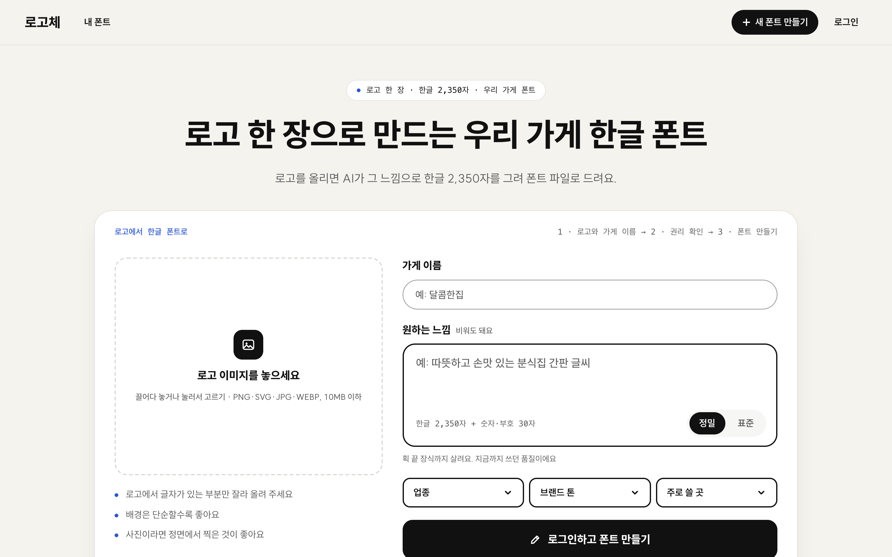
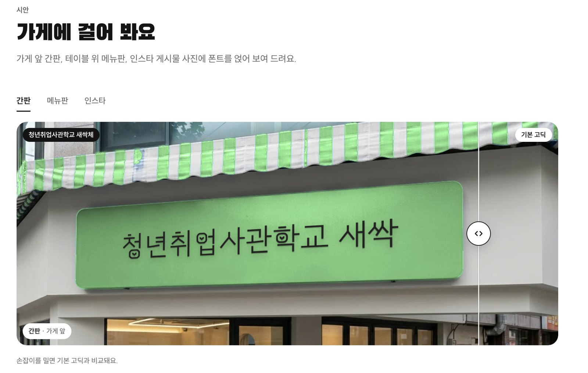
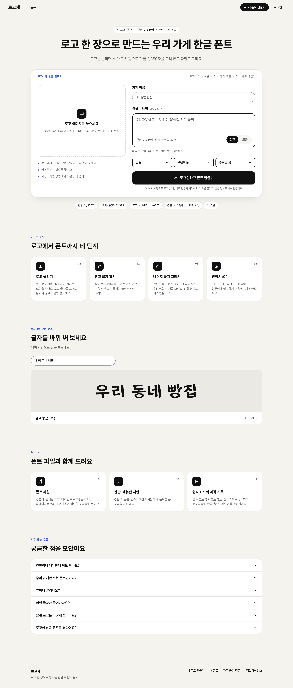
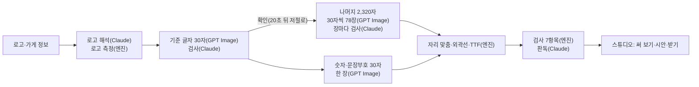

# 로고체 자세한 설명

> 짧게 정리한 소개는 [README](../README.md)에 있습니다. 이 문서는 README에서 줄인 내용을 그대로 모아 둔 것입니다.

가게 로고 한 장으로 그 가게만의 한글 폰트를 만드는 서비스입니다.

**사이트: https://logoche.my**

> 🏆 **2026 청년취업사관학교 AI 인재 페스티벌 우수 프로젝트 발표회 우수상** (서울특별시 주최, 2026.11.9) · 팀 **/eli30**



[볼 만한 점](#이-프로젝트에서-볼-만한-점) · [수상과 팀](#수상과-팀) · [왜 만들었나](#왜-만들었나) · [이렇게 씁니다](#이렇게-씁니다) · [어떻게 만드나](#어떻게-만드나) · [엔진을 바꿔 온 과정](#엔진을-바꿔-온-과정) · [직접 실행하기](#직접-실행하기) · [한계와 남은 일](#한계와-남은-일)

## 한눈에 보기

| 항목 | 내용 |
|---|---|
| 넣는 것 | 가게 로고 한 장과 가게 이름 |
| 받는 것 | 한글 2,350자(KS X 1001 완성형)와 숫자·문장부호 30자가 든 폰트 파일(TTF·OTF·WOFF2), 간판·메뉴판 시안, 권리 카드, 제작 기록 |
| 걸리는 시간 | 느낌을 고른 뒤 약 13~18분 (현재 기본 설정으로 2,350자 전체를 돌려 11/5~6에 잰 값). 처음 표준 품질로 쟀을 때는 6.4분이었습니다([실측 기록](full-run-20261103.md)) |
| 만드는 방식 | AI(GPT Image)가 글자를 모두 새로 그리고, 다른 AI(Claude)가 한 장씩 검사하고, 엔진이 폰트 파일로 묶습니다 |

### 시연 영상

[](https://youtu.be/T9JXQpk0VMo)

예시 가게 사장님이 로고 한 장을 올리고 폰트를 받아 직접 써 보기까지의 과정입니다. 해커톤 본선에서 틀었던 영상이고, 이미지를 누르면 YouTube로 넘어갑니다.

### 만든 결과 예시: 스튜디오 시안



'청년취업사관학교 새싹'이라는 예시 가게 이름으로 만든 폰트 '새싹체'(한글 2,350자)를 스튜디오의 간판 시안에 입힌 모습입니다. 손잡이를 밀면 기본 고딕과 비교됩니다. 간판 사진은 AI로 만들었고, 그 위의 글자는 만든 폰트를 그대로 얹었습니다. 청년취업사관학교의 공식 로고나 서체가 아니라, 시험으로 만든 예시입니다.

## 이 프로젝트에서 볼 만한 점

- **AI에게 맡길 일과 맡기지 않을 일을 나눴습니다.** 글자 그리기는 GPT Image, 그림을 보고 판단하는 일(로고 해석·글자 검사·판독)은 Claude가 맡습니다. 폰트 파일을 만들고 검사하는 엔진은 AI를 부르지 않습니다.
- **그림을 폰트로 바꾸는 과정을 직접 만들었습니다.** 한 장에 그린 글자를 같은 배율로 키워 자리를 맞추고, 획 두께를 맞춘 뒤, vtracer로 외곽선을 따서 fontTools로 TTF를 만듭니다. 만든 TTF와 원래 그림의 겹침은 평균 0.979입니다.
- **측정하고 한계도 적었습니다.** 2,350자 전체를 실제로 돌려 시간과 호출 횟수를 쟀습니다(11/3 표준 품질은 6.4분·이미지 98회, 지금 기본 설정은 13~18분). 끝내 채우지 못한 한글 74자(3.1%)도 [한계](#한계와-남은-일)로 남겼습니다.
- **권리 문제를 구조로 막았습니다.** 로고 글자는 폰트에 넣지 않고, 그리는 중과 다 그린 뒤 두 번 무료 폰트 69개와 획 뼈대를 견줘 닮으면 다시 그립니다. 사람이 고르거나 고친 것은 모두 제작 기록에 남습니다.
- **방식을 다섯 가지 거쳤습니다.** 직접 학습한 모델에서 시작해 지금의 "AI가 모두 그리고 엔진은 외곽선만 땁니다"에 이르기까지의 시도와 실패를 [표](#엔진을-바꿔-온-과정)로 정리했습니다.
- **사람이 손볼 수 있습니다.** 글자 다듬기 편집기에는 슬라이더, 끌어서 바꾸기, 초성·중성·종성을 따로 끄는 부분 나누기, 직접 그리기가 있습니다.
- **창을 닫아도 계속됩니다.** 작업은 서버에서 이어지고, 끊겨도 그린 글자는 그대로 두고 못 그린 글자만 다시 그립니다. AWS EC2 한 대에 올려 운영합니다.

## 수상과 팀

| 항목 | 내용 |
|---|---|
| 상 | **우수상** (총 상금 500만 원, 대상 1팀·최우수상 1팀·우수상 2팀 중) |
| 행사 | 『2026 청년취업사관학교 AI 인재 페스티벌』 우수 프로젝트 발표회, 서울특별시 주최. 해커톤 본선은 DDP 컨퍼런스홀에서 열렸습니다 |
| 일시 | 2026년 11월 9일 |
| 팀 | **/eli30** — 김용휘(팀장·기획·개발: 생성 엔진과 서버), 임낙원(디자인·프론트엔드: 브랜드와 화면). 둘 다 청년취업사관학교 교육 과정 중에 만들었습니다 |

서류 심사에서는 공개 폰트로 학습하는 방식을 냈습니다. 본선을 준비하는 동안 AI가 글자를 모두 그리는 지금 방식으로 바꿨고, 그 과정은 [엔진을 바꿔 온 과정](#엔진을-바꿔-온-과정)에 적었습니다.

## 왜 만들었나

예비 청년 창업가가 브랜드를 기획해도, 개업할 때 간판과 메뉴판 글씨는 시공 업체가 정합니다. 업체에는 로고만 넘어가고 나머지 글씨는 업체가 늘 쓰는 기본 폰트로 채워집니다. 전용 서체를 외주로 맡기면 평균 120만 원쯤 들고, 짧아도 15일이 걸립니다.

로고체는 로고를 전용 폰트 파일로 넓혀서, 기획한 브랜드가 매장 글씨까지 이어지게 합니다. 로고를 올려 폰트를 받기까지 15분 안에 끝내는 것이 목표입니다.

### 현장에서 확인한 것

만들기 전에 두 번 사람을 만났습니다.

| 언제 | 누구 | 방식 |
|---|---|---|
| 10/30 | 서울시 청년 창업 사업(로컬인서울) 팝업 부스의 다섯 팀(참여팀 창업자 4명, 팀 디자이너 1명) | 현장 인터뷰와 부스 사진 |
| 11/3 | 창업 교육 교수진 세 분 | 인터뷰 |

- **사진을 찍은 네 팀 모두 로고는 영문인데, 한글은 기성 고딕이나 명조였습니다.** 디자이너가 있는 팀도 같았습니다. 기성 폰트가 틀렸다는 뜻이 아니라, 로고에 들인 공이 한글에서 끊긴다는 관찰입니다.
- **다섯 팀 중 세 팀은 팀 안에 디자이너가 없었습니다.**
- **지원 흐름에도 이 칸이 비어 있었습니다.** 로고·브랜딩 수업부터 사업화 자금까지 이어지지만, 간판과 메뉴판 글씨를 다루는 단계는 없었습니다. 교수진은 로고는 쉬워졌지만 서체는 아직 어렵다고 했습니다.
- 사장님이 고를 수 있는 길은 기성 폰트(바로 쓰지만 톤만 맞추고 옆 가게와 같을 수 있음)와 외주(77만~120만 원, 작업일 15일) 두 가지였습니다. 로고체는 그 사이를 약 15분으로 메웁니다. 품질이 같다고 말하지는 않습니다. 로고체는 간판·메뉴판·SNS 제목용입니다.

**아직 검증하지 못한 것**

- **표본이 작습니다.** 로컬인서울 팀은 브랜딩 수업을 받은 팀이라 일반 청년 창업보다 디자인 도움을 더 받는 쪽입니다.
- **"디자이너 없음"은 기준에 따라 달라집니다.** 팀 안에 디자이너가 없는 것만 센 값이 5팀 중 3팀이고, 지인에게 로고를 맡긴 팀을 빼면 2팀(40%)입니다.
- **"네 팀 모두 기성 폰트"는 관찰입니다.** 불편을 들은 것이 아니라 쓰는 모습을 본 것이고, 한 창업자는 초기에는 무료 폰트로 충분하다고 했습니다.
- **답이 모인 질문은 세 가지뿐입니다.** 질문지는 7문항이었지만 대화로 흘러서, 로고를 누가 만들었는지, 교육에서 글씨를 다뤘는지, 쓸 의향이 있는지만 모였습니다.
- **돈을 낼 의향과 시점은 듣지 못했습니다.** 첫 파일럿(참여팀 약 10팀 목표)에서 매장 글씨가 로고와 이어졌는지, 누가 돈을 냈는지, 얼마나 걸렸는지와 함께 재려고 합니다.

## 이렇게 씁니다

1. 메인 화면에 로고를 올리고 가게 이름을 적습니다.
2. 질문 네 개에 답합니다. 업종, 가게 이야기(10자 이상), 원하는 글씨 모양, 로고의 권리입니다. 이 단계에서 구글 계정으로 로그인합니다. "○○체처럼" 같은 특정 폰트 요청은 받지 않습니다.
3. AI가 로고를 읽고, 가게 이름으로 그린 **견본 세 가지**를 보여 줍니다. 하나를 고르면 그 느낌으로 이어집니다.
4. 고른 느낌으로 **기준 글자** 30자를 먼저 그립니다. 마음에 안 드는 글자는 다시 그리게 할 수 있습니다.
   - 괜찮으면 나머지 한글과 숫자·문장부호·영문 대소문자를 그리고, 폰트 파일을 만들어 검사합니다.
   - 창을 닫아도 서버에서 계속 만들고, 단계마다 메일로 알려 줍니다.
5. 다 만들면 **스튜디오**에서 글자를 써 보고, 간판·메뉴판 시안을 보고, 글자를 다듬고, 파일을 받습니다.

| 화면 | 주소 | 하는 일 |
|---|---|---|
| 메인 | `/` | 민트색 접수증에 로고와 가게 이름을 넣고 시작합니다. 아래쪽에 만드는 순서, 로고체로 만든 폰트로 글자를 써 보는 칸, 받아서 쓰는 법, 쓸 수 있는 범위, 자주 묻는 질문이 있습니다 |
| 만드는 중 · 스튜디오 | `/fonts/[id]` | 만드는 동안에는 단계별 진행과 기준 글자 확인을 보여 주고, 다 만들면 같은 주소가 스튜디오가 됩니다. 스튜디오에는 써 보기, 간판·메뉴판·인스타 시안, 글자 표와 **글자 다듬기**, 문자 세트와 검사 결과, 쓸 수 있는 범위, 제작 기록이 있습니다 |
| 내 폰트 | `/fonts` | 만든 폰트 목록입니다. 찾기, 상태별 보기, 정렬, 즐겨찾기, 받기가 됩니다. 폰트는 만든 사람만 볼 수 있습니다 |

간판·메뉴판 시안은 실제 가게처럼 보이는 사진(AI로 만든 사진)에 로고 색을 칠하고, 만든 폰트의 진짜 글자를 원근에 맞춰 얹은 것입니다. 시안 속 글자는 AI가 그린 그림이 아닙니다.

### 글자 다듬기

AI가 그린 글자에 사람의 손을 더하는 편집기입니다. 스튜디오에서 글자를 고르면 열리고, 저장하면 그 글자만 폰트 파일에 바로 바꿔 끼웁니다.

| 방식 | 하는 일 |
|---|---|
| 슬라이더 | 굵기·기울기·가로·세로·크기·위치를 숫자로 고칩니다 |
| 끌어서 바꾸기 | 글자 둘레의 네모 점을 끌어 크기와 가로·세로를, 안쪽을 끌어 위치를 바꿉니다 |
| 부분 나누기 | 켜면 글자가 초성(빨강)·중성(파랑)·종성(초록) 덩어리로 나뉩니다. 덩어리를 눌러 그 부분만 끌 수 있고, 나뉜 자리가 어긋났으면 점선을 끌어 경계를 고칩니다. 같은 초성(중성·종성)을 가진 모든 글자에 한꺼번에 적용할 수도 있습니다 |
| 직접 그리기 | 그림판으로 글자를 직접 그리거나 고칩니다. 빠진 글자도 그려 채웁니다 |

고친 값은 AI가 정한 값 위에 더한 만큼만 저장하고, 이전 버전으로 되돌릴 수 있습니다(최대 100개). 사람이 고친 내용은 제작 기록에 남습니다.

<details>
<summary>메인 화면 전체 보기</summary>



</details>

## 어떻게 만드나

> **로고 글자는 폰트에 넣지 않습니다.** 로고 글자가 상용 폰트로 만들어졌을 수도 있기 때문입니다. 로고는 굵기·둥글기 같은 값을 재고 분위기를 읽는 데에만 쓰고, 폰트의 글자는 모두 새로 그립니다.

일은 셋으로 나뉩니다. 글자 그리기는 GPT Image가, 그림 보기(로고 해석·글자 검사·판독)는 Claude가 맡습니다. 엔진은 AI를 부르지 않고, 그린 그림을 폰트로 바꾸고 검사합니다.



1. **기준 글자 30자.**
   - 기준 서체(Source Han Sans KR)로 30자를 6열×5행에 놓은 그림(글자표)을 글자 모양과 칸 위치의 견본으로 주고, 한 장에 그리게 합니다. 30자는 자주 쓰는 음절과 쌍자음·복합 모음·받침이 든 글자로 골랐습니다.
   - 엔진이 글자 사이의 빈 띠를 찾아 칸을 자르면, Claude가 칸마다 그 글자로 읽히는지, 스타일이 맞는지 봅니다.
   - **닮음 가드**도 이 단계에서 돕니다. 기준 글자 30자가 무료 폰트와 0.78 이상 닮으면 폰트를 만들기 전에 최대 두 번 다시 그립니다. 그래도 넘으면 가장 덜 닮은 안을 쓰고 점수를 그대로 기록에 남깁니다.
   - 기준 0.78은 완성 폰트 기준(0.85)보다 낮습니다. 기준 글자 그림의 점수가 완성한 폰트보다 낮게 나오는 경향이 있기 때문입니다(시험에서 0.75대가 완성 뒤 0.86).
2. **나머지 글자.**
   - 확정한 기준 글자 그림을 스타일 견본으로 붙여 30자씩 그립니다. 가게 이름, 견본 문장, 자주 쓰는 글자 순서로 그리고, 한 번에 8장씩 동시에 그립니다.
   - 검사에서 떨어진 글자는 모아서 두 번 더 그립니다.
   - 숫자와 문장부호 30자(0~9 . , ! ? 등)는 따로 한 장에 그립니다.
3. **폰트로 바꾸기.**
   - 엔진(`drawn.py`·`build.py`)이 자른 그림을 폰트 틀에 놓습니다. 한 장에서 나온 글자는 같은 배율로 키워, 그린 글자끼리의 크기 차이를 그대로 살립니다.
   - 획 두께는 기준 글자에 맞추고, vtracer로 외곽선을 따서 fontTools로 TTF를 만듭니다.
   - 끝내 못 그린 글자는 빠진 채로 폰트를 만들고 "빠진 글자"로 알려 줍니다. 스튜디오에서 빠진 글자만 다시 그리게 할 수 있습니다.
4. **검사.** 엔진이 일곱 가지를 봅니다. 글자 세트, 깨진 글자, 문서 포함 허용, 이름·라이선스, 기기별 표시, 작은 크기에서 뭉치거나 큰 크기에서 속공간이 무너지지 않는지, 다른 폰트와 닮았는지입니다. 그다음 Claude가 글자를 읽어 다른 글자로 읽히는 것을 찾습니다.
   - 닮은 정도는 무료 폰트 69개와 획 뼈대를 견줘 **0.85 미만**이어야 통과합니다.
   - 0.85는 비교 폰트 69개(52가족)에서 서로 다른 가족 2,329쌍의 점수를 재서 정했습니다(중앙값 0.40, 95%가 0.84 이하).
   - 뼈대만 보는 선별 점수라서 따로 만든 본문용 고딕·명조끼리도 0.92~0.93이 나오고, 한 값으로 완벽하게 가르지는 못합니다.

### 실측

**지금 기본 설정.** 이미지 모델은 `gpt-image-2.5-sunburst`(붐비면 flare로 넘어감), 그리기 품질은 정밀(high)입니다. 이 설정으로 2,350자 전체를 만드는 데 느낌을 고른 뒤 **약 13~18분**이 걸렸습니다(11/5~6 실측). 화면의 안내 문구는 여유를 두어 12~17분이라고 적었습니다.

11/3에는 표준으로 쟀지만, 지금은 그리기 수준을 고르는 화면을 없애고 정밀만 씁니다. 정밀은 장당 출력 토큰이 약 2,200개로, 표준(약 560개)의 약 4배입니다. 그만큼 오래 걸려서 전체 시간이 6.4분에서 13~18분으로 늘었습니다. 단계별 시간과 비용은 아직 11/3처럼 기록으로 남기지 못했습니다.

<details>
<summary>11/3 표준 품질 단계별 기록과 비용 보기</summary>

**처음 기록 (11/3, 표준 품질).** 정밀로 올리기 전에 표준(medium)으로 2,350자 전체를 돌려 단계별로 잰 값입니다. 단계별 구성을 보여 주려고 남겨 둡니다.

| 항목 | 결과 |
|---|---|
| 처음 만들기 | 약 6.4분. 로고 읽기 5초, 기준 글자 46초, 확인 대기 20초, 나머지 글자 약 4.8분(글자표 장당 중앙값 13.5초), 엔진 빌드 16초, 검사·판독 10초 |
| 호출과 비용 | 이미지 98회, 어림 약 4.6달러. Claude 94회는 토큰으로만 쟀습니다(입력 29만·출력 14만). 단가는 어림이라 실제 청구액은 콘솔로 확인해야 합니다 |
| 끊긴 뒤 이어서 만들기 | 그린 글자는 그대로 쓰고 못 그린 글자만 다시 그립니다. 이번 실측도 한 번 끊겨 이어서 만들었습니다 |
| 엔진 빌드 | 2,288자의 외곽선 따기와 저장에 16초 |
| 품질 | TTF와 그린 그림의 겹침 평균 0.979(최소 0.969). 닮은 폰트 검사 0.83(기준 0.85 미만이라 통과). 스타일 검사로 다시 그린 글자는 0자 |
| 검사 7항목 | 글자 세트만 실패 (아래 한계 참고) |

자세한 내용은 [실측 기록](full-run-20261103.md)에 있습니다.


</details>

## 엔진을 바꿔 온 과정

가장 오래 고민한 것은 "AI가 그린 초안의 개성을 2,350자 끝까지 어떻게 지키느냐"였습니다.

| 시기 | 방식 | 결과 |
|---|---|---|
| 제출본 | 공개 폰트 50종으로 자소 기반 퓨샷 모델을 직접 학습 | 2주 안에 학습까지 끝내기 어려웠고, 공개 모델은 로고의 개성을 평범한 손글씨체로 뭉갬 |
| 10/27~10/29 | GPT Image가 자소(초성·중성·종성)를 그리고 엔진이 2,350자로 조합 | 낱자를 놓일 자리에 맞추느라 늘어지고, 배치가 기준 서체 그대로라 어느 가게든 비슷해짐 |
| 10/29 | 기준 글자 30자를 MX-Font++(공개 생성 모델)에 주어 2,350자 생성 | 굵기와 비례는 따라오지만 획 끝 말림 같은 장식이 누그러지고, 크게 보면 가장자리가 울퉁불퉁함 |
| 10/30 | MX-Font를 작업마다 기준 글자로 다시 학습(약 50초) | 기준 글자에서 뺀 글자와의 겹침이 0.46~0.60에서 0.74~0.83으로 좋아졌지만, 작은 장식은 여전히 뭉개짐 |
| **10/30 ~ 지금** | **GPT Image가 2,350자를 모두 그리고, 엔진은 외곽선만 땀** | 겹받침·쌍자음처럼 짜임이 어려운 30자 시험에서 두 스타일 모두 30자 전부 통과. TTF와 그린 그림의 겹침 0.97~0.99, 획 끝 물결도 그대로 남음 |

MX-Font 코드와 가중치는 저장소에서 뺐습니다.

## 화면 디자인

<details>
<summary>디자인 원칙과 접근성 기준 보기</summary>

- Claude Design에서 정한 'Logoche Final' 시안에서 출발했고(원본은 `design-import/`), 11/6에 화면 전체를 한 번 더 정리했습니다(과정은 [`docs/design-1106/`](design-1106/)).
- 기본 바탕은 흰색입니다. 큰 민트 면은 접수(메인 첫 화면)·만드는 중·완성 순간에만 쓰고, 고르거나 정하는 화면은 늘 흰 바탕입니다. 민트 위 글자는 항상 검정이고, 흰 바탕에는 민트 글자와 민트 버튼을 쓰지 않습니다.
- 본문 글꼴은 SUIT, 큰 제목은 Black Han Sans입니다. 로고는 글꼴이 아니라 SVG로 넣습니다.
- Apple Human Interface Guidelines를 기준으로 검토해 반영했습니다.
  - 글자 크기는 rem 단위라 브라우저의 글자 크기 설정을 따릅니다.
  - 화면 폭이 1,800px를 넘으면 화면 전체가 비율 그대로 커집니다. 큰 모니터에서 양옆 여백만 넓어지지 않게 하려는 것입니다.
  - 고른 선택지는 두꺼운 테두리와 체크로 보여 주고, 검정 채움은 누르는 버튼에만 씁니다.
  - 휴대폰에서는 점을 누르는 범위를 44px 이상으로 잡았습니다.
- 밝은 화면만 씁니다. 어두운 모드를 넣어 봤더니 글자 그림과 시안만 흰 종이처럼 남아 어색해서 뺐습니다.

</details>

## 기술 스택

| 부분 | 쓰는 것 |
|---|---|
| 웹 | Next.js 16(App Router), React 19, TypeScript, Tailwind CSS 4, zod |
| 로그인 | Better Auth(구글 로그인), Node 내장 SQLite |
| AI | OpenAI GPT Image `gpt-image-2.5-sunburst`(그리기, 붐비면 `gpt-image-2.5-flare`로 넘어감), Anthropic Claude `claude-opus-5-5`(로고 해석·글자 검사·판독). 키는 웹 서버에서만 읽습니다 |
| 엔진 | Python 3.12, FastAPI, fontTools, vtracer, OpenCV, skia-pathops, FreeType, uv |
| 배포 | AWS EC2 한 대(서울)에 웹과 엔진을 함께 올리고, Caddy가 HTTPS를 맡습니다 |
| 기준 서체 | Source Han Sans KR 1.001(Apache License 2.0). 글자표를 만들고 크기·자리를 맞추는 데에만 쓰고, 이 서체의 외곽선은 만든 폰트에 들어가지 않습니다 |

## 폴더 구조

<details>
<summary>폴더별 내용 보기</summary>

| 폴더 | 내용 |
|---|---|
| [`web/`](../web/README.md) | 화면과 API 라우트. 설정, API 목록, 모의 응답 모드는 이 폴더의 README에 있습니다 |
| `web/lib/server/` | AI 호출과 작업 진행. 폰트 작업 단계 `projects.ts`, 기준 글자 `glyphs.ts`, 나머지 글자 `rest.ts`, 빌드 `build.ts`, 로그인 `auth.ts` |
| [`engine/`](../engine/README.md) | Python 서버. 엔진 API와 검사 기준값은 이 폴더의 README에 있습니다 |
| `engine/logoche_engine/` | 로고 측정 `measure.py`, 글자표 `sheets.py`, 자리 맞추기·외곽선 `drawn.py`, TTF `build.py`, 검사 `checks.py` |
| [`deploy/`](../deploy/README.md) | 서버 설치·갱신 스크립트 |
| [`design.md`](../design.md) | 화면 설계와 날짜별 결정 기록 |
| `design-import/` | 화면 디자인 원본 |
| `docs/` | 이 문서에 쓴 화면 캡처와 실측 기록 |

예전 여섯 단계 화면(`/style`·`/draft`·`/build`·`/kit`·`/download`)은 파일만 남아 있고 연결은 끊었습니다. 예전 새 폰트 만들기 주소 `/new`로 들어오면 메인으로 넘어갑니다.

</details>

## 직접 실행하기

Python 3.12와 [uv](https://docs.astral.sh/uv/), Node.js 24가 필요하고, 터미널 두 개를 씁니다.

```bash
git clone https://github.com/poongbit/logoche.git
cd logoche

# 1. 엔진 (터미널 하나)
cd engine
uv sync
uv run python scripts/fetch_compare_fonts.py   # 처음 한 번: 닮은 폰트 검사에 쓸 무료 폰트 받기
uv run uvicorn logoche_engine.main:app --port 8000 --reload

# 2. 웹 (다른 터미널에서 logoche 폴더로 가서)
cd web
cp .env.example .env.local   # AI 키 두 개와 구글 로그인 키를 채운다
npm install
npm run dev                  # http://localhost:3000
```

- 폰트를 만들려면 로그인해야 합니다. 구글 OAuth 클라이언트(리디렉션 URI `http://localhost:3000/api/auth/callback/google`)와 `BETTER_AUTH_SECRET`이 필요합니다. 자세한 내용은 `web/.env.example`에 있습니다.
- 키 없이 화면만 보려면 `web/.env.local`에 `LOGOCHE_MOCK=1`을 넣습니다. 모의 응답을 쓰므로 엔진도 켜지 않아도 됩니다.
- 닮은 폰트 검사용 폰트는 저장소에 넣지 않았습니다. 위 명령은 Google Fonts의 한글 폰트 47개 파일만 받습니다. 나머지 20개 파일(Pretendard·SUIT 등)은 목록만 `engine/compare/free/local-fonts.json`에 있어서, 필요하면 직접 받아 `engine/compare/free/`에 넣습니다.
- 싸게 시험하려면 `GLYPH_REST_LIMIT=90`처럼 폰트에 넣을 글자 수를 줄입니다. 자주 쓰는 글자만 그리는 대신 글자 세트 검사는 떨어집니다.
- 나머지 설정도 `web/.env.example`에 있습니다.

## 배포

https://logoche.my 는 AWS EC2 한 대(서울)에서 돌아갑니다. Vercel 같은 서버리스에는 올리지 않았습니다. 작업 파일을 서버 디스크에 쓰고, 폰트 한 벌을 서버에서 몇 분 동안 쉬지 않고 만들기 때문입니다.

코드를 바꾼 뒤에는 main에 푸시하고 서버에서 `deploy/update.sh`를 돌립니다. 처음 설치하는 방법은 [`deploy/README.md`](../deploy/README.md)에 있습니다.

## 권리와 라이선스

- 만든 폰트는 SIL Open Font License 1.1로 냅니다. 가게에서 상업적으로 쓸 수 있고, 폰트 파일만 따로 팔지는 않습니다. AI로 만들었다는 표시는 폰트의 이름 정보와 권리 카드에 넣습니다.
- "○○체 느낌으로"처럼 특정 서체를 따라 해 달라는 요청은 받지 않습니다.
- 닮은 폰트 검사는 비슷한 폰트를 걸러 내는 선별 검사일 뿐, 권리를 보증하지는 않습니다.
- 자료별 출처와 라이선스는 [`engine/LICENSE-NOTES.md`](../engine/LICENSE-NOTES.md)에 정리해 두었습니다.
- 이 저장소 코드의 라이선스는 아직 정하지 않았습니다.

## 한계와 남은 일

**알려진 한계**

- **빠진 한글 74자(3.1%).** 11/3 전체 실측에서 처음엔 한글 83자(3.5%)와 숫자 0~8이 빠졌습니다. 숫자는 그림 지시문의 표기(`1.0 2.1 …`을 소수·분수로 읽음)를 고쳐 해결했습니다. 한글은 빠진 글자만 다시 그린 뒤에도 74자를 채우지 못했습니다(글자표 방식, 한 글자씩 그리기 모두 실패, [실측 기록](full-run-20261103.md) 8·9장). 160만 자 말뭉치에서 출현이 2회뿐인 글자들이라 일상 글자는 사실상 다 들어 있지만, 한계로 남깁니다. 이 기록은 표준 품질 기준입니다.
- 아주 굵은 스타일에서 작은 크기 뭉침이 남아 있습니다(12px로 쓰는 시험에서 23자 중 3자가 뭉침).

**남은 일**

- 지금 설정(sunburst·정밀)의 단계별 시간과 비용을 11/3처럼 기록으로 남기기, 다른 로고로도 재기(11/3에는 표준 품질·로고 한 장만 쟀음)
- 글자표 요청이 동시에 몰릴 때 엔진이 500을 내는 경합 의심 확인(재현 못 해 고치지 않음)
- 만든 폰트의 라이선스를 OFL로 계속 둘지 다시 정하기(OFL로 정한 이유였던 MX-Font를 뺐음)
- 상용 폰트도 닮은 폰트 검사 대상에 넣기(`engine/compare/commercial/`이 비어 있음). 상용 폰트는 파일을 합법적으로 확보해야 비교할 수 있어서 아직 못 합니다
- 고객이 만든 폰트끼리도 비교하기(만든 서체의 지문을 남겨 견줌)
- 결제(크레딧 충전 방식)
- 이용 조건·개인정보 처리방침 화면(구글 로그인 동의 화면을 게시하려면 필요)
- 인스타 시안을 실제 사진으로 바꾸기, 메인에 진열할 폰트 늘리기(지금 1개)

## 더 읽을 문서

이 문서는 2026-11-12 기준입니다. 화면 설계와 날짜별 결정은 [`design.md`](../design.md)에 있습니다. 예전 기획서(10/29 기준)와 화면 안내서는 지금 방식과 맞지 않아 저장소에서 정리했습니다(2026-11-12, 커밋 `b4fe062`까지의 기록에서 볼 수 있습니다).
