# 로고체 사용 안내서 (화면으로 보는 이용 과정)

2026년 11월 4일 기준으로 만들어진 기능을 정리했습니다. 사용자가 로고 한 장을 올리고 한글 폰트 파일을 받기까지의 과정을 화면과 함께 순서대로 설명합니다.

> **화면에 대해**
> - 1~5번 화면(입력 질문)은 실제 앱을 띄워 직접 눌러 보며 찍었습니다.
> - 6번 이후는 이미 만들어 둔 '냥치체' 예시 데이터로 같은 화면을 띄워 찍었습니다. 글자와 그림은 실제로 그린 것입니다.
> - 서버에는 https://logoche.my 로 올라가 있습니다.

---

## 한눈에 보기

로고체는 **로고 이미지 한 장과 몇 가지 질문**으로 우리 가게만의 한글 폰트를 만들어 주는 서비스입니다.

```
[메인]  로고 + 가게 이름
   ↓
[질문 4번]  업종 → 사업 내용 → 글씨 모양 고르기 → 로고 권리
   ↓              (여기서 구글 로그인)
[AI가 로고를 읽음]  약 1분
   ↓
[견본 고르기]  세 가지 느낌 중 하나 고름
   ↓
[30자 그리기]  1~2분   →   결과를 보고 "이어서 그릴지" 정함
   ↓
[나머지 글자 그리기]  약 6분   (한글 2,350자 + 숫자·부호 30자)
   ↓
[폰트 파일 만들기·검사]  자동
   ↓
[완성: 스튜디오]  써 보기 · 시안 · 글자 다듬기 · 폰트 받기
```

- 직접 하는 일: 입력·고르기·결정 (위 그림에서 메인, 질문, 견본 고르기, 이어서 그릴지 정하기, 완성 뒤)
- 서버가 알아서 하는 일: 로고 읽기, 글자 그리기, 파일 만들기, 검사
- **창을 닫아도 서버가 계속하거나 기다립니다.** 견본이 나왔을 때, 30자가 나왔을 때, 완성됐을 때 메일로 알려 드립니다.
- 걸리는 시간 합계: 약 10분 안팎 (사용자가 고르는 시간 제외)

---

## 1단계. 메인 화면: 로고와 가게 이름만 넣기

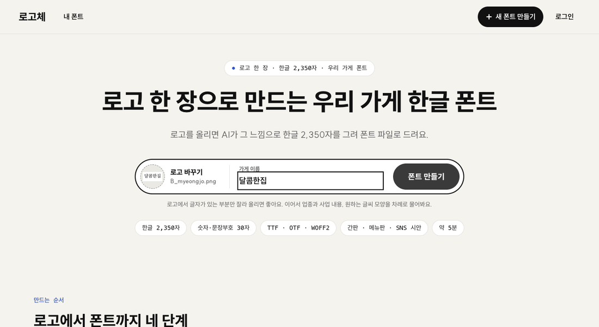

**무엇을 하나요?**
- 왼쪽 동그란 칸에 **로고 이미지**를 올립니다. 눌러서 고르거나, 화면 어디든 끌어다 놓아도 됩니다.
- **가게 이름**을 적습니다.
- 검은 **폰트 만들기** 버튼을 누릅니다.

**알아두세요**
- 이 화면에서 받는 것은 이 두 가지뿐입니다. 나머지는 다음 질문 화면에서 한 가지씩 물어봅니다.
- 로고나 이름이 비어 있으면 빠진 것을 알려 줍니다.
- 올릴 수 있는 파일: PNG, SVG, JPG, WEBP (10MB 이하)
- 로고에서 **글자가 있는 부분만 잘라서** 올리면 더 잘 읽어요.

---

## 2단계. 질문 4개에 답하기

버튼을 누르면 질문 화면으로 넘어갑니다. **한 화면에 한 가지씩**, 모든 질문이 필수입니다(건너뛰기 없음). 답을 정해야 **다음** 버튼이 켜집니다. 위쪽 진행 표시는 `가게 → 느낌 → 권리 → 견본 → 만들기` 다섯 칸입니다.

### 질문 ① 업종

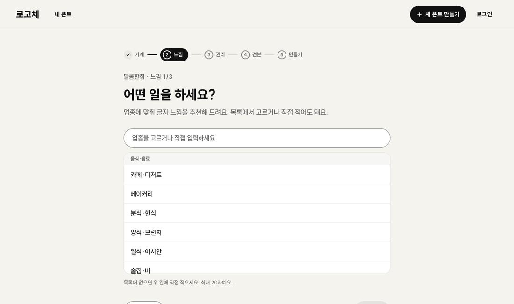

- 칸을 누르고 **목록을 스크롤**해서 고릅니다. (음식·음료 / 가게·서비스 / 배움·전문·여행 / 그 밖에)
- 목록에 없으면 위 칸에 **직접 적어도** 됩니다. 적는 동안 목록이 좁혀집니다.

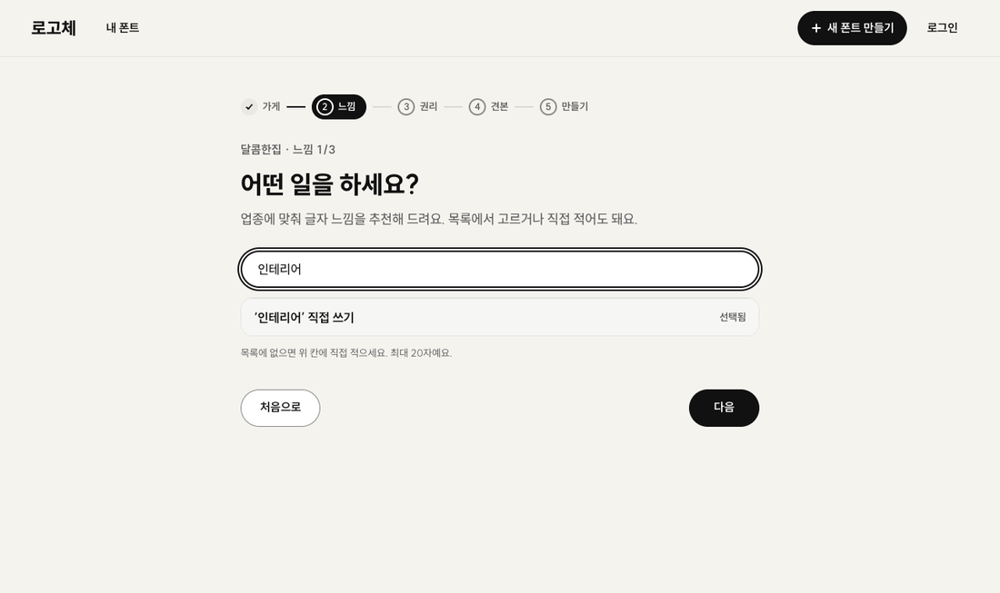

### 질문 ② 사업 내용

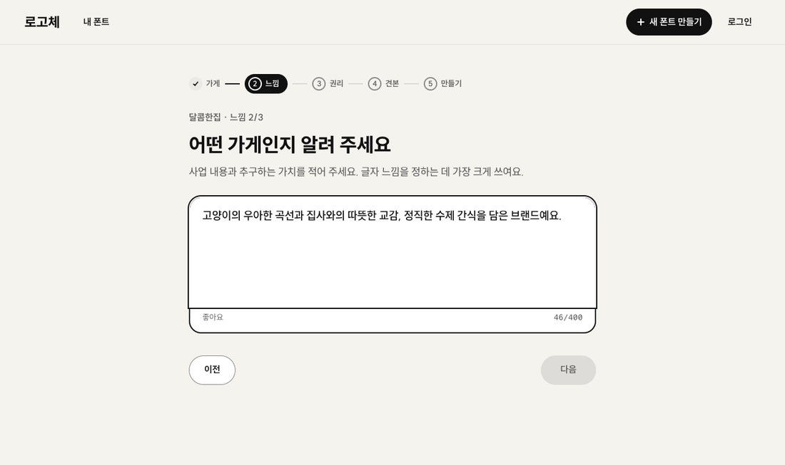

- 어떤 가게인지, 무엇을 소중하게 생각하는지 **10자 이상** 적습니다.
- 이 글이 글자 느낌을 정하는 데 **가장 크게** 쓰입니다. 길고 구체적으로 적을수록 좋습니다.
- "○○체처럼" 같은 **특정 폰트를 따라 하는 요청은 받지 않습니다.** "둥글고 통통한"처럼 모양을 말로 적어 주세요.

### 질문 ③ 글씨 모양 고르기

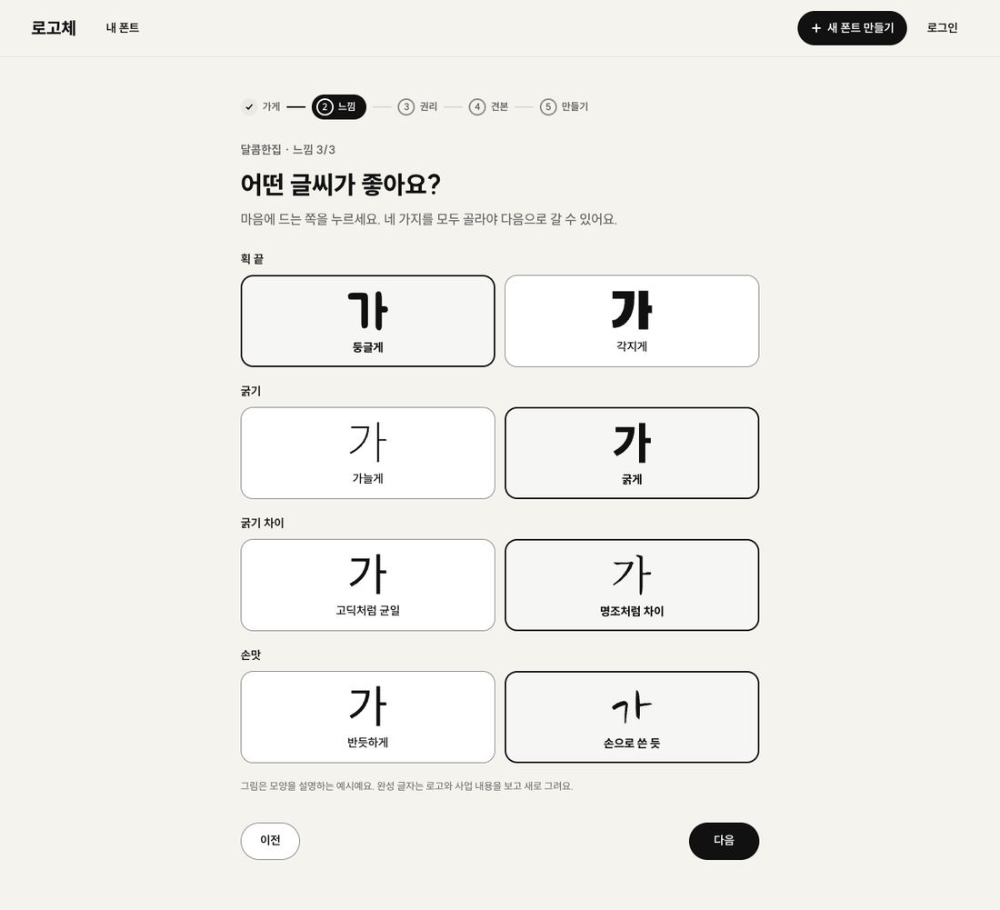

같은 글자 '가'를 두 가지 방식으로 보여 줍니다. 마음에 드는 쪽을 누르세요. **네 가지 모두** 골라야 다음으로 갑니다.

| 묻는 것 | 선택지 |
|---|---|
| 획 끝 | 둥글게 / 각지게 |
| 굵기 | 가늘게 / 굵게 |
| 굵기 차이 | 고딕처럼 균일 / 명조처럼 차이 |
| 손맛 | 반듯하게 / 손으로 쓴 듯 |

- 그림은 모양을 설명하는 **예시**입니다. 완성 글자는 로고와 사업 내용을 보고 새로 그립니다.
- 여기서 고른 값은 AI가 **반드시 따릅니다.** 이 때문에 세 가지 견본이 비슷한 결로 나올 수 있어요.
- 글자 폭, 기울기, 글자 사이 간격은 묻지 않습니다. AI가 정하고, 완성 뒤 다듬기에서 고칠 수 있습니다.

### 질문 ④ 로고 권리

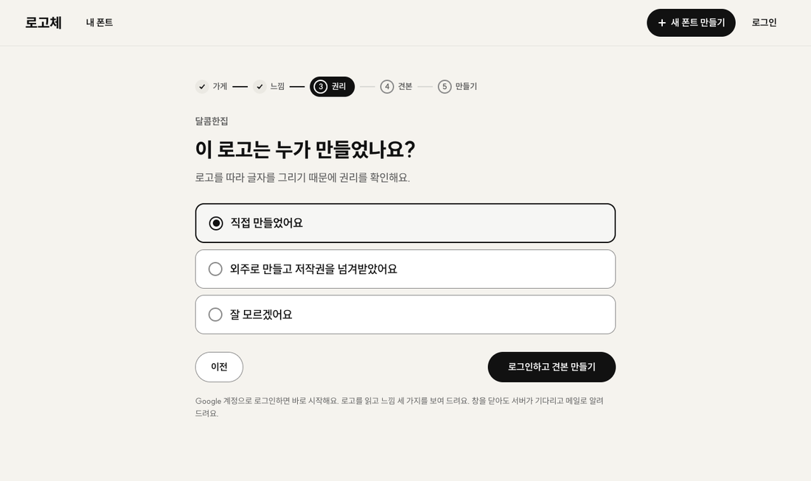

- 로고를 누가 만들었는지 고릅니다. (직접 만듦 / 외주로 만들고 저작권을 넘겨받음 / 잘 모름)
- "잘 모르겠어요"를 골라도 진행할 수 있습니다. 다만 폰트를 쓰기 전에 로고 권리를 확인하라고 안내합니다.
- 로그인하지 않았다면 버튼이 **로그인하고 견본 만들기**로 바뀝니다. 누르면 구글 로그인으로 갔다가 **돌아와서 바로 시작**합니다. 그때까지 입력한 내용은 그대로 남습니다.

### 휴대폰에서는

| 업종 | 글씨 모양 | 견본 고르기 | 완성 화면 |
|---|---|---|---|
| 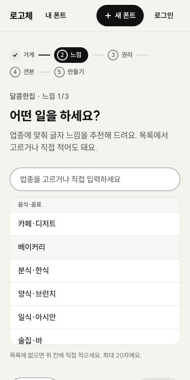 | 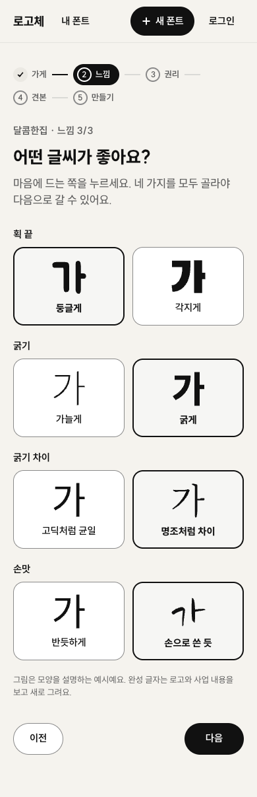 | 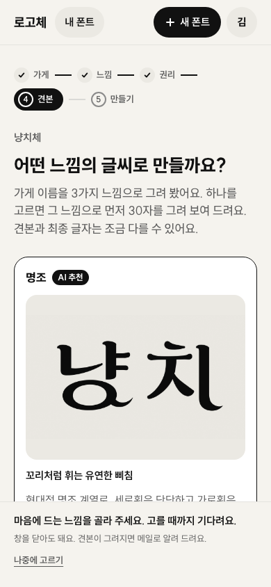 | 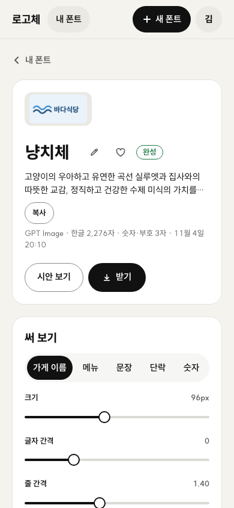 |

휴대폰에서는 선택지가 두 칸씩 접히고, 버튼은 아래에 하나씩 쌓입니다.

---

## 3단계. 로그인

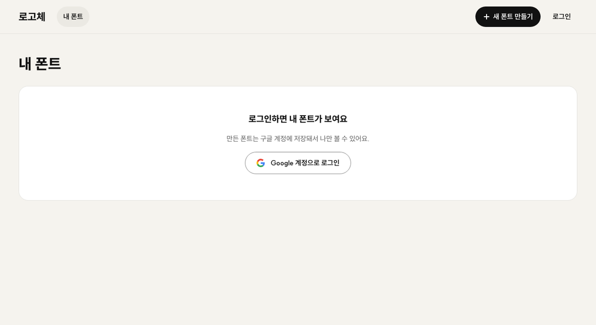

- **구글 계정**으로만 로그인합니다. 별도 가입은 없습니다.
- 로그인하지 않은 상태로 **내 폰트** 화면을 열면 위와 같은 안내가 나옵니다.
- 카카오톡 같은 앱 안 브라우저에서는 구글이 로그인을 막아서, 다른 브라우저로 열라고 안내합니다.

---

## 4단계. AI가 로고를 읽는 중 (약 1분)

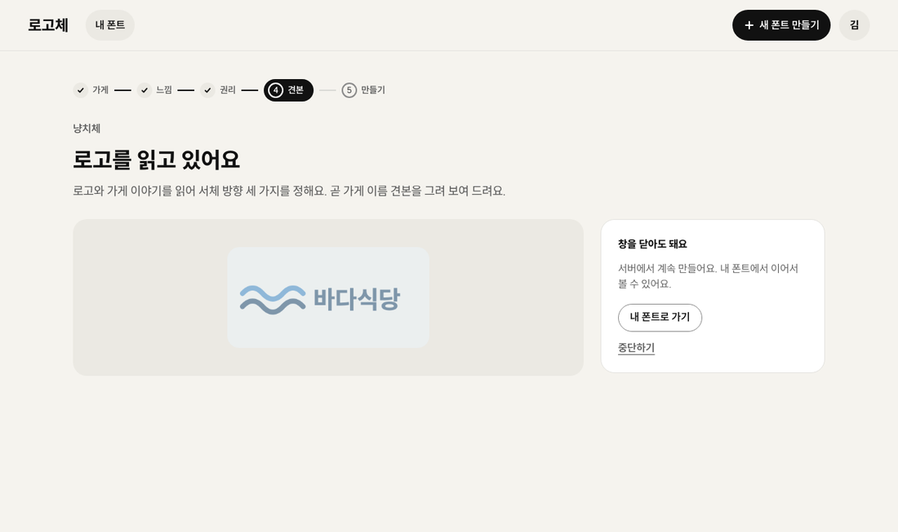

- 로고 그림과 입력한 내용을 AI(Claude)가 읽고 **서체 방향 세 가지**를 정합니다.
- 그다음 가게 이름을 그 세 방향으로 그려 견본을 만듭니다.
- **창을 닫아도 됩니다.** 견본이 나오면 메일로 알려 드려요.

---

## 5단계. 견본 고르기: 세 가지 느낌 중 하나

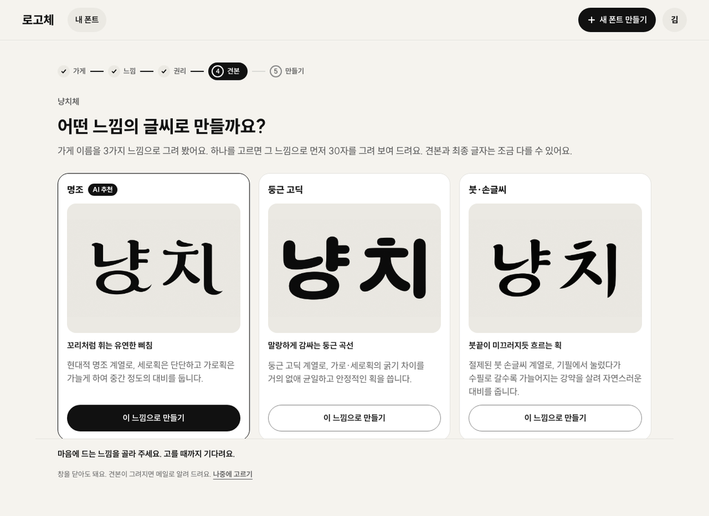

- 가게 이름을 **세 가지 느낌**으로 그려 보여 줍니다. (예: 명조 / 둥근 고딕 / 붓·손글씨)
- 가장 어울린다고 AI가 본 것에 **AI 추천** 표시가 붙고 맨 앞에 옵니다.
- 카드마다 **굵기**(가는 / 보통 / 굵은 등)가 함께 적혀 있습니다.
- 마음에 드는 카드의 **이 느낌으로 만들기**를 누릅니다.
- **저절로 골라지지 않습니다.** 고를 때까지 서버가 기다립니다.
- 견본은 느낌을 보여 주는 시안이라 **최종 글자와 조금 다를 수 있습니다.**

---

## 6단계. 참고 글자 30자 그리기 (1~2분)

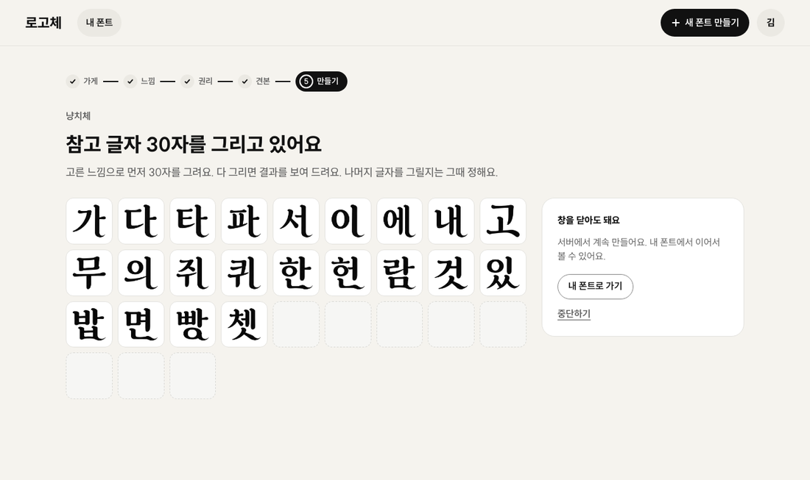

- 고른 느낌으로 **먼저 30자**를 그립니다. 한 글자씩 채워집니다.
- 이 30자가 나머지 글자의 **본보기**가 됩니다.
- 그리는 중에 **중단하기**를 누를 수 있습니다.

---

## 7단계. 30자를 보고 "이어서 그릴지" 정하기

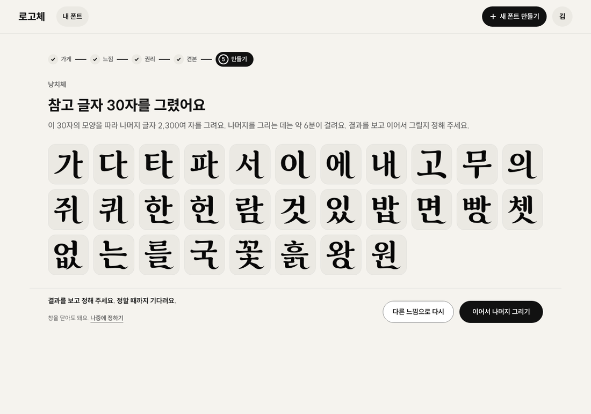

나머지 글자 약 2,300자를 그리는 데 **약 6분과 비용**이 들어서, 30자를 보고 사용자가 정합니다. 저절로 넘어가지 않고 정할 때까지 기다립니다.

| 버튼 | 하는 일 |
|---|---|
| **이어서 나머지 그리기** | 이 느낌 그대로 나머지 글자를 그립니다. |
| **다른 느낌으로 다시** | 견본 세 가지로 돌아가 다른 느낌을 고릅니다. (그린 30자는 지움) |
| **고른 글자 다시 그리기** | 마음에 안 드는 글자를 눌러 골라서 그 글자만 다시 그립니다. (글자마다 1번) |
| **나중에 정하기** | 창을 닫아도 됩니다. 나중에 내 폰트 목록에서 이어갑니다. |


---

## 8단계. 나머지 글자 그리기 (약 6분)

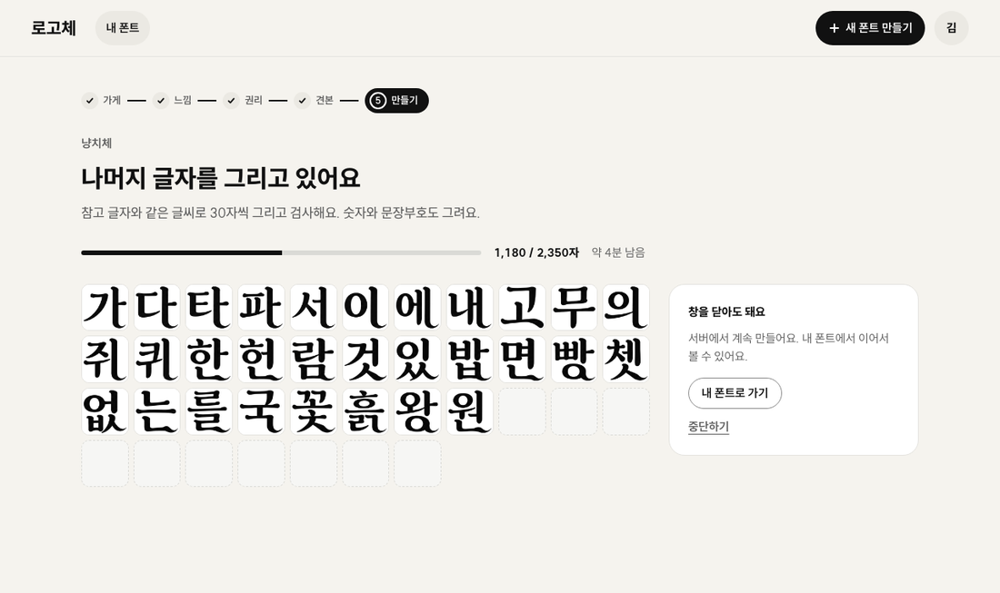

- 한글 **2,350자**와 숫자·문장부호 **30자**를 30자씩 그리고 검사합니다.
- 그린 글자가 판에 채워지고, 남은 시간이 표시됩니다.
- **창을 닫아도 됩니다.** 서버가 계속 만들고, 끝나면 메일로 알려 드립니다.

---

## 9단계. 폰트 파일 만들기·검사 (자동)

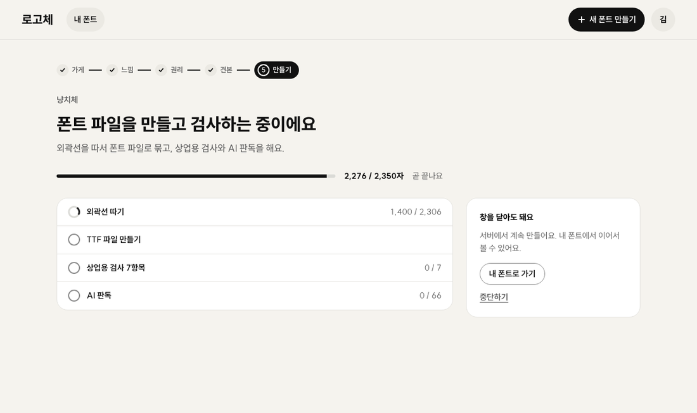

그린 글자를 폰트 파일로 묶는 마지막 단계입니다. 아래 네 가지를 차례로 합니다.

1. **외곽선 따기**: 그림 글자를 폰트용 선으로 바꿉니다.
2. **TTF 파일 만들기**
3. **상업용 검사 7항목**: 글자 빠짐, 깨진 글자, 라이선스 정보, 다른 폰트와 닮았는지 등
4. **AI 판독**: 글자가 올바로 읽히는지 확인합니다.

---

## 10단계. 완성: 스튜디오

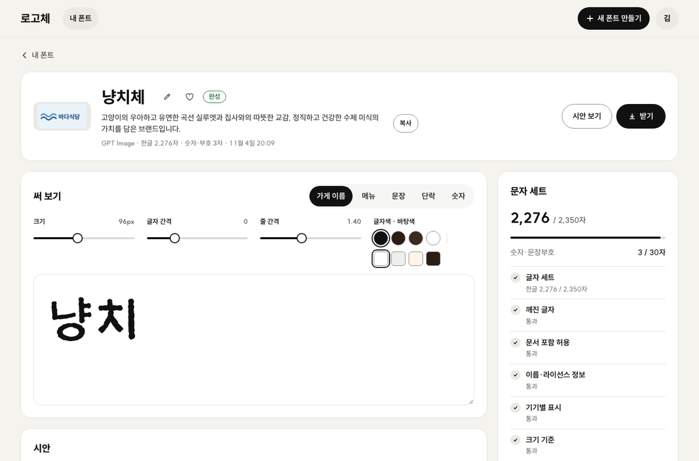

폰트가 완성되면 이 화면이 열립니다. 할 수 있는 일은 다음과 같습니다.

- **써 보기**: 직접 글을 쳐서 내 폰트로 어떻게 보이는지 봅니다. (가게 이름 / 메뉴 / 문장 / 단락 / 숫자) 크기, 글자 간격, 줄 간격, 글자색, 바탕색도 바꿀 수 있어요.
- **문자 세트**: 글자가 몇 자 들어갔는지, 검사 7항목이 통과했는지 봅니다.
- **시안 보기**: 아래에서 설명합니다.
- **받기**: 아래에서 설명합니다.

### 시안: 실제 사진 위에서 보기

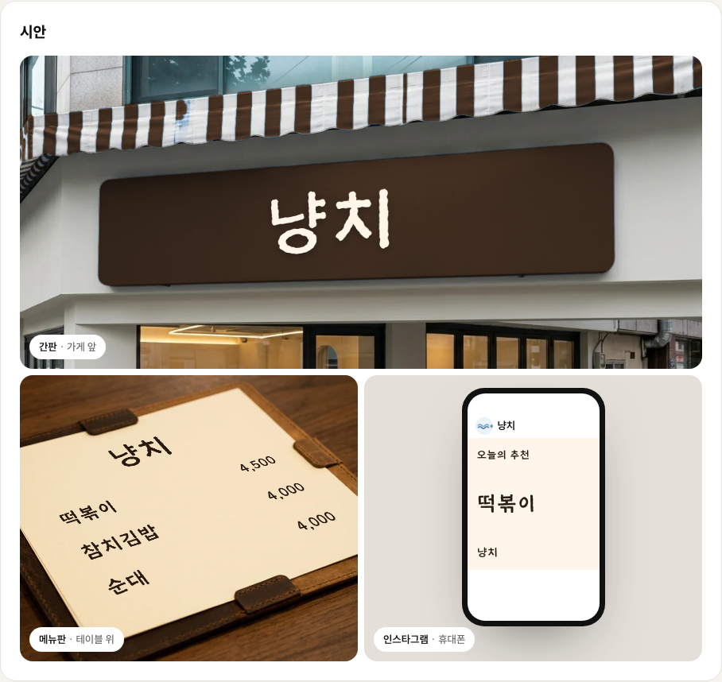

간판, 메뉴판, 인스타그램 화면에 **내 폰트가 쓰인 모습**을 미리 봅니다. 로고 색으로 칠하고, 실제 폰트로 글자를 얹어 만듭니다.

### 글자 다듬기

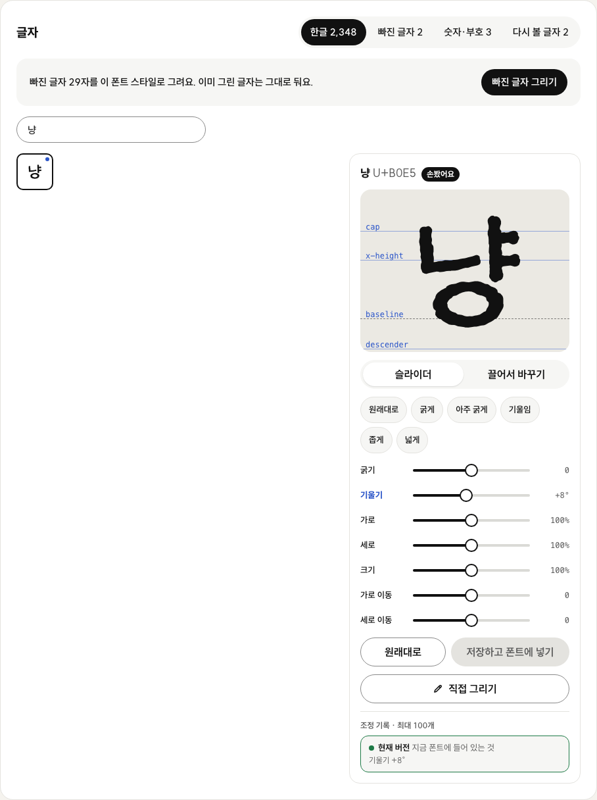

마음에 안 드는 글자를 **직접 고칠 수** 있습니다. 고친 내용은 제작 기록에 "사람이 직접 고침"으로 남습니다.

- **슬라이더**: 굵기, 기울기, 가로, 세로, 크기, 위치를 조금씩 조정합니다. (미리 정해 둔 버튼도 있어요: 굵게, 아주 굵게, 기울임, 좁게, 넓게)
- **끌어서 바꾸기**: 글자를 직접 잡고 당겨 모양을 바꿉니다. ‘부분 나누기’를 켜면(기본은 꺼짐) 글자가 초성(빨강)·중성(파랑)·종성(초록) 덩어리로 나뉘고, 덩어리를 눌러 그 부분만 크기·가로·세로·위치를 바꿉니다. 나뉜 자리가 어긋났으면 아무것도 고르지 않은 상태에서 점선을 끌어 경계를 고칩니다. 부분 조정은 글자 하나에만 걸리고 ‘모든 글자에 적용’에는 들어가지 않습니다.
- **직접 그리기**: 그림판처럼 직접 그려서 채워 넣습니다.
- 고친 뒤 **저장하고 폰트에 넣기**를 누르면 폰트 파일에 반영됩니다. 언제든 원래대로 되돌릴 수 있습니다.

### 빠진 글자 채우기

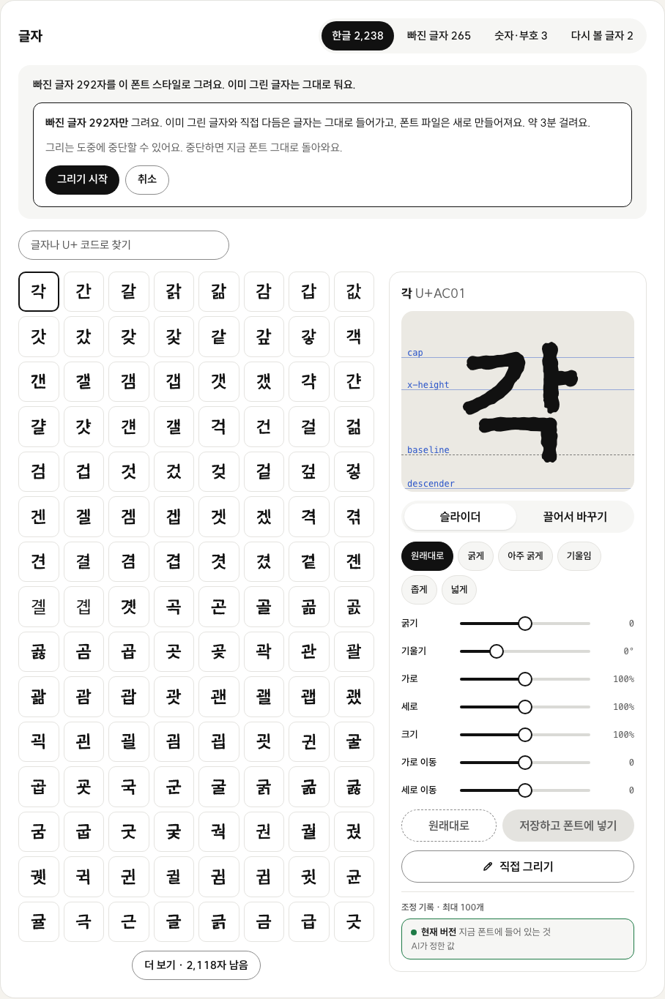

- 그리지 못했거나 검사에서 떨어진 글자는 **빠진 글자** 탭에 모입니다.
- **빠진 글자 그리기**를 누르면 확인 창이 뜨고, **진짜 빠진 글자만** 같은 글씨로 다시 그립니다. 이미 만든 폰트는 그대로 둡니다.
- 그리는 도중에 **중단**하면 지금 폰트로 돌아갑니다.

### 폰트 받기

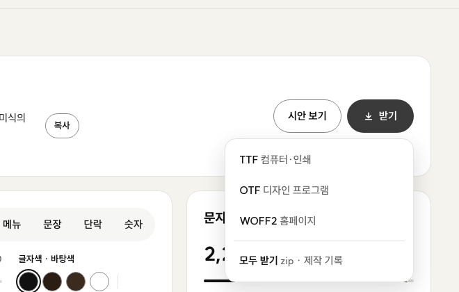

| 파일 | 어디에 쓰나요 |
|---|---|
| **TTF** | 컴퓨터에 설치, 인쇄용 |
| **OTF** | 디자인 프로그램용 |
| **WOFF2** | 홈페이지용 |
| **모두 받기 (zip)** | 위 파일 + **권리 카드** + **제작 기록** |

- **권리 카드**: 이 폰트로 할 수 있는 일과 없는 일을 정리한 문서입니다.
- **제작 기록**: 어떤 입력, 어떤 선택, 어떤 AI 모델, 어떤 직접 수정이 있었는지 남긴 기록입니다. 사람의 창작 기여를 보여 주는 자료가 됩니다.

---

## 11단계. 내 폰트 목록

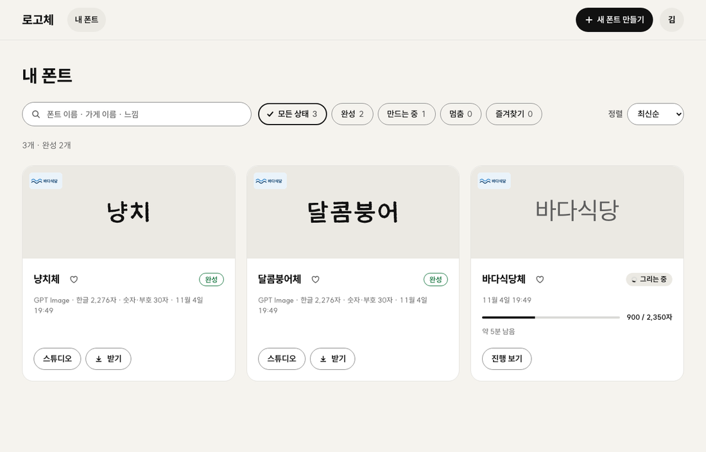

- 만든 폰트가 카드로 모입니다. 완성 / 만드는 중 / 멈춤 상태가 표시됩니다.
- **스튜디오**(열기), **받기**, **진행 보기**를 바로 누를 수 있습니다.
- 이름·느낌으로 **검색**, 상태 필터, 정렬, 즐겨찾기(하트)가 있습니다.
- 내 폰트는 **항상 비공개**입니다. 나만 볼 수 있어요.

---

## 중간에 멈추거나 문제가 생기면

### 직접 멈추기

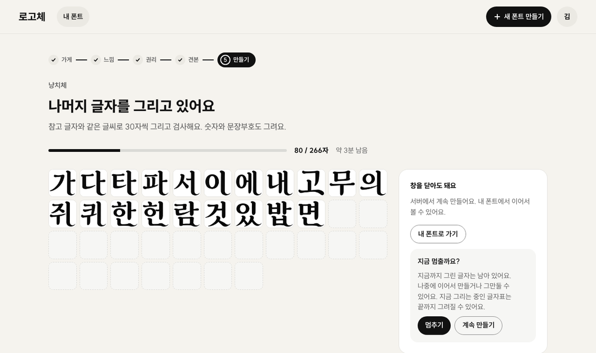

- 만드는 중인 화면의 **중단하기**를 누르면 확인 상자가 뜹니다.
- 지금까지 **그린 글자는 남습니다.** 이어서 만들거나 그만둘 수 있어요.
- 이미 완성한 폰트가 있다면 그 폰트로 돌아갑니다.

### 서버 문제로 멈췄을 때

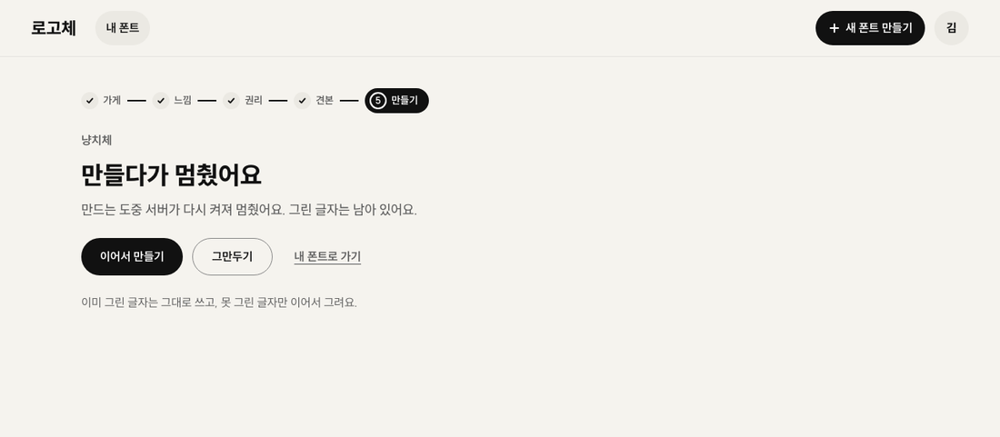

- **이어서 만들기**: 아직 그리지 않은 글자만 이어서 그립니다. (이미 그린 글자는 다시 그리지 않아요.)
- **그만두기**: 이 폰트를 지웁니다.

---

## 계정

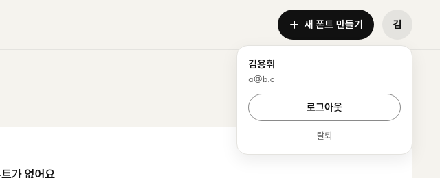

오른쪽 위 동그란 이름 버튼을 누르면 메뉴가 열립니다.

- **로그아웃**
- **탈퇴**: 눌러서 확인 창을 연 뒤 '탈퇴'를 직접 적어야 진행됩니다.

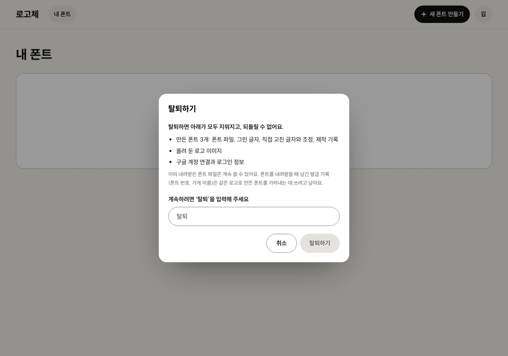

탈퇴하면 **만든 폰트, 그린 글자, 직접 고친 내용, 제작 기록, 올린 로고, 로그인 정보**가 모두 지워지고 되돌릴 수 없습니다. 이미 내려받은 폰트 파일은 계속 쓸 수 있습니다. 만드는 중인 폰트가 있으면 끝난 뒤에 탈퇴할 수 있습니다.

---

## 메일 알림

창을 닫아도 아래 때 메일로 알려 드립니다.

| 때 | 내용 |
|---|---|
| 견본이 나왔을 때 | "느낌을 골라 주세요" |
| 30자 초안이 나왔을 때 | "이어서 그릴지 정해 주세요" |
| 폰트가 완성되었을 때 | "완성됐어요" |
| 만들다 실패했을 때 | "멈췄어요" |

---

## 아직 안 된 것 / 알아둘 점

- **결제와 크레딧**: 아직 없습니다. (크레딧 충전식으로 만들 계획)
- **카카오톡 알림**: 아직 없습니다. 메일로만 알립니다.
- **입력 질문 중 로고 미리 읽기**: 지금은 모든 질문에 답한 뒤에야 로고 읽기를 시작합니다. 질문에 답하는 동안 미리 시작해서 기다림을 줄이는 개선이 남아 있습니다.
- **영문 알파벳**: 아직 들어가지 않습니다. 한글 2,350자와 숫자·문장부호 30자만 들어갑니다.
- **견본이 비슷해질 수 있음**: 글씨 모양 네 가지를 강하게 고르면 세 견본이 비슷한 결로 나올 수 있습니다.
- **메일 보내기**: 코드는 있지만 실제 서버에서 끝까지 확인해 보지는 못했습니다.
- **폰트 판매**: 이 폰트를 파일만 따로 파는 것은 허용되지 않습니다. 간판, 메뉴판, 홈페이지, 포장 등에는 쓸 수 있습니다.
